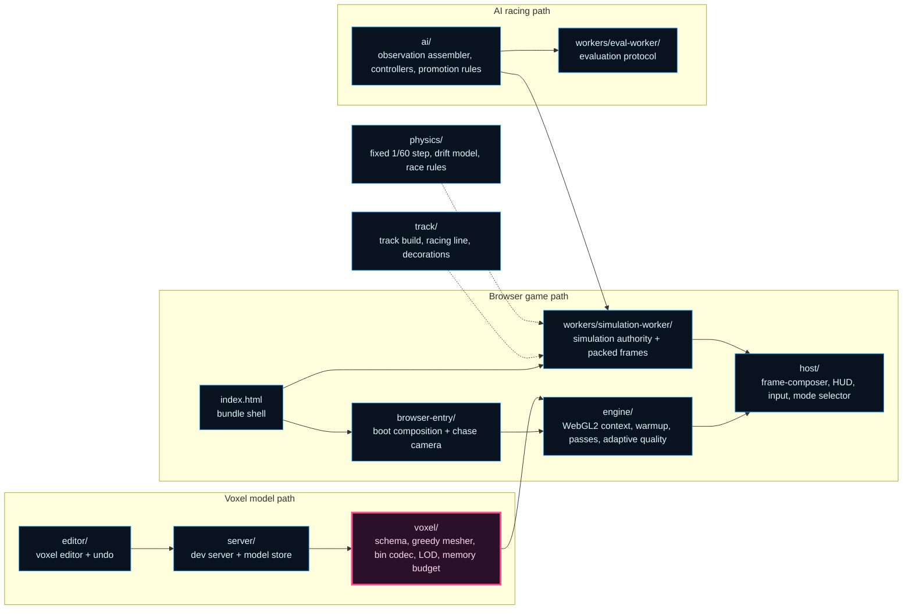

# Neat Racing (NeatapticTS)

This folder is the repository's lesson in what neuroevolution looks like when
the task is not a flat 2D playground but a **full 3D voxel racing game with a
hand-rolled WebGL2 renderer, deterministic physics, and a live AI population**.

The demo cars race around a generated track, but the cars are not the real
subject. The real subject is systems design: a composable render-pass engine, a
voxel model pipeline with explicit memory budgets, a fixed-timestep simulation
with a reproducibility contract, worker-owned simulation and evaluation, and a
voxel editor for authoring the car and track art. Each of these is a boundary
that can be read, tested, and changed in isolation.

If Flappy Bird is the fast control-systems lesson and Racing Curriculum is the
coevolution lesson, Neat Racing is the **graphics-engine and game-runtime
lesson**.

## What This Folder Is Trying To Teach

This example is organized around four reader questions:

1. How do you build a real-time 3D renderer on raw WebGL2 — context
   acquisition, shader warmup, per-object render passes, post-processing bloom,
   and a frame composer — without pulling in a scene-graph library?
2. How do you produce game art (cars, wheels, decorations, crowds) through a
   voxel pipeline — schema, greedy meshing, binary encoding, and LOD — while
   keeping the runtime memory inside a named budget?
3. How do you keep a game simulation deterministic and reproducible — fixed
   timestep, packed typed-array frames, and an explicit reproducibility tuple —
   so that a race episode can be replayed and verified?
4. How do you evolve a racing policy under that contract — observation
   assembly, scripted rivals, NGE controllers, promotion rules, and worker-side
   evaluation — while the human can still drive the same car by keyboard?

The folder matters because it answers all four questions inside one runnable
game rather than four disconnected demos.

## Choose Your Route

Different readers want different first files. Use the route that matches your
question instead of reading everything linearly.

| If you want to...                                      | Start here                                                                                          | Then read                                                                                                                            |
| ------------------------------------------------------ | --------------------------------------------------------------------------------------------------- | ------------------------------------------------------------------------------------------------------------------------------------ |
| See how the game boots and drives                       | [browser-entry/README.md](./browser-entry/README.md) or [index.html](./index.html)                   | [host/README.md](./host/README.md)                                                                                                    |
| Understand the renderer and its passes                  | [engine/README.md](./engine/README.md)                                                               | [engine/passes/README.md](./engine/passes/README.md)                                                                                  |
| Understand the voxel art pipeline                       | [voxel/README.md](./voxel/README.md)                                                                 | [editor/README.md](./editor/README.md)                                                                                                |
| Understand the simulation and its determinism contract  | [physics/README.md](./physics/README.md)                                                             | [workers/simulation-worker/README.md](./workers/simulation-worker/README.md)                                                           |
| Understand the race world, track, and decorations       | [track/README.md](./track/README.md)                                                                 | [engine/README.md](./engine/README.md)                                                                                                 |
| Understand how AI policies are assembled and evaluated  | [ai/README.md](./ai/README.md)                                                                       | [workers/eval-worker/README.md](./workers/eval-worker/README.md)                                                                       |
| Run the game locally or edit voxel models               | [editor/README.md](./editor/README.md)                                                               | [server/README.md](./server/README.md)                                                                                                 |
| Understand the whole example as a system                | this README                                                                                          | the module READMEs listed in [Recommended Reading Order](#recommended-reading-order)                                                  |

## Run The Example

### Run the game from the browser

From the repo root:

```bash
npm run build:neatRacing
npx ts-node examples/neatRacing/server/dev-server.ts
```

Important note:

- `index.html` is a lightweight bundle-loading shell, not the source-of-truth
  browser runtime.
- the real game boots in [browser-entry/browser-entry.ts](./browser-entry/browser-entry.ts),
  which mounts into `index.html` and starts the keyboard-driven drive loop.
- the served page loads bundles from `docs/assets`, so after code changes that
  affect the published example surface, run `npm run docs` to refresh the
  generated docs and bundles, or `npm run build:neatRacing` to refresh the host
  bundle (`neatracing.bundle.js`) and the simulation worker bundle
  (`neatracing.worker.js`).
- keyboard input drives the car in manual mode; the mode selector in the HUD
  switches between manual driving and AI rivals.

### Run the voxel editor

The voxel editor has its own tooling surface:

```bash
npm run dev:neatRacing
```

The editor lets you edit the voxel car model with camera, palette, tool
frames, symmetry, and undo history, then save the model through the dev server
([server/README.md](./server/README.md)).

## The Core Idea In One Glance

The architectural rule is simple: simulation and rendering authority are
explicit, the voxel pipeline owns all art, and AI policies run through the same
deterministic simulation the human player drives.



Read the diagram in two passes:

- the browser path renders game frames through the engine's render passes and
  receives packed simulation frames from the worker-owned simulation authority,
- the model path authors voxel art in the editor, stores it through the dev
  server, and bakes it into runtime-ready meshes with explicit LOD and memory
  budgets.

That split is the heart of the example. Once you understand it, the rest of the
folder stops looking like many files and starts looking like a deliberate
teaching system.

## What Each Boundary Protects

### `browser-entry/`: boot composition and camera

The browser entry boundary owns page boot, canvas sizing, the chase camera, and
the transition from static HTML to the running game. It is intentionally not
the source of truth for simulation.

### `engine/`: the renderer

The engine owns WebGL2 context acquisition, shader warmup, world lighting, and
the per-object render passes (starfield, grid, pulse, track, car, glass,
bloom). It also owns adaptive quality: when frames get tight, quality is
dropped in a fixed quality-first order before frames are.

This boundary exists so rendering can be reasoned about without knowing about
physics, AI, or the editor.

### `host/`: compose and present frames

The host boundary owns the frame composer that orders render passes into one
draw, plus HUD, keyboard input, and the race-mode selector. It presents state;
it does not decide it.

### `physics/`: the simulation truth

Physics owns car state, the drift model, the fixed 1/60 s timestep integration,
collision handling, and race rules (fuel/budget, laps, levels, terminal
transitions). The world advances only through this boundary.

### `workers/simulation-worker/`: off-thread authority

The simulation worker owns the fixed-step race loop and returns compact packed
typed-array frames instead of live mutable objects. Its reproducibility helpers
pin the tuple (seed, RNG state, ordering, frame index) that makes a race
episode replayable.

### `ai/`: the racing policy

The AI boundary owns observation assembly (track-relative features), scripted
controllers, the NGE controller, oscillation penalty, promotion rules, and
rival propagation. Policies and rivals consume the same packed frames a human
player produces.

### `workers/eval-worker/`: evaluation off the hot path

The eval worker boundary keeps genome evaluation away from the rendering loop.
It speaks a typed evaluation protocol, so the host neither blocks nor sees
per-network inference traffic.

### `track/`: the world

Track generation, road edges, the curvature-derived racing line, decorations,
and the billboard crowd live here. The racing-line boundary is also the
track-relative observation source for AI policies.

### `voxel/`: all art is voxel data

The voxel pipeline owns the model schema, greedy meshing, binary asset
encoding, LOD building and distance tiers, materials, team remapping, and the
named runtime memory budget. Game art never bypasses this pipeline.

### `editor/` and `server/`: the authoring surface

The editor is a dedicated voxel editing tool with its own render preview,
camera, controls, and undo history; the server is its persistence boundary.
It is tooling, not gameplay: nothing in the game imports editor code.

## Two Execution Stories

The same example tells two different runtime stories depending on where you
enter.

### Manual drive story

1. `index.html` loads the host bundle.
2. [browser-entry/README.md](./browser-entry/README.md) acquires the WebGL2
   context, runs the shader warmup, mounts the HUD, and starts the drive loop.
3. Keyboard input flows into the fixed-step physics tick.
4. The frame composer orders the render passes into one draw.
5. HUD and mode-selector reflect the race state.

### AI racing story

1. The mode selector switches the host from manual input to AI rivals.
2. [ai/README.md](./ai/README.md) assembles track-relative observations from
   the packed frames.
3. Controllers either produce scripted rival behavior or run NGE policy
   networks.
4. [workers/eval-worker/README.md](./workers/eval-worker/README.md) evaluates
   candidate policies off the rendering hot path.
5. Promotion rules decide when a candidate becomes a shipped rival.

The important teaching point is that both stories run through the same
deterministic simulation and the same renderer — AI plays the same game the
human plays.

## The Most Important Design Bets

Several design decisions explain why the folder looks the way it does.

### Determinism is a replay contract, not a nicety

The simulation pins seed, RNG state, and ordering; frames are packed
typed-array snapshots. That is what allows a race episode to be replayed and
verified instead of merely watched. Training claims are only meaningful when
episodes are reproducible.

### The renderer is composition, not a monolith

Every visual effect is a render pass with clear inputs, and the frame composer
owns the ordering. Starfield, track, car, glass, and bloom can each be read or
removed without understanding the others. Adaptive quality then has a clean
drop order (bloom off, lower LOD tier, reduced prop density) that preserves
behavior while shedding cost.

### All art flows through the voxel pipeline

Cars, wheels, and decorations are schema'd voxel models meshed to geometry and
packed into binary assets. LOD tiers swap by distance, and the runtime keeps a
named sparse-only model memory budget. The pipeline makes art inspectable and
its cost measurable.

### The human drives; the AI rides the same physics

There is no separate "demo physics" for AI cars. Rivals, promoted policies, and
the keyboard player share one fixed-step simulation. That keeps any evolved
racing policy honest: it must drive the same world the human experiences.

### The editor is tooling, not runtime

The voxel editor never ships as part of the game bundle. Its output lands on
disk through the dev server and re-enters the game only through the voxel
pipeline. Tooling and gameplay never collapse into one boundary.

## If You Want To Change Something, Read This First

This is the shortest route to the right boundary when you are modifying the
example.

| Change goal                                              | Read first                                                        | Why                                                                       |
| -------------------------------------------------------- | ----------------------------------------------------------------- | ------------------------------------------------------------------------- |
| Change visual effects, lighting, or quality policy       | [engine/README.md](./engine/README.md)                            | The renderer and adaptive policy live here.                                |
| Change boot, canvas, or camera behavior                  | [browser-entry/README.md](./browser-entry/README.md)              | That is where page boot and camera law live.                               |
| Change HUD, input, or mode switching                     | [host/README.md](./host/README.md)                                | The presentation and input boundary lives here.                            |
| Change driving feel, collisions, or race rules           | [physics/README.md](./physics/README.md)                          | Simulation truth lives here.                                               |
| Change the track, racing line, or decorations            | [track/README.md](./track/README.md)                              | World construction lives here.                                             |
| Change car or level art                                  | [voxel/README.md](./voxel/README.md), then the editor             | All art must go through the voxel pipeline.                                |
| Change AI observations, rivals, or promotion             | [ai/README.md](./ai/README.md)                                    | The policy boundary lives here.                                            |
| Change worker transport or evaluation protocol           | [workers/simulation-worker/README.md](./workers/simulation-worker/README.md) and [workers/eval-worker/README.md](./workers/eval-worker/README.md) | Worker-owned runtime lives here. |

## Folder Map

The folder is split by responsibility, not by one giant "game" module.

- `ai/`: observation assembler, scripted and NGE controllers, promotion rules,
  rival propagation, oscillation penalty, and fitness shaping.
- `browser-entry/`: page boot composition, canvas sizing, chase camera, and
  browser constants.
- `engine/`: WebGL2 context service, lighting, adaptive quality, and the
  render-pass set under `engine/passes/`.
- `host/`: frame composer wiring, HUD, keyboard input, mode selector, and
  render-loop utilities.
- `editor/`: the voxel car editor (camera, controls, tool frames, palette,
  symmetry, rebuild pipeline, undo, live save).
- `physics/`: fixed-timestep stepping, drift model, collision helpers, race
  rules, and AI autopilot fixtures.
- `server/`: dev server and voxel model store for editor persistence.
- `track/`: track slabs and edges, racing line, grid building, decorations
  LOD, and public crowd sprites.
- `voxel/`: model schema, greedy mesher, binary codec, LOD builder and
  distance tiers, materials, team remap, memory budget, and generated
  asset checks.
- `workers/eval-worker/`: the evaluation protocol boundary.
- `workers/simulation-worker/`: the simulation authority, frame packing, and
  reproducibility helpers.
- `assets/`: generated voxel model JSON and the built browser bundles.
- `scripts/`: local voxel asset generation helpers.
- `index.html`: the local browser shell for the game page.
- The `*.specs.md` files are permanent trace documents for high-risk
  boundaries (boot composition, frame composer, starfield, editor preview).

## Recommended Reading Order

If you want the cleanest ramp into the example, this order usually pays off:

1. this README for the system-level mental model,
2. [voxel/README.md](./voxel/README.md) for the art pipeline and memory budget,
3. [engine/README.md](./engine/README.md) for the renderer and its passes,
4. [physics/README.md](./physics/README.md) for deterministic simulation and
   race rules,
5. [workers/simulation-worker/README.md](./workers/simulation-worker/README.md)
   for the off-thread runtime and reproducibility contract,
6. [ai/README.md](./ai/README.md) for how policies consume that world,
7. [browser-entry/README.md](./browser-entry/README.md) and
   [host/README.md](./host/README.md) for the boot and presentation surfaces,
8. [editor/README.md](./editor/README.md) and
   [server/README.md](./server/README.md) if you will touch the tooling.

If you only care about one slice:

- renderer and quality: start with `engine/` and `host/`,
- simulation and fairness: start with `physics/` and `workers/`,
- art and tooling: start with `voxel/`, `editor/`, and `server/`,
- policy work: start with `ai/` and `workers/eval-worker/`.

## Background Reading

This folder is readable from the code alone, but three external references
genuinely help if you want the broader concepts behind the design:

- Kenneth O. Stanley and Risto Miikkulainen,
  ["Evolving Neural Networks through Augmenting Topologies"](https://direct.mit.edu/evco/article/10/2/99/998),
  _Evolutionary Computation_ 10(2), 2002. This is the canonical NEAT paper and
  the conceptual backdrop for the AI boundaries that consume this world.
- Wikipedia contributors, ["Greedy meshing"](https://en.wikipedia.org/wiki/Greedy_meshing),
  _Wikipedia, The Free Encyclopedia_. Useful background for why the voxel
  pipeline merges faces before emitting geometry.
- Wikipedia contributors, ["Level of detail (computer graphics)"](https://en.wikipedia.org/wiki/Level_of_detail_(computer_graphics)),
  _Wikipedia, The Free Encyclopedia_. Useful background for the LOD tiers that
  the distance util and adaptive quality policy share.

## Why Start Here

Many demos look strong when they render. Fewer stay strong when asked to keep
every frame deterministic, every megabyte budgeted, every policy evaluation
off-thread, and every piece of art inspectable as voxel data.

That is why this README matters. The goal is not merely to show that
NeatapticTS can polish a racing demo. The goal is to show what the library's
engineering values look like when they have to coexist inside a real WebGL2
game with a live evolving population.
