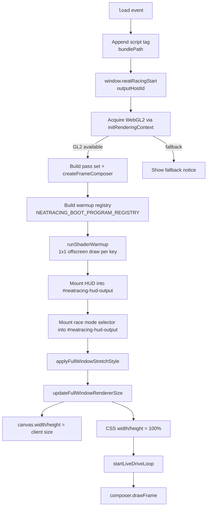
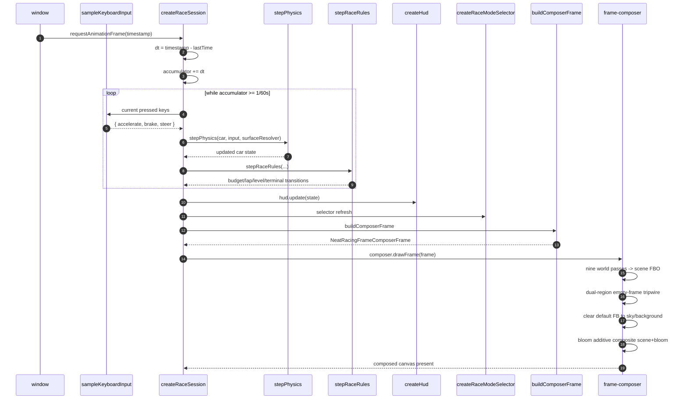

# NeatRacing Game Page Boot + Live Drive Data Flow

> Permanent trace for the served `/` page: context acquisition, boot composition, live keyboard-driven race loop, and HUD/mode-selector mounts (slices `P1-boot-composition` + `P1-drive-loop-live`, AC-024 / AC-040).
>
> Updated for the batch-102 composition fix: full-viewport canvas stretch (Neateinstein-style edge-to-edge sizing), host-owned default-framebuffer sky clear before bloom, and a dual-region empty-frame tripwire that tolerates the chase camera's empty-sky center.

## Boot flow

## Per-frame drive loop

## Warmup registry contract

- `NEATRACING_WARMED_PROGRAM_KEYS` is the single source of truth for the nine program keys.
- `NEATRACING_BOOT_PROGRAM_REGISTRY` must contain exactly one entry per key before frame 1.
- `NEATRACING_BOOT_PROGRAM_COUNT` is derived from the key array; the boot warmup count must match it.

## HUD + mode selector mounts

Both controllers receive the reserved `#neatracing-hud-output` container at boot. The container is a full-viewport, pointer-events-disabled overlay layer; the mounted control wrappers re-enable pointer events on their own subtrees.

## Critical invariants

1. **No lazy mid-race compiles**: `runShaderWarmup` draws each of the nine registered programs once before the first visible frame.
2. **60 Hz fixed cadence**: `stepPhysics` is called inside a `while (accumulator >= FIXED_TIMESTEP)` loop, with input sampled at the start of every simulation sub-step.
3. **Composer once per frame**: `composer.drawFrame` is invoked exactly once per RAF callback, even when zero physics ticks run (zero-step frame).
4. **Restart carrier**: `overlays.selector.onSwitch` resets the lap-line detector baseline before the next verification begins.
5. **Full-viewport stretch**: `applyFullWindowStretchStyle` sets CSS `width:100%; height:100%` and `updateFullWindowRendererSize` matches the backing store to `clientWidth/clientHeight`, so the rendered image fills the viewport with the correct aspect ratio (Neateinstein-style edge-to-edge sizing).
6. **Opaque present**: the composer clears the default framebuffer to a sky/background color before the additive bloom composite so transparent page background no longer shows through unlit pixels.
7. **False-positive-proof tripwire**: the dev-only `assertComposedFrameNonEmpty` guard samples both the center and a lower-center region of the scene FBO, avoiding an empty-sky false alarm when the chase camera leaves the frame center transparent.
