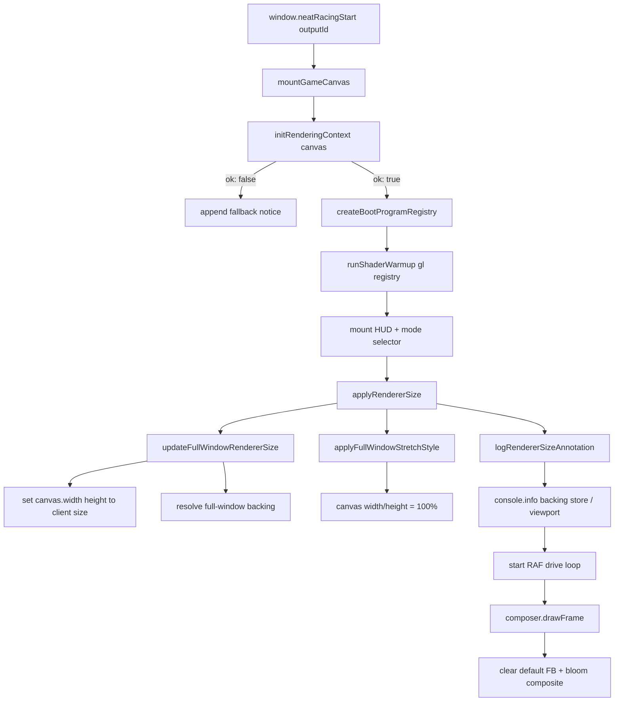

# Game Page Boot Composition Trace — P1-composition-green

Mermaid data-flow trace for the game-page boot path that mounts the canvas,
acquires WebGL2, warms programs, and applies the full-viewport stretch sizing
strategy. This diagram captures the batch-102 composition fix: the canvas now
fills the viewport edge-to-edge like Neateinstein, the WebGL context is created
with `preserveDrawingBuffer: true` for stable capture/presentation, and a
host-owned default-framebuffer clear is performed before the additive bloom
composite.

## Key contract notes

- **Full-viewport stretch**: `applyFullWindowStretchStyle` sets the canvas
  `style.width` and `style.height` to `100%`, removing the old letterbox offsets.
  `updateFullWindowRendererSize` matches the backing store to the host's
  `clientWidth/clientHeight`, so the rendered image fills the viewport with the
  correct aspect ratio (Neateinstein-style edge-to-edge sizing).
- **Window-size annotation**: `logRendererSizeAnnotation` records the backing
  store, computed full-window dimensions, and live `window.innerWidth/Height`
  so the next browser smoke test can cross-check the full-page render box.
- **No page scroll**: `index.html` keeps `overflow: hidden` on `body` and
  `position: relative` on `#neatracing-output` so the canvas is positioned
  inside the full-viewport host.
- **Stable presentation context**: `initRenderingContext` requests the WebGL2
  context with `preserveDrawingBuffer: true`, `alpha: true`, and
  `premultipliedAlpha: true` so composed frames remain readable for screenshots
  and post-frame diagnostics without relying on the implicit front buffer.
- **Opaque present path**: the frame composer clears the default framebuffer to
  a sky/background color before the additive bloom composite, preventing the
  dark page background from showing through unlit pixels and restoring the
  visible scene.
