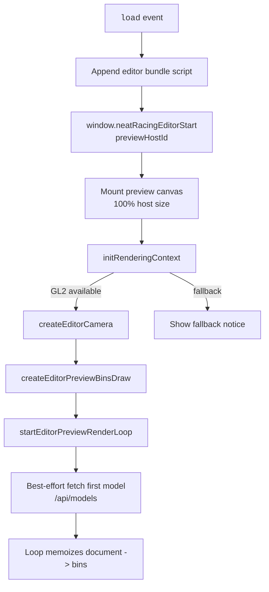
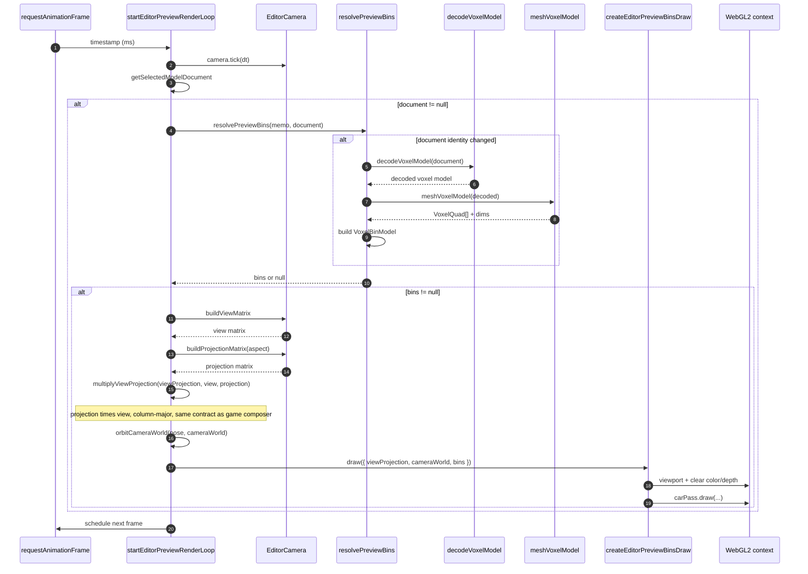

# NeatRacing Editor Preview Data Flow

> Permanent trace for the served `/editor/` page preview lane (slice `P1-editor-preview`, AC-019). The editor page renders **only** the selected model preview; no game-scene race passes run here.

## Boot flow

## Per-frame preview loop

## Bins draw adapter

The editor preview reuses the production `createCarPass` from `engine/passes/car.pass.ts` by wrapping the selected document's bins as the car `body` and an empty wheel bin as the `wheel`. This satisfies the AC-019 dogfooding requirement (spec section 8.3): the preview lane draws through the same decoder, mesher, and renderer used by the race scene.

## Critical invariants

1. **Preview-only composition**: The editor page does **not** run starfield, grid, pulse, track, glass, or bloom passes. It clears the default framebuffer each frame and draws only the selected model.
2. **Matrix contract parity**: The editor loop uses the same `projection * view` column-major product as the game composer, because it feeds the same `car.pass.ts` `uViewProjection` uniform.
3. **Memoized decode/mesh**: `resolvePreviewBins` caches by document reference so a steady selection decodes and meshes exactly once; decode failures are cached and logged once.
4. **RAF survival**: Any failure during `createCarPass` or document decode is caught and logged; the RAF loop keeps ticking and the preview stays blank rather than crashing the page.
