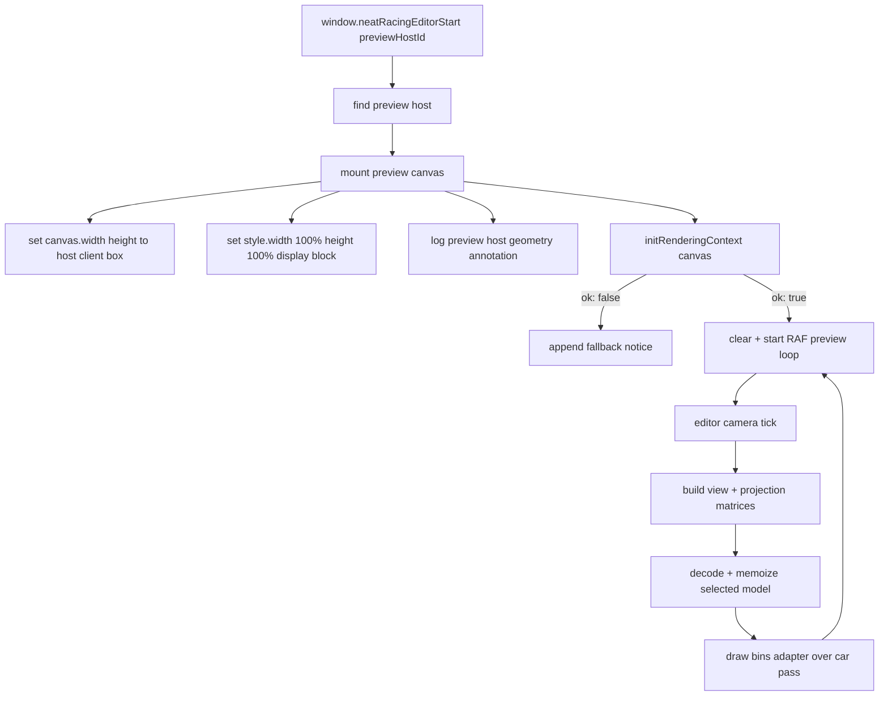

# Editor Preview Trace — P1-composition-green

Mermaid data-flow trace for the editor preview lane. This diagram captures the
P1-composition-green fix: the preview canvas now fills its host via CSS, and a
geometry annotation is logged for plainly-visible editor preview evidence.

## Key contract notes

- **Fill host CSS**: the preview canvas is styled `width: 100%`, `height: 100%`,
  `display: block` so it fills the `#neatracing-editor-preview` host instead of
  collapsing to the default 300×150 CSS box.
- **Geometry annotation**: on boot the editor logs the preview host bounding
  rectangle, canvas backing-store size, CSS display values, and the host window
  dimensions for evidence capture.
- **Preview host layout**: `editor.html` gives the preview host `flex: 1`,
  `position: relative`, and `overflow: hidden` so the 100% sized canvas is
  clipped to the host and cannot trigger page scroll.
