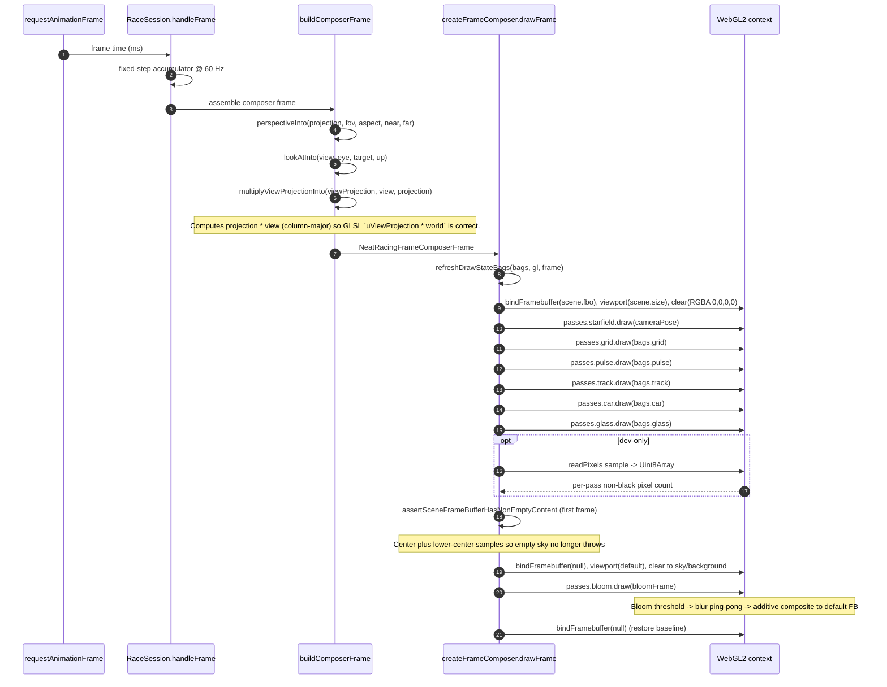

# NeatRacing Frame Composer Data Flow

> Permanent trace for the host-owned nine-pass composition path (slice `P1-frame-composer`, AC-002 extension).

## Sequence: one composed frame

## State ownership

| Layer | Owns | Does NOT own |
|-------|------|--------------|
| Browser entry (`browser-entry.ts`) | Live camera matrices (`viewProjection`), RAF loop, keyboard/hud wiring | Pass handles, scene FBO |
| Frame composer (`host/frame-composer.ts`) | Scene FBO + texture, draw-state bags, per-frame viewport/baseline | Individual pass internals |
| Pass modules (`engine/passes/*`) | Program compiles, pass-local GL state, geometry uploads | Framebuffer bindings after return |
| Bloom pass (`engine/passes/bloom.pass.ts`) | Internal half-res targets, three programs, additive composite | Scene texture (borrowed) |

## Critical invariants

1. **Matrix order**: `multiplyViewProjectionInto` writes `projection * view` (column-major) because every world-pass vertex shader applies it as `gl_Position = uViewProjection * vec4(world, 1.0)`.
2. **Single scene transfer**: The world is rendered exactly once into the composer-owned RGBA8 scene FBO; the bloom additive composite is the only draw that samples that texture and transfers it to the default framebuffer.
3. **Zero per-frame allocations**: Bags, `Float32Array` scratch, and the readback `Uint8Array` are allocated once at construction and refreshed in place.
4. **Framebuffer baseline**: The composer binds its scene FBO before every world pass and restores `gl.FRAMEBUFFER` to `null` after the bloom composite, so no pass can leak a bound FBO into the next frame.
5. **Default-framebuffer sky clear**: before the additive bloom composite the host clears the default framebuffer to a sky/background color so unlit pixels remain opaque and the dark page background no longer shows through.
6. **Dual-region empty-frame tripwire**: the dev-only `assertComposedFrameNonEmpty` guard samples the center and a lower-center region of the scene FBO. With the chase camera, the center is empty sky while the lower-center covers the ground grid and car, so the tripwire catches a truly blank frame without firing on a valid scene.
