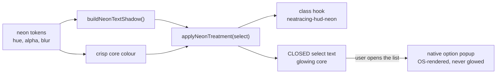
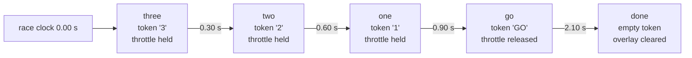
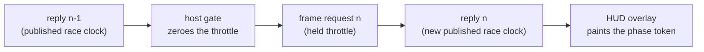

# host

NeatRacing host HUD overlay: the speed/lap/time DOM overlay into the
reserved host output container plus the mode-switch control surface
(spec sections 4.2, 10.2, 11.2, 13.1). The cyan/magenta palette is
recycled verbatim from the Neatenstein host HUD (spec section 11.2
recycling inventory: "same CSS tokens, cyan/magenta"), pinned here as
`NEATRACING_HUD_COLOR_CYAN` and `NEATRACING_HUD_COLOR_MAGENTA`
(rgb() literal strings, matching the Neatenstein `hud.constants.ts`
precedent).

Display contract: `examples/neatRacing/host/mode-selector.test.ts`
pins the display string grammar —
speed = whole km/h (TP-01 physical anchor: 1 world unit = 1 meter, so
~89 units/s ≈ ~320 km/h arcade feel; never a decimal part), lap =
`Lap c/20` clamped at `NEATRACING_HUMAN_RACE_LAPS` (a completed race
never displays 21/20; the selector restart contract is pre-verified
by `mode-selector.ts`), and time = `M:SS.d` (unpadded
minutes, zero-padded seconds, one tenths digit).

The TRACTION READOUT is a DISPLAY of the ONE published traction severity
(`PhysicsCarState.tractionSeverity`, published by the physics step):
the HUD SHOWS the number it is handed and NEVER re-derives it, so the
overlay, the car pass tires and the browser debug seam can never
disagree about how much grip is left. The severity reaches the read
model as an OPTIONAL field (a read model without it paints the idle
zero), so the sibling suites that build the classic speed/lap/time
model keep compiling and keep their legacy look.

The arcade reconciliation is deliberate and documented rather than
incidental: spec section 11.1 wants an arcade-speed feel while the
physics layer (spec section 5) is intentionally NOT scale-accurate
(TP-01). The HUD is a display-only read model — it never mutates race
state — so the km/h conversion constant lives here at the seam where
the decision is made, mirroring how `race-rules.ts` keeps its own
budget constants instead of importing physics timing.

The COUNTDOWN OVERLAY is the Flappy-style 3-2-1-GO start signal: the
HUD paints the phase the RACE clock publishes (`raceState.elapsedS`,
NEVER the wall clock) with the two-pass neon recipe (the glow pass
behind, the crisp core on top). The phase law lives in
`hud.countdown.ts` — ONE resolver, TWO consumers — so the gate never
releases before the overlay shows GO. The overlay MAY paint GO up to ONE
FRAME before the gate releases: the frame's throttle must ride the
request BEFORE that frame's reply exists, so the gate reads the
previous reply's published clock while the overlay paints the current
one.

The DEPARTURE HINT is an ADVISORY display of the ONE published FINE
surface classification (`TrackSurfaceClassification`,
published by `physics/collision.utils.ts`): the hint fires when the
published classification says the car left the drivable surface (the
grass BAND is still drivable, the OPEN grass is not). The law lives in
`hud.departure.ts` — ONE pure resolver — and the hint CHANGES NO pose,
NO speed, NO penalty and NO physics state: it is a DISPLAY, in the
same spirit as the traction readout.

Allocation policy: `createHud` is the only DOM allocator (the five
readout labels plus the countdown overlay and the departure hint are
created once inside one wrapper), and `update()` performs no per-frame
DOM/geometry allocation beyond the unavoidable display strings passed
to `textContent` (zero allocations is not technically achievable for
a text repaint; this is the minimal allocation form — one string per
label, no arrays/closures/new objects per call). Formatting never
touches the DOM: it is pure so the same numbers produce the same
strings on any tick, enabling deterministic replay in tests.

Time formatting note: tenths are computed via
`Math.round(seconds * TENTHS_PER_SECOND)` and then integer modulo
arithmetic (tenths per minute = 600). Floating-point seconds such as
3.04, 75.3, or 9.9999 do not accumulate a double drift error larger
than one rounding of the tenths (the double is 3 units of ulp at
~1e14 tenths, a range far beyond any race duration); negative seconds
are non-domain — race-rules guarantees `elapsedS >= 0` (zero starts,
60s checkpoint budget) and the formatters document that domain instead
of carrying an unreachable guard branch.

Determinism section: every executor here is pure — identical inputs
produce identical strings with no Math.random, no clock reads, no
timers. Not claimed (same-runtime rung only): cross-environment byte
equality (DOM layout differences across browsers do not affect text
content or the pinned style token strings).

## host/hud.ts

### createHud

```ts
createHud(
  outputId: string,
): NeatRacingHud
```

What: binds the HUD labels to a live `RaceRulesState` slice and
mounts them into the reserved host output container (spec section
10.2 folder layout). This is the only place that reads
`document` for the HUD display (the selector module resolves its own
container the same way, Neatenstein precedent).

Why: the host shell owns the container id; the HUD never assumes a
particular host DOM beyond that one hook, keeping the module portable
between the dev-server shell and the jsdom test fixture.

When: called once during host boot (the render loop's `update` call is
wired by the host shell; the restart hook is pre-verified by
`createRaceModeSelector`). Throws instead of returning a null HUD so
boot order bugs surface immediately instead of as silent blank HUDs.

Allocation contract: this function performs all HUD DOM allocation
for the page lifetime (one wrapper + seven labels — speed, lap, time,
traction, the controls hint, the countdown overlay and the departure
hint — each once); `update()` then only writes textContent strings
per frame.

Parameters:
- `outputId` - Reserved host DOM id; `neatracing-hud-output` in
the host shell and the slice fixture suite.

Returns: The HUD controller (labels + stateless update binding).

Example:

```ts
const hud = createHud('neatracing-hud-output');
hud.update({
    speedUnitsPerS: 20,
    raceState: createRaceRulesState(),
});
// speedLabel.textContent === '72 km/h', lapLabel === 'Lap 1/20',
// timeLabel === '0:00.0', traction readout === 'Traction 0%'
```

### createHudCountdownLabel

```ts
createHudCountdownLabel(
  wrapper: HTMLElement,
): HTMLElement
```

What: builds the COUNTDOWN overlay element inside the HUD wrapper —
the Flappy-style 3-2-1-GO start token, painted with the two-pass neon
recipe (the GLOW pass as a `text-shadow` behind, the CRISP core colour
on top) and centred in the viewport.

Why: the countdown is a START signal for the whole race, so it must
read over the track instead of inside the top-left readout box; the
element is `position: fixed` and therefore viewport-relative, while it
stays a DESCENDANT of the HUD wrapper so the overlay surface keeps
owning it.

Why the pointer opt-out: the host output container re-enables pointer
events for its direct children, so the countdown (a grandchild) would
otherwise sit on top of the track and swallow clicks.

Parameters:
- `wrapper` - The HUD wrapper the countdown overlay is appended to.

Returns: The created countdown overlay element.

### createHudDepartureLabel

```ts
createHudDepartureLabel(
  wrapper: HTMLElement,
): HTMLElement
```

What: builds the DEPARTURE hint overlay element inside the HUD wrapper
— the ADVISORY "return to the track" line.

Why the overlay sits INSIDE the wrapper: the wrapper owns the HUD
surface, so the hint is mounted with the readouts and the overlay
surface keeps owning it (the countdown precedent). The hint is
POSITIONED (absolute, just under the readout box) so the box never
grows and shrinks while the hint comes and goes.

Why the pointer opt-out: the host output container re-enables pointer
events for its direct children, so the hint (a grandchild) would
otherwise float over the track and swallow clicks.

Why the hint starts EMPTY: an unpainted hint contributes NO HUD text,
so the boot paint and every on-surface frame leave the readout box
exactly as it was.

Parameters:
- `wrapper` - The HUD wrapper the departure overlay is appended to.

Returns: The created departure overlay element.

### createHudLabel

```ts
createHudLabel(
  wrapper: HTMLElement,
  color: string,
): HTMLElement
```

What: builds one HUD readout label inside the wrapper with a pinned
accent color (speed = cyan, lap = magenta, time = cyan — the labels as
primary/progress/primary readouts of the recycled palette). Labels
share the wrapper's typography (monospace 14px) so each label only
needs its own color.

Parameters:
- `wrapper` - The HUD wrapper the label is appended to.
- `color` - The accent token from the Neatenstein palette.

Returns: The created label element.

### createHudWrapper

```ts
createHudWrapper(
  container: HTMLElement,
): HTMLElement
```

What: builds the HUD wrapper element styled like the Neatenstein
death-feedback overlay (absolute top-left, z-index 10, translucent
dark bg, 1px cyan border, monospace) so both examples share one
readable arcade palette (spec section 11.2).

Parameters:
- `container` - The host container to mount the wrapper into.

Returns: The styled, appended wrapper element.

### formatHudLap

```ts
formatHudLap(
  lapsCompleted: number,
): string
```

What: formats the completed-laps counter `lapsCompleted` for the lap
label as the race-day ordinal `Lap c/20` (the lap currently being
raced), clamped so a finished race still reads `Lap 20/20`.

Why: `race-rules` counts completed crossings, so lapsCompleted === 0
during lap 1; the human-facing label is the current lap number. The
clamp uses the shared `NEATRACING_HUMAN_RACE_LAPS` constant (single
source of truth with the rules module, spec section 5.4); without it a
terminal out-of-budget tick could paint `21/20` for one frame.

When: called by `NeatRacingHud.update` per frame and by tests.

Parameters:
- `lapsCompleted` - Number of lap lines fully crossed (race-rules
domain: integer >= 0, clamped at NEATRACING_HUMAN_RACE_LAPS).

Returns: The lap label, e.g. `'Lap 1/20'` for 0 completed laps.

Example:

```ts
formatHudLap(0); // 'Lap 1/20'
formatHudLap(1); // 'Lap 2/20'
formatHudLap(20); // 'Lap 20/20' (clamped, never 21/20)
```

### formatHudSpeed

```ts
formatHudSpeed(
  speedUnitsPerS: number,
): string
```

What: formats forward speed for the speed label, converting world
units-per-second into whole km/h (TP-01: 1 unit = 1 meter, so the
conversion is a fixed 3.6 km/h per unit/s).

Why: the arcade physics layer is deliberately not scale-accurate
(spec section 11.1) but the HUD readout is pinned to a physical anchor
in the slice contract so the displayed number is stable across
refactors of the physics constants; keeping the conversion here means
callers pass the raw sim speed without pre-scaling.

When: called by `NeatRacingHud.update` per frame; also used directly
by tests and debug overlays.

Format contract (slice header): whole number, no decimal part — a
half-unit bump is an imperceptible 1.8 km/h jump against a 320 km/h
readout, so rounding loses no arcade readability.

Parameters:
- `speedUnitsPerS` - Forward speed in world-units-per-second
(TP-01 meters/s); expected in [0, inf).

Returns: The speed formatted as whole `km/h`, e.g. `'320 km/h'` for 89.

Example:

```ts
formatHudSpeed(89); // '320 km/h'
formatHudSpeed(0); // '0 km/h'
formatHudSpeed(20); // '72 km/h'
```

### formatHudTime

```ts
formatHudTime(
  seconds: number,
): string
```

What: formats race elapsed seconds as `M:SS.d` — unpadded minutes,
zero-padded 2-digit seconds, one tenths digit — for the time label.

Why: tenths are resolved first via `Math.round(seconds *
TENTHS_PER_SECOND)` and then by integer arithmetic (minutes =
floor of tenths / TENTHS_PER_MINUTE; remainder split into seconds and
tenths), which is immune to the classic double pitfall of decomposing
fractional seconds directly — e.g. 75.3s stored as
75.299999999999997... would floor to the wrong `:15.2` but rounds to
the contract-pinned `1:15.3`, and 3.04s pins to `0:03.0` not `0:03.1`
even though 3.04 * TENTHS_PER_SECOND lands on 30.4.

When: called by `NeatRacingHud.update` per frame and by tests.

Parameters:
- `seconds` - Elapsed race time in seconds (race-rules domain:
non-negative; zero starts, checkpoint budget keeps it at or above 0).

Returns: The race clock, e.g. `'1:15.3'` for 75.3.

Example:

```ts
formatHudTime(0); // '0:00.0'
formatHudTime(75.3); // '1:15.3'
formatHudTime(3.04); // '0:03.0'
formatHudTime(60); // '1:00.0'
```

### formatHudTraction

```ts
formatHudTraction(
  tractionSeverity: number | undefined,
): string
```

What: formats the PUBLISHED traction severity for the traction
readout as a whole percent (e.g. `'Traction 42%'`).

Why: the severity is the ONE shared scalar the physics step publishes,
so the HUD only CONVERTS it for display — it never
re-derives it from the speed, the slip or any other HUD input, and
the overlay therefore cannot disagree with the car pass tires. A
missing severity (the OPTIONAL read-model field) is the IDLE zero:
the readout is always on screen, so the player never has to guess
whether the overlay lost the value.

When: called by `NeatRacingHud.update` per frame and by the boot
paint.

Parameters:
- `tractionSeverity` - The published severity in [0, 1];
`undefined` when the read model carries no severity (the idle zero).

Returns: The traction readout, e.g. `'Traction 42%'` for 0.42.

Example:

```ts
formatHudTraction(0.42); // 'Traction 42%'
formatHudTraction(0); // 'Traction 0%'
formatHudTraction(undefined); // 'Traction 0%' (the idle zero)
```

### NEATRACING_HUD_COLOR_CYAN

Cyan token used for the speed label, time label, and selector border.

### NEATRACING_HUD_COLOR_MAGENTA

Magenta token used for the lap label (the second accent of the
Neatenstein palette kept as a distinct token so future HUD elements
can share one import source).

### NeatRacingHud

The constructed HUD controller handed to the host shell.

The interface exposes the overlay wrapper plus the speed, lap and time
readout labels; `update` repaints every published label, including the
traction readout, the controls hint, the countdown overlay and the
departure hint.

### NeatRacingHudState

The race state slice the HUD reads from. Mirroring `input.ts`, this is
a named input contract instead of the whole `RaceRulesState` so the
render loop can pass exactly what the HUD needs.

### resolveOutputContainer

```ts
resolveOutputContainer(
  outputId: string,
  hudName: string,
): HTMLElement
```

What: resolves the reserved host output container by id, matching the
Neatenstein `resolveHudContainer` precedent (`hud.dom.utils.ts`)
flattened into this module (no extra shared files inside the host
boundary).

Parameters:
- `outputId` - Reserved host DOM id (spec section 10.2 folder
layout; `neatracing-hud-output` in the host shell and fixtures).
- `hudName` - Human-readable surface name used in the banner text.

Returns: The DOM container to append the HUD overlay into.

Example:

```ts
resolveOutputContainer('neatracing-hud-output', HUD_NAME);
```

## host/input.ts

Keyboard input map for the neatRacing example (plan slice P1-S7-C;
AC-024 partial, spec section 5.1 decision D5).

D5 sampling rule: keyboard state is sampled ONCE per rAF frame by the
host into a transport-neutral pressed-key map
({@link NeatRacingKeyboardPresses}); this module maps that sample onto
the analog axes the physics step consumes, and the host replays the
SAME sample object unchanged into EVERY catch-up tick of that frame.
Key-to-press binding is deliberately the host's DOM concern (key
codes, focus, preventDefault), so this mapper holds no browser state
and reads no DOM: it is a pure boolean-to-axis map.

The output type is the `PhysicsStepInput` axes shape itself, so a
sampled keyboard sample replays into `stepPhysics` verbatim with no
adapter step that could re-order or re-quantize the axes.

Determinism: `sampleKeyboardInput` is pure — identical pressed-key
maps always produce byte-identical samples (`JSON.stringify`-equal)
with no runtime-random state.

### NeatRacingKeyboardPresses

The once-per-rAF-frame pressed-key map the host feeds to
{@link sampleKeyboardInput} (D5). Transport neutral: the map carries
plain boolean pressed state; how `up`/`down`/`left`/`right` bind to
physical key codes is the host's DOM concern, not the sim's.

### NeatRacingKeyboardSample

One-keyboard-frame analog axes sample (D5): exactly the
`PhysicsStepInput` shape, so the host can apply the same sample
object unchanged to every catch-up tick of the frame it was sampled
in, and fresh identical samples per tick always land byte-identical.

### sampleKeyboardInput

```ts
sampleKeyboardInput(
  presses: NeatRacingKeyboardPresses,
): PhysicsStepInput
```

Maps one once-per-rAF-frame pressed-key map onto the analog axes
sample (`spec section 5.1` D5).

The up key maps to full positive throttle, the down key to full
positive brake, the left key to steer +1 (counterclockwise per the
steer axis contract), and the right key to steer -1. A neutral map
yields three zero axes. Pressing left and right together resolves to
a zero steer axis (the symmetric analog difference of the two
directions); pressing up and down together keeps both axes at full
ratio — brake precedence is enforced by the physics tick itself (the
`PhysicsStepInput` contract: "a positive brake wins over throttle"),
not by remapping keys here.

Parameters:
- `presses` - Host-collected pressed-key map sampled once for this
rAF frame.

Returns: The axes sample applied, unchanged, to every catch-up tick
of that frame before the next per-frame sample is taken (D5).

Example:

```ts
const sample = sampleKeyboardInput({
  up: true, down: false, left: true, right: false,
});
console.log(sample.throttle, sample.steer); // 1, 1 — forward and left
```

## host/hud.neon.ts

The NeatRacing host NEON helper — the ONE source of truth for the
neatRacing neon treatment.

WHAT: the ONE helper that owns the neatRacing neon — the neon colour
tokens, the neon CLASS hook name and the DOM `text-shadow` builder.
Every closed-select consumer reads the treatment from HERE, so no
consumer inlines a neon literal and no second copy of the neon tokens
can drift away from the first.

WHY a helper module at all: the native `<option>` popup is
OS-rendered and IGNORES `text-shadow` and `filter`, so the neon can
only land on the CLOSED `<select>` — the control the user reads while
the HUD is idle. Two closed selects share that treatment (the
race-mode select and the track select), so the treatment is written
ONCE here instead of twice in the two selector modules.

THE TWO-PASS RECIPE (the house neon recipe, mirrored from
`examples/neatRacing/host/hud.ts`): the CRISP pass paints the solid
core colour, the GLOW pass paints the bloom BEHIND it, so the text
reads as a light source instead of flat coloured type. The canvas
recipe it mirrors is the Flappy two-pass neon pipe
(`examples/flappy_bird/browser-entry/runtime/runtime.startup-preview.service.ts`),
translated from the canvas API to CSS. The countdown overlay already
uses the same DOM translation (`./hud.countdown.ts`); its OWN tokens
STAY there — this helper neither refactors nor imports them, so this
module remains a LEAF and the HUD could adopt the neon later without
an import cycle.

THE NEON HUE: the neon cyan is the CANONICAL neon cyan (`#00ffff`),
one step brighter than the HUD's `rgb(0, 240, 255)` accent, so the
bloom reads as a light source rather than as the flat accent colour
and so this module owns a hue of its own instead of holding a
value-identical copy of the HUD token.

THE TREATMENT BOUNDARY — the neon lands on the closed control, and the
OS-drawn popup stays outside the treatment:



DETERMINISM: this module is pure — it creates NO DOM of its own, it
never reads a wall clock, it never consults a random source and it
allocates nothing per frame. The same element always receives the
same treatment.

Further reading: the DOM glow pass translates the canvas recipe's
`shadowBlur` bloom into CSS
[`text-shadow`](https://developer.mozilla.org/en-US/docs/Web/CSS/text-shadow),
and the lit-tube look it imitates is the one described in
[Neon sign](https://en.wikipedia.org/wiki/Neon_sign)
(Wikipedia contributors).

### applyNeonTreatment

```ts
applyNeonTreatment(
  element: HTMLElement,
): void
```

What: applies the whole neon treatment to an element the CALLER
owns — the neon CLASS hook plus the two-pass text style (the CRISP
core colour first, then the GLOW bloom behind it).

Why: the two passes must always be applied together and in the same
order on every closed select, so the recipe lives here instead of
being spelled out by each consumer. The element itself stays the
consumer's: this helper creates NO DOM, queries NO DOM and owns NO
DOM of its own.

When: called once per closed select, at mount time.

Parameters:
- `element` - The closed control that carries the neon treatment.

Returns: Nothing — the treatment is applied to the given element.

Example:

```ts
const select: HTMLSelectElement = document.createElement('select');
applyNeonTreatment(select);
select.classList.contains(NEATRACING_HUD_NEON_CLASS_HOOK); // true
```

### buildNeonTextShadow

```ts
buildNeonTextShadow(): string
```

What: builds the DOM `text-shadow` that paints the GLOW PASS behind
the crisp core colour.

Why: the shadow value is derived from the neon tokens, so the closed
selects share ONE glow and the two of them can never drift. The
shape (`0 0 <blur> rgba(<channels>, <alpha>)`) is the DOM translation
of the canvas bloom (`shadowBlur` plus `shadowColor`), the same
translation the countdown overlay uses.

When: called once per neon surface, at mount time, by
`applyNeonTreatment` — never per frame.

Returns: The CSS `text-shadow` value for the GLOW PASS.

Example:

```ts
buildNeonTextShadow(); // '0 0 10px rgba(0, 255, 255, 0.75)'
```

### NEATRACING_HUD_NEON_CLASS_HOOK

The neon CLASS hook name (the CSS hook a stylesheet, a test or a
browser probe targets to recognise a neon surface).

WHY a class and not an id: the hook marks the SURFACE that carries
the neon treatment, and both closed selects must carry the SAME hook
so the HUD never shows a half-neon surface.

Example:

```ts
const select: HTMLSelectElement = document.createElement('select');
select.classList.add(NEATRACING_HUD_NEON_CLASS_HOOK);
select.classList.contains(NEATRACING_HUD_NEON_CLASS_HOOK); // true
```

### NEATRACING_HUD_NEON_CORE_COLOR

The CRISP PASS colour (the solid core colour painted on top of the
bloom).

Example:

```ts
NEATRACING_HUD_NEON_CORE_COLOR; // 'rgb(0, 255, 255)'
```

### NEATRACING_HUD_NEON_GLOW_ALPHA

The GLOW PASS alpha (the bloom strength).

WHY 0.75: the bloom must be strong enough to read as a neon tube at
the HUD's 14px type size, but soft enough that the crisp core colour
stays legible on the dark overlay.

Example:

```ts
NEATRACING_HUD_NEON_GLOW_ALPHA; // 0.75 — the bloom's opacity
```

### NEATRACING_HUD_NEON_GLOW_BLUR_PX

The GLOW PASS blur radius in CSS pixels (the bloom radius).

WHY 10px: the bloom has to outgrow the 14px type of a closed select
without bleeding into the neighbouring HUD readouts.

Example:

```ts
NEATRACING_HUD_NEON_GLOW_BLUR_PX; // 10 — the bloom radius in CSS pixels
```

### NEATRACING_HUD_NEON_GLOW_RGB

The GLOW PASS colour channels (the comma-separated RGB argument list
that `rgba()` expects).

WHY the channels and not a finished colour: the CRISP pass and the
GLOW pass share this hue, and only the bloom needs an alpha, so the
channels are the single place the hue lives.

Example:

```ts
`rgba(${NEATRACING_HUD_NEON_GLOW_RGB}, 0.75)`; // 'rgba(0, 255, 255, 0.75)'
```

## host/hud.countdown.ts

The Flappy-style 3-2-1-GO countdown resolver.

WHAT: ONE pure resolver over the RACE clock that publishes the
countdown phase. The resolver is the SINGLE law behind BOTH countdown
consumers: the HUD overlay (`host/hud.ts`) paints the phase's token and
the host per-frame sample site (`browser-entry/browser-entry.ts`) holds
the sampled throttle until the phase reaches GO. Two consumers, one
law: the gate never releases before the overlay shows GO. The overlay MAY
paint GO up to ONE FRAME before the gate releases, because the frame's
throttle must ride BEFORE that frame's reply exists - so the gate reads
the PREVIOUS reply's published clock while the overlay paints the
CURRENT one.

WHY the RACE clock and never the wall clock: the race clock
(`raceState.elapsedS`) is the deterministic clock the physics publishes,
so the countdown can never JUMP or DRIFT against the wall clock (a
clock-skew or an NTP step cannot move a phase), a replayed race
repaints the same countdown, and the HUD and the gate read the SAME
clock - the gate one reply behind the overlay, because the frame's
throttle must ride BEFORE that frame's reply exists. `Date.now()` is
NEVER read in this module.

WHY the beat is short: the countdown is a START signal, not a modal.
The whole 3-2-1 sequence must fit inside the short window the demo's
driven probes give the car, so the field still rolls - and still
reaches the drift model's MIN-SPEED gate - right after GO. The beat is
a named constant so the phase law stays readable and adjustable in ONE
place.

The phase table is the whole law, and it is a TABLE, not a branch tree:



The one-reply seam between the two consumers:



THE NEON RECIPE (the two-pass Flappy recipe lifted from
`examples/flappy_bird/browser-entry/runtime/runtime.startup-preview.service.ts`):
the GLOW pass (the additive bloom: the cyan shadow colour at the glow
alpha and the glow blur) and the CRISP pass (the solid core colour on
top of the bloom). The Flappy palette is EXAMPLE-LOCAL, and the
countdown overlay is its OWN lane: it carries its OWN tokens — the
canvas recipe's values, plus the DOM translation of the glow pass (the
CSS `text-shadow` the DOM renderer paints). The shared closed-select
helper (`./hud.neon`) serves a DIFFERENT lane (the two overlay
`<select>` controls), so the two token families stay deliberately
separate and neither surface borrows the other's palette.

Further reading: the DOM glow pass translates the canvas recipe's
`shadowBlur` bloom into CSS
[`text-shadow`](https://developer.mozilla.org/en-US/docs/Web/CSS/text-shadow),
and the canvas primitives it mirrors are
[`shadowBlur`](https://developer.mozilla.org/en-US/docs/Web/API/CanvasRenderingContext2D/shadowBlur).

### NEATRACING_HUD_COUNTDOWN_BEAT_S

The countdown beat: the width of ONE phase in RACE-clock seconds.

The beat is the countdown's contract with the demo's driven probes: the
'3', '2' and '1' phases span three beats, so the pre-GO hold lasts
`3 * NEATRACING_HUD_COUNTDOWN_BEAT_S` (0.9 s of race clock) and the car
is released with a full probe window still ahead of it.

WHY 0.3 s: the beat must be WIDER than a quarter second, so a probe
that samples the countdown on a quarter-second grid visits every phase
(a narrower beat can skip a phase between two samples), and it must be
NARROW enough that the whole sequence stays inside the demo's driven
window (a one-second beat would spend the probe's whole window on the
countdown and the car would never reach the drift model's MIN-SPEED
gate, so the published slip and traction severity would stay zero).

### NEATRACING_HUD_COUNTDOWN_CORE_COLOR

The CRISP PASS colour (the recipe's solid core colour, painted on top
of the bloom).

### NEATRACING_HUD_COUNTDOWN_GLOW_ALPHA

The GLOW PASS alpha (the recipe's bloom strength).

The DOM glow pass composites this alpha with the `GLOW_RGB` channels,
so the rendered shadow keeps the recipe's bloom strength instead of
the recipe's own 0.95 alpha.

### NEATRACING_HUD_COUNTDOWN_GLOW_BLUR_PX

The GLOW PASS blur radius in CSS pixels (the recipe's bloom radius).

### NEATRACING_HUD_COUNTDOWN_GLOW_RGB

The GLOW PASS colour channels (the recipe's cyan bloom colour as the
comma-separated RGB argument list that `rgba()` expects).

WHY the channels only: the Flappy recipe's bloom colour is
`rgba(95, 255, 255, 0.95)`, but the DOM glow pass composes its OWN
alpha (`NEATRACING_HUD_COUNTDOWN_GLOW_ALPHA`, 0.68) into the same
colour, so this constant carries the three channels and the rendered
shadow keeps the recipe's bloom strength.

### NEATRACING_HUD_COUNTDOWN_GLOW_SHADOW

The DOM translation of the GLOW PASS: the CSS `text-shadow` the DOM
renderer paints behind the crisp core colour.

### NEATRACING_HUD_COUNTDOWN_GO_BEATS

The number of beats the GO phase holds before the countdown clears.

GO stays on screen for four beats (1.2 s of race clock) so the start
signal is readable at a glance; after that the phase is 'done' and the
overlay clears the token.

### NEATRACING_HUD_COUNTDOWN_PHASE_INFO

The countdown phase table (the ONE law the HUD and the gate share).

The table is a module-level constant, so reading a phase allocates
nothing: the render loop reads the token and the gate reads the hold
flag without building a per-frame object.

### NeatRacingHudCountdownPhase

The countdown phase the race clock publishes.

The phase names are the STABLE vocabulary of the countdown law: the HUD
paints the phase's token and the host gate reads the phase's hold flag.
The names carry the phase SEMANTICS, never their rendered text (the
token lives in `NEATRACING_HUD_COUNTDOWN_PHASE_INFO`).

### NeatRacingHudCountdownPhaseInfo

What each countdown phase renders and does.

`label` is the token the HUD paints ('3', '2', '1' and 'GO'); the 'done'
phase carries the EMPTY token, which clears the overlay. `holdsThrottle`
is the gate law: while it is true the host sample site must publish a
zero throttle, so the car waits for the countdown instead of driving off
the grid before GO.

### resolveHudCountdownPhase

```ts
resolveHudCountdownPhase(
  elapsedS: number,
): NeatRacingHudCountdownPhase
```

What: resolves the countdown phase for a race-clock reading.

Why: the HUD and the host gate must apply the SAME phase law to the
SAME race clock, so the law lives here instead of being spelled twice
(the overlay once, the gate once). The two consumers read CONSECUTIVE
readings of that one clock, never the same reading - the gate reads
the PREVIOUS reply's published clock (the frame's throttle must ride
the request BEFORE that frame's reply exists) and the overlay paints
the CURRENT one - so the gate never releases before the overlay shows
GO, and the overlay may paint GO up to ONE FRAME before the gate
releases.

When: called by the HUD overlay once per frame (to paint the token) and
by the host per-frame sample site once per frame (to read the hold
flag) — both from the SAME race clock (the gate one reply behind the
overlay, by the reply-ordering seam).

The phase windows (the beat is `NEATRACING_HUD_COUNTDOWN_BEAT_S`):
'three' [0, beat), 'two' [beat, 2*beat), 'one' [2*beat, 3*beat),
'go' [3*beat, (3 + GO_BEATS) * beat) and 'done' from then on. A
negative reading is clamped to the start of the countdown, so a clock
that has not started yet still shows '3'.

Parameters:
- `elapsedS` - The RACE clock reading in seconds (`raceState.elapsedS`).

Returns: The countdown phase the reading belongs to.

Example:

```ts
resolveHudCountdownPhase(0); // 'three'
resolveHudCountdownPhase(0.4); // 'two'
resolveHudCountdownPhase(1.1); // 'go'
resolveHudCountdownPhase(9); // 'done'
```

## host/hud.departure.ts

The ADVISORY departure resolver: the HUD's "return to the track" hint.

WHAT: ONE pure resolver over the ONE published FINE surface
classification (`TrackSurfaceClassification`, published by
`physics/collision.utils.ts`). The resolver publishes the ADVISORY
departure state: the car has LEFT the drivable surface when the
published classification says the surface is not drivable.

WHY the published classification and never a second surface model:
the physics already publishes ONE FINE classification per car pose
(the same surface family the coarse penalty path consumes), so the
HUD reads THAT record instead of re-deriving a surface of its own. A
second surface model would be a second law: it could disagree with the
published one about where the drivable surface ends, and the hint
would then fire while the car still drives on the grass apron.

WHY the law reads `isDrivable` alone: the grass BAND (the apron
between the curb and the open grass) IS drivable, so only the OPEN
grass counts as a departure. `isRoadOnly` is deliberately NOT read:
the curb and the grass apron are drivable surfaces, and the hint is
about being OFF the drivable surface, not about being off the road
core.

WHY the hint is ADVISORY: it changes NO pose, NO speed, NO penalty and
NO physics state. It is a DISPLAY of the published classification, in
the same spirit as the traction readout: the overlay shows the
published fact and never re-derives it, so the hint, the coarse
penalty counter and the browser debug seam can never disagree.

WHY there is no clock: the hint is a function of the published
classification ALONE, so a replayed race repaints the same hint.
`Date.now()` is NEVER read in this module.

The hint table is the whole law, and it is a TABLE (not a branch
tree): a module-level constant, so resolving a hint allocates
nothing — the render loop reads the token and the HUD writes it to the
DOM without building a per-frame object.

### NEATRACING_HUD_DEPARTURE_HINT_TEXT

The ADVISORY hint the HUD paints while the car is off the drivable
surface.

WHY this wording: the hint is a RETURN instruction, not a failure
message — the car is never punished for a departure, the hint only
tells the driver how to get back onto the road.

Example:

```ts
NEATRACING_HUD_DEPARTURE_HINT_TEXT; // 'RETURN TO THE TRACK'
```

### NEATRACING_HUD_DEPARTURE_HINTS

The departure hint table (the ONE law the HUD reads).

The table is a module-level constant, so resolving a hint allocates
nothing: the render loop reads the token and the HUD writes it to the
DOM without building a per-frame object.

Example:

```ts
NEATRACING_HUD_DEPARTURE_HINTS.onSurface.label; // '' (the hint paints nothing)
NEATRACING_HUD_DEPARTURE_HINTS.departed.label;  // 'RETURN TO THE TRACK'
```

### NeatRacingHudDepartureHint

What each departure state renders.

`label` is the token the HUD paints (`''` clears the hint), so the
on-surface state contributes NO HUD text at all.

Example:

```ts
const hint: NeatRacingHudDepartureHint = {
    state: 'departed',
    label: NEATRACING_HUD_DEPARTURE_HINT_TEXT,
};
```

### NeatRacingHudDepartureState

The departure state the resolver publishes.

The names are the STABLE vocabulary of the departure law: the HUD
paints the state's token and nothing else consumes the state. The
names carry the SEMANTICS, never the rendered text (the token lives
in `NEATRACING_HUD_DEPARTURE_HINTS`).

Example:

```ts
const state: NeatRacingHudDepartureState = 'departed';
```

### resolveHudDepartureHint

```ts
resolveHudDepartureHint(
  classification: TrackSurfaceClassification | undefined,
): NeatRacingHudDepartureHint
```

What: resolves the ADVISORY departure hint for a published FINE
surface classification.

Why: the hint must agree with the physics about where the drivable
surface ends, so the law reads the ONE published classification
(`isDrivable`) and NOTHING else — no clock, no pose, no speed, no
re-derived surface. The grass apron (the BAND between the curb and
the open grass) IS drivable, so only the OPEN grass counts as a
departure.

The resolver is TOTAL: it never throws and never reads a clock, so an
absent classification is answered with the `onSurface` record rather
than with an error.

When: called by `NeatRacingHud.update` once per frame (to paint the
hint token).

Parameters:
- `classification` - The PUBLISHED FINE surface classification for
the car's pose; `undefined` when the read model carries no
classification (the hint needs published evidence, so it stays off).

Returns: The departure hint record for the classification: the
`onSurface` record when the classification is absent or reports a
drivable surface, and the `departed` record when it reports a
non-drivable surface. The returned record is always one of the shared
`NEATRACING_HUD_DEPARTURE_HINTS` entries.

Example:

```ts
resolveHudDepartureHint({ surface: 'road', isRoadOnly: true, isDrivable: true }).label; // ''
resolveHudDepartureHint({ surface: 'grass', isRoadOnly: false, isDrivable: false }).label; // 'RETURN TO THE TRACK'
resolveHudDepartureHint(undefined).label; // '' (no published evidence)
```

## host/mode-selector.ts

NeatRacing host race-mode selector — the closed `<select>` overlay that
owns the race-mode CHOICE and the switch NOTIFICATION, but never the
race itself.

WHAT the overlay does: it mounts a single `<select>` (the `ai` and
`manual` options, `ai` first, pinned to the top-right of the reserved
host output container) and keeps the current mode in a closure. Both a
user pick and a programmatic `setMode` notify subscribers EXACTLY ONCE
per ACTUAL switch; a same-value switch is a documented no-op, so a
re-pick of the already-active mode can never restart a race.

WHY the restart lives elsewhere: `onSwitch` is the single hook the
host shell connects to a race restart, so "toggle the race mode" is
delivered as a NOTIFY CONTRACT here rather than as an owned restart
call — the shell keeps the mode authority, and this module owns no
race state.

THE AI-MODE LIFECYCLE this selector switches into
(`../ai/ai-mode.goals.ts`): AI mode runs a minimum 20-lap session and
then continues until the current level's promotion-threshold-driven
growth goal is met; level 3 continues until the user stops the
session. A mode switch into AI mode makes the HOST shell boot that
fresh AI goal session at the first ladder rung
(`NEATRACING_AI_MODE_START_LEVEL`).

BOOT MODE: the overlay still exposes both 'ai' and 'manual' options,
but the INITIAL mode is 'manual'. WHY: the served page IS the
acceptance surface (the user judges the driving feel on the page that
is actually served) and the ai-mode page is never acceptable evidence
— the AI autopilot crosses the 0.5 engage cliff on only 176 of 7200
ticks (2.44 percent), so an AI boot masks the very slide the user has
to judge. The 'ai' option stays SELECTABLE through the same switch,
which still notifies its listeners and fires the restart hook.

Structural precedent: `examples/neatenstein/browser-entry/host/hud.human-mode.utils.ts`
— resolve the reserved container or throw; build the `<select>` once and
style it from named constants; render both options with ai FIRST; keep
the selected mode in a closure guarded by an early same-value exit;
notify subscribers exactly once per actual switch (both for a user
`change` event and a programmatic `setMode`); never rebuild DOM on mode
change (allocation policy: only allocation is mount-time).

Cyan/magenta discipline: the border recycles `NEATRACING_HUD_COLOR_CYAN`
imported from './hud' (single source of truth for the tokens; the
magenta token stays owned by hud.ts since the selector only uses the
cyan border here).

NEON DISCIPLINE: the native `<option>` popup is OS-rendered and IGNORES
`text-shadow` and `filter`, so the neon lands on the CLOSED control —
the neon CLASS hook and the two-pass neon text style both come from the
ONE helper (`./hud.neon`), the single source of truth for the
neatRacing neon. No neon literal is inlined here, the select keeps its
id and its name, and the option loop below is untouched (the popup
stays OS-rendered; no custom listbox is introduced).

Determinism section: every executor here is pure or mount-only —
identical inputs produce identical DOM/notify behavior with no
Math.random, no clock reads, no timers. Not claimed (same-runtime
rung only): cross-environment byte equality (jsdom vs browsers agree
on the style strings this module assigns, not on layout metrics).

### createModeSelect

```ts
createModeSelect(): HTMLSelectElement
```

What: builds the `<select>` with both race-mode options in the pinned
order (`ai` first) and the Neatenstein top-right overlay styling from
named constants, without attaching it to the document yet.

Why: the option order and the initial value are part of the overlay's
acceptance contract, and the DOM is built exactly once at mount
(allocation policy: no per-switch DOM construction).

The closed control also carries the neon treatment: the neon CLASS
hook and the two-pass neon text style, both read from the ONE helper
(`./hud.neon`).

Returns: The styled, unattached `<select>` element.

### createRaceModeSelector

```ts
createRaceModeSelector(
  outputId: string,
): NeatRacingRaceModeSelector
```

What: creates the race-mode selector overlay inside the reserved host
output container with the Neatenstein `hud.human-mode.utils.ts`
structure: a single `<select>` (ai, manual — initial 'manual'), a
closure-held current mode, an `onSwitch` subscription list, and one
`change` listener plus one `setMode` entry point that both notify
subscribers exactly once per actual switch and never notify on
same-value switches.

Why: the host connects `onSwitch` to a race restart — the restart runs
in BOTH directions and the host shell handles it, including the boot
of the fresh AI goal session at the first ladder rung
(`../ai/ai-mode.goals.ts`); the hook is delivered and verified here so
the restart wiring cannot be blocked by a missing selector surface.
The race opens in the 'manual' mode (the served page is the acceptance
surface and the ai-mode page is never acceptable evidence — see
`INITIAL_RACE_MODE`); the boot glue never calls `setMode`; the 'ai'
option remains rendered and selectable to keep the toggle contract
fully exercisable (same CSS tokens, cyan/magenta; option order
`ai, manual`).

When: called once during host boot after the HUD mounts into the same
reserved container id (`neatracing-hud-output`). Throws instead of
returning null so boot-order bugs surface immediately.

Parameters:
- `outputId` - Reserved host DOM id; `neatracing-hud-output` in
the host shell and the slice fixture suite.

Returns: The selector controller (select element + mode API).

Example:

```ts
const selector = createRaceModeSelector('neatracing-hud-output');
selector.mode; // 'manual' (the boot default)
selector.setMode('ai'); // notifies onSwitch listeners once with 'ai'
selector.setMode('ai'); // same-value: documented no-op, not notified
selector.onSwitch((mode) => restartRace(mode));
```

### INITIAL_RACE_MODE

Initial race mode: the game page boots in MANUAL mode.

WHY (the served page is the acceptance surface): the served page is the
acceptance surface — the user judges the drift on the page that is
actually served — and the ai-mode page is never acceptable evidence.
The AI autopilot only crosses the 0.5 engage cliff on 176 of 7200
ticks (2.44 percent), so an AI boot masks the very slide the user
has to judge. This is a BOOT DEFAULT and nothing else: the 'ai'
option stays selectable through the mode selector and a switch still
notifies its listeners.

### NeatRacingRaceMode

The two race modes supported by the selector overlay.

### NeatRacingRaceModeListener

```ts
NeatRacingRaceModeListener(
  mode: NeatRacingRaceMode,
): void
```

Race-mode change subscriber shape.

### NeatRacingRaceModeSelector

The constructed race-mode selector handed to the host shell.

### resolveSelectorContainer

```ts
resolveSelectorContainer(
  outputId: string,
  surfaceName: string,
): HTMLElement
```

What: resolves the reserved host output container by id, matching the
Neatenstein `resolveHudContainer` precedent (`hud.dom.utils.ts`)
(hud.ts keeps its own copy of this eight-line resolver).

Parameters:
- `outputId` - Reserved host DOM id (`neatracing-hud-output` in the
host shell and the fixture suite).
- `surfaceName` - Human-readable surface name for the error body.

Returns: The DOM container to append the selector into.

Example:

```ts
resolveSelectorContainer('neatracing-hud-output', SELECTOR_NAME);
```

## host/frame-composer.ts

### bindSceneFrameBufferAndViewport

```ts
bindSceneFrameBufferAndViewport(
  gl: WebGL2RenderingContext,
  scene: NeatRacingFrameComposerSceneTarget,
): void
```

Ensures the scene FBO and its full-size viewport are currently bound.
Always rebinds both: framebuffer binds are cheap, and this guarantees a
previous pass that changed either target or viewport cannot silently blank
the next pass.

Parameters:
- `gl` - WebGL2 context.
- `scene` - The owned scene render target.

### composeBloomComposite

```ts
composeBloomComposite(
  gl: WebGL2RenderingContext,
  bloom: BloomPass,
  bloomFrame: DrawStateBag<BloomPassDrawFrame>,
): void
```

Composites the bloom stage onto the default framebuffer using the owned
scene texture as the transfer carrier (single scene transfer, batch 54).
The default framebuffer is cleared to transparent black before the
additive composite so the `blendFunc(GL_ONE, GL_ONE)` destination is
deterministic per frame — without it the presented result depends on
whatever the browser drawing buffer holds after the previous present
instead of being a pure `scene + bloom * intensity` transfer.

Parameters:
- `gl` - WebGL2 context.
- `bloom` - The injected bloom pass handle.
- `bloomFrame` - The refreshed bloom frame bag.

### countNonTransparentBlackPixels

```ts
countNonTransparentBlackPixels(
  pixels: Uint8Array<ArrayBufferLike>,
): number
```

Reads back a small deterministic sample from the scene FBO and throws
a labeled composer error if every sampled pixel is transparent black.

This is the dev-only tripwire that turns a silent blank-composite
failure into a loud, searchable exception on the first composed frame.
It intentionally samples the center of the scene target because the
surrounding letterbox area may legitimately stay black while the game
content is centered.

Parameters:
- `gl` - WebGL2 context.
- `scene` - The owned scene render target.
- `label` - Error label prefix.

### createDrawStateBags

```ts
createDrawStateBags(
  gl: WebGL2RenderingContext,
  sceneTexture: WebGLTexture,
): NeatRacingFrameComposerDrawStateBags
```

Creates the identity-stable draw-state bags once at construction. Every
bag view persists for the composer lifetime; the bloom bag starts with
the owned scene texture and neutral refresh targets.

Parameters:
- `gl` - WebGL2 context (backing-store dims seed the bloom bag).
- `sceneTexture` - The owned scene texture of the initial bloom bag.

Returns: The stable bag bundle.

### createFrameComposer

```ts
createFrameComposer(
  deps: NeatRacingFrameComposerDeps,
): NeatRacingFrameComposer
```

Creates the frame composer: the host-side carrier that owns one scene
FBO + texture, draws the world passes into it once per tick in the
pinned warmup-key order, then composites bloom onto the default
framebuffer with the owned scene texture.

Parameters:
- `deps` - One WebGL2 context plus the seven required pass handles; the
composer never owns (and never disposes) the injected passes.

Returns: The composer handle with `drawFrame` and `dispose`.

Example:

```ts
const composer = createFrameComposer({ gl, passes });
composer.drawFrame({ viewProjection, cameraWorld, cameraPose, pulses, cars, enabled: true });
composer.dispose();
```

### createSceneRenderTarget

```ts
createSceneRenderTarget(
  gl: WebGL2RenderingContext,
): NeatRacingFrameComposerSceneTarget
```

Creates the owned scene render target at construction: one RGBA8 texture
sized to the canvas backing store, attached to the FBO which is left
bound (the carrier state; no construction-time default-FB bind). The FBO
completeness is validated with `checkFramebufferStatus` (bloom-parity
loudness: a broken attachment can never degrade silently into a blank
composite) and the canvas-backed viewport dims are captured for the
per-frame scene viewport (the warmup sweep leaves the global 1x1
viewport behind, and no world pass sets a viewport itself).

Parameters:
- `gl` - WebGL2 context.

Returns: The texture + framebuffer + viewport-dims bundle.

### DrawStateBag

Converts one pass-facing draw state into its identity-stable local bag
mirror: identical member types with mutable members, so a per-tick
refresh writes values in place while every `draw()` call still receives
a structurally exact draw state (AC-042).

### logPerPassDiagnosticsIfEnabled

```ts
logPerPassDiagnosticsIfEnabled(
  gl: WebGL2RenderingContext,
  scene: NeatRacingFrameComposerSceneTarget,
  passName: string,
  readbackBuffer: Uint8Array<ArrayBufferLike> | null,
): void
```

Temporary deep diagnostic: after each world pass, logs the bound
framebuffer, viewport, GL error, and the non-transparent pixel count across
a 16x16 sample grid covering the whole scene target.

### logPerPassPixelCount

```ts
logPerPassPixelCount(
  gl: WebGL2RenderingContext,
  scene: NeatRacingFrameComposerSceneTarget,
  passName: string,
  readbackBuffer: Uint8Array<ArrayBufferLike>,
): void
```

Reads back a small deterministic sample from the scene FBO and logs the
number of non-transparent-black pixels for one world pass. This is the
per-pass diagnostic used to locate which pass fails to contribute pixels
after a camera-matrix or pass-state fix.

Parameters:
- `gl` - WebGL2 context.
- `scene` - The owned scene render target.
- `passName` - World pass name printed in the console log.
- `readbackBuffer` - Reused `Uint8Array` buffer allocated at construction.

### logPerPassPixelCountIfEnabled

```ts
logPerPassPixelCountIfEnabled(
  gl: WebGL2RenderingContext,
  scene: NeatRacingFrameComposerSceneTarget,
  passName: string,
  readbackBuffer: Uint8Array<ArrayBufferLike> | null,
): void
```

Helper that conditionally logs the per-pass pixel count when the composer
was constructed with `assertPerPassPixelCounts` enabled. The buffer is
reused, so this adds no per-frame allocation on the steady-state hot path.

Parameters:
- `gl` - WebGL2 context.
- `scene` - The owned scene render target.
- `passName` - World pass name printed in the console log.
- `readbackBuffer` - Reused `Uint8Array` buffer, or null when disabled.

### NeatRacingFrameComposer

Handle created by {@link createFrameComposer}.

### NeatRacingFrameComposerDeps

Dependencies of the frame composer: one GL context plus the pass handles.

### NeatRacingFrameComposerDevFlags

Dev-only assertion surface for the frame composer (AC-035 off-switch parity).

### NeatRacingFrameComposerDrawStateBags

Identity-stable draw-state bags created once at construction (AC-042).
Bag identity persists across ticks; only member values are refreshed.

### NeatRacingFrameComposerFrame

One composed frame handed to the composer's draw seam.

### NeatRacingFrameComposerPasses

The pass handles the composer draws once per tick, in pinned order.

### NeatRacingFrameComposerSceneTarget

Composer-owned scene render target: the single-scene-transfer carrier
resources (one RGBA8 texture, one depth renderbuffer, plus their attach
FBO). The captured width/height own the per-frame viewport (the warmup
sweep leaves the global 1x1 viewport behind, and no world pass sets a
viewport itself).

### NeatRacingTrackPassDrawState

Draw state forwarded to the not-yet-extracted track pass seam.

### NeatRacingTrackPassSeam

Minimal draw-only structural seam for the not-yet-extracted track pass
(track/track.slabs.ts exposes only `buildTrackSlabs`, so importing a
track module here would break the module graph). P1-drive-loop-live
replaces it with the real pass module under this same shape.

### PulseDrawStateBag

Pulse draw-state bag: the pulse program samples the matrix from plain
number storage (`readonly number[]` seam), so its matrix buffer is a
plain 16-float array written by a per-tick loop copy.

### refreshDrawStateBags

```ts
refreshDrawStateBags(
  bags: NeatRacingFrameComposerDrawStateBags,
  gl: WebGL2RenderingContext,
  frame: NeatRacingFrameComposerFrame,
): void
```

Refreshes the identity-stable bags in place from one frame (pure member
writes; no object allocation, AC-042).

Parameters:
- `bags` - The stable bag bundle to refresh.
- `gl` - WebGL2 context (backing-store dims for the bloom bag).
- `frame` - The composed frame payload for this tick.

### renderWorldIntoSceneTarget

```ts
renderWorldIntoSceneTarget(
  gl: WebGL2RenderingContext,
  scene: NeatRacingFrameComposerSceneTarget,
  passes: NeatRacingFrameComposerPasses,
  bags: NeatRacingFrameComposerDrawStateBags,
  frame: NeatRacingFrameComposerFrame,
  perPassReadbackBuffer: Uint8Array<ArrayBufferLike> | null,
  perPassDiagnosticBuffer: Uint8Array<ArrayBufferLike> | null,
): void
```

Renders the world passes into the owned scene target: binds the scene
FBO, resets the per-frame viewport to the full scene extent (the
`runShaderWarmup` sweep leaves the global viewport at the shared 1x1
warmup target and `updateRendererSize` only resizes the canvas backing
store — no world pass sets a viewport, so the composer owns it per the
batch 54 host policy), establishes a transparent-black color baseline
(the post-present drawing-buffer clearance the un-composed path
depended on, now explicit), resets the depth mask so the depth clear is
never silently masked off by the previous frame's `depthMask(false)`
pass state, and draws every world pass exactly once in the pinned
warmup-key order (starfield → grid → pulse → track → car → glass).

Defensively re-binds the scene FBO and viewport immediately before each
world pass draw call so a pass that internally changes framebuffer state
cannot silently blank subsequent passes.

Parameters:
- `gl` - WebGL2 context.
- `scene` - The owned scene render target.
- `passes` - The injected pass handles.
- `bags` - The refreshed draw-state bags.
- `frame` - The composed frame payload (starfield camera pose seam).
- `perPassReadbackBuffer` - Reused `Uint8Array` buffer for the dev-only
per-pass pixel-count diagnostic, or null when disabled.

### restoreFrameFramebufferBaseline

```ts
restoreFrameFramebufferBaseline(
  gl: WebGL2RenderingContext,
): void
```

Restores the host-owned frame-level framebuffer baseline (default FB)
after every tick; the bind is idempotent by the batch 54 host policy.

Parameters:
- `gl` - WebGL2 context.

## host/track.selector.ts

NeatRacing host track selector — the track-selection control over the
demo track catalog, built on the retained mode-selector notify/restart
law: switching the selection restarts the race through the host's
restart carrier in EITHER direction, and the selection is retained.

The module carries TWO surfaces and pins their EXPORT ORDER:

1. `createNeatRacingTrackSelection` (FIRST) — the DOM-free selection
   core. The track-catalog contract home
   (`../track/track.catalog.test.ts`) runs in the NODE environment and
   discovers the selection surface with a capability probe that iterates
   the module's exported functions in declaration order, calling each
   one with the catalog and with `undefined`, and adopts the FIRST
   produced record that carries a switch + subscribe surface. This core
   is therefore the FIRST export and it must never touch the DOM: the
   contract witnesses the switch + notify/restart law with no browser
   environment at all.
2. `createNeatRacingTrackSelector` (SECOND) — the `<select>` overlay
   composition over the mode-selector pattern (resolve the reserved
   container or throw; one `<select>` built once at mount; Neatenstein
   overlay styling; user `change` picks and programmatic switches share
   the SAME core law). In a DOM-free environment the factory throws
   (`document` is undefined) and the capability probe skips it — the
   FIRST-export ordering above keeps the probe deterministic in ANY
   environment regardless.

WIRING LAW (the browser-entry boot composition carries it): the demo
boots on the catalog default (`NEATRACING_DEMO_TRACK_CATALOG_DEFAULT_ID`)
and a switch notifies the restart hook EXACTLY once per actual switch
in BOTH directions with the SELECTED track id; the wiring then
re-resolves the round's geometry THROUGH the catalog resolver
(`resolveTrackVariantSpec` — the sole spec-resolution path), so every
selected variant inherits the catalog's SIGNED left-normal lane-point
convention: the generator emits a positive magnitude on the optional
per-sample `innerOffsetWorld` and each consumer applies its own team
sign, and the catalog's `reverse` / `mirrorX` transforms NEGATE the
stored sample value (a sign flip, never a magnitude mirroring) so each
team keeps its physical lane on the same road (cf. the lane-point math in
`examples/racing_curriculum/renderer/racing.renderer.ts`).

Same-value switches are documented no-ops (mirroring the mode selector:
the host shell must not reboot a race because a user re-picked the
already-active track — a same-track restart must come from the round
lifecycle, never from a re-pick).

Membership law: the selection is a control OVER the catalog, so an id the
catalog does not carry is a named membership error that mirrors the
catalog resolver's error shape (unknown id + the known ids). The guard
reads the catalog KEYS — never a generated spec — so validating a pick
never pays a track generation, and `resolveTrackVariantSpec` stays the
SOLE spec-resolution path of the demo.

NEON DISCIPLINE: the native `<option>` popup is OS-rendered and IGNORES
`text-shadow` and `filter`, so the neon lands on the CLOSED control —
the neon CLASS hook and the two-pass neon text style both come from the
ONE helper (`./hud.neon`), the single source of truth for the
neatRacing neon. No neon literal is inlined here, the select keeps its
id and its name, and the option loop below is untouched (the popup
stays OS-rendered; no custom listbox is introduced). This select is
RE-PINNED onto the SAME helper and the SAME seam as the race-mode
select, so the two closed controls can never drift apart.

Determinism: the selection law is pure closure state mutation; the
overlay is mount-only — identical inputs produce identical state
transitions with no Math.random, no clock reads, no timers.

### assertCatalogMemberTrackId

```ts
assertCatalogMemberTrackId(
  catalog: Readonly<Record<string, NeatRacingDemoTrackCatalogEntry>>,
  trackId: string,
): void
```

What: validates a track id against the configured catalog's KEYS — the
same membership law `resolveTrackVariantSpec` enforces — and throws the
catalog's named membership error when the id is unknown.

Why: the selection is a control over the catalog, so a typo can never
select a track the demo does not ship. The guard reads the catalog keys
(never a generated spec), so validating a pick never pays a track
generation and the catalog resolver stays the sole spec-resolution path.
The error message is built from the SAME `Object.keys` shape the
resolver builds its message from, so both surfaces speak one membership
vocabulary.

Parameters:
- `catalog` - The catalog the selection works over.
- `trackId` - The candidate variant id.

### createNeatRacingTrackSelection

```ts
createNeatRacingTrackSelection(
  options: NeatRacingTrackSelectionOptions,
): NeatRacingTrackSelection
```

What: creates the DOM-free track-selection core (the FIRST export, per
the capability probe's declaration-order law): a closure-held
current track id, a same-value early-exit guard, a membership guard over
the configured catalog, and an `onSwitch` subscription list that notifies
EXACTLY once per actual switch with the selected track id — never on a
same-value switch, in BOTH switch directions.

Why DOM-free: the track-catalog contract witnesses the notify/restart
law in the NODE environment (no browser); the capability probe calls
this factory with the demo catalog and with `undefined`, and both shapes
must boot the identical law (the probe argument carries none of the
option fields, so both fall to the same defaults).

When: called by the browser-entry boot composition through the overlay
factory, and directly by the track-catalog contract. Never touches the
DOM, so a node-environment probe always succeeds.

Parameters:
- `options` - Optional catalog / initial-id overrides (all default to
the demo catalog's own law).

Returns: The DOM-free selection controller.

Example:

```ts
// The contract probes BOTH call shapes:
createNeatRacingTrackSelection(NEATRACING_DEMO_TRACK_CATALOG);
createNeatRacingTrackSelection(undefined);
createNeatRacingTrackSelection();
const selection = createNeatRacingTrackSelection();
selection.trackId; // 'neatracing-demo-loop' (the catalog default)
selection.setSelectedTrack('neatracing-demo-loop-reverse'); // notifies once
selection.setSelectedTrack('neatracing-demo-loop-reverse'); // no-op
```

### createNeatRacingTrackSelector

```ts
createNeatRacingTrackSelector(
  outputId: string,
): NeatRacingTrackSelector
```

What: creates the track-selector overlay inside the reserved host output
container over the mode-selector structure: one `<select>` listing every
catalog member (pinned demo loop first), a closure-held selection via the
DOM-free core, one `change` listener plus one `setSelectedTrack` entry
point that both notify subscribers exactly once per actual switch and
never notify on same-value switches.

Why: the host connects `onSwitch` to the track-switch restart
carrier — the restart runs in BOTH directions on the SELECTED
track and the selection is retained. Same-value picks and same-value
programmatic switches ride the core's same-value guard (one law, one
place), and programmatic switches are mirrored into the DOM control so
user picks and programmatic switches share one state.

When: called once during host boot after the race-mode selector mounts
into the same reserved container id (`neatracing-hud-output`). Throws
instead of returning null so boot-order bugs surface immediately; the
boot composition (browser-entry) degrades to an inert fallback when the
container cannot be resolved, so the demo keeps racing on the catalog
default.

Parameters:
- `outputId` - Reserved host DOM id; `neatracing-hud-output` in
the host shell and the fixture suite.

Returns: The track-selector controller (select element + selection API).

Example:

```ts
const trackSelector = createNeatRacingTrackSelector('neatracing-hud-output');
trackSelector.trackId; // 'neatracing-demo-loop' (the catalog default)
trackSelector.setSelectedTrack('neatracing-demo-loop-reverse'); // notifies
trackSelector.setSelectedTrack('neatracing-demo-loop-reverse'); // no-op
trackSelector.onSwitch((trackId) => restartRaceOn(trackId));
```

### createTrackSelect

```ts
createTrackSelect(): HTMLSelectElement
```

What: builds the `<select>` with every catalog member rendered in
CATALOG order (the pinned demo loop first) — the catalog's `displayName`
is the visible label and the variant id is the value — styled from the
named Neatenstein overlay constants, offset BELOW the race-mode selector
so both controls stay visible.

Why: option order and initial value are part of the selection
acceptance contract, the DOM is built exactly once at mount (allocation
policy: no per-switch DOM construction), and the option list is a VIEW
over the catalog — never a second source of the track list.

The closed control also carries the neon treatment: the neon
CLASS hook and the two-pass neon text style, both read from the ONE
helper (`./hud.neon`), never inlined.

Returns: The styled, unattached `<select>` element.

### NeatRacingTrackSelection

The DOM-free track-selection controller (the surface the track-catalog
contract discovers): it switches the selection to a named catalog member
and notifies subscribers with the selected track id, exactly once per
actual switch, in either direction.

### NeatRacingTrackSelectionOptions

Optional arguments of the DOM-free selection core factory (all default).

### NeatRacingTrackSelector

The constructed track-selector overlay handed to the host shell (the
`<select>` composition over {@link NeatRacingTrackSelection}).

### NeatRacingTrackSwitchListener

```ts
NeatRacingTrackSwitchListener(
  trackId: string,
): void
```

Track-switch subscriber shape: carries the SELECTED track id.

### resolveSelectorContainer

```ts
resolveSelectorContainer(
  outputId: string,
  surfaceName: string,
): HTMLElement
```

What: resolves the reserved host output container by id, matching the
mode-selector resolver (`host/mode-selector.ts`) — resolve-or-throw so
boot-order bugs surface immediately.

Parameters:
- `outputId` - Reserved host DOM id (`neatracing-hud-output` in the
host shell and fixtures).
- `surfaceName` - Human-readable surface name for the error body.

Returns: The DOM container to append the track selector into.

## host/render-loop.utils.ts

Host render-loop utilities for NeatRacing (slice P1-S1-D, plan
plans/neatracing-voxel-racer.plans.md, step 02, spec sections 5.1/6.3).

This module owns the deterministic part of the NeatRacing render loop:
frame-delta clamping, the fixed-timestep accumulator that releases
simulation steps at a strict 60 Hz cadence, the spiral-of-death guard, and
the preallocated matrix/vector buffers that later render passes fill in.
The browser-entry glue (rAF scheduling, WebGL2 calls, input sampling)
lives in sibling slices and consumes these executors.

Allocation policy (AC-042, render-loop share): every Float64Array is
allocated exactly once at state creation through the injectable allocator
seam. The per-frame executors only read/write plain numbers and the
preallocated buffers, so a steady-state render loop performs zero host
allocations per frame.

Floating-point note (AC-003): `Math.floor(accumulatedMs / timestep)`
loses exactly one tick per simulated second when frame timestamps carry
ulp-scale rounding drift (for example `i * (1000 / 144)` timestamps), so
the step boundary is relaxed by an ulp-scale epsilon. The epsilon only
flips boundaries that differ by ~1e-9 ms (a nanosecond), which preserves
the spec cadence exactly while keeping the accumulator ulp-robust.

### advanceFrameSteps

```ts
advanceFrameSteps(
  state: NeatRacingRenderLoopState,
  timestampMs: number,
): number
```

Advances the accumulator for one rAF frame and returns how many simulation
steps the loop must run this frame. Steps are released from the fixed
60 Hz cadence accumulator, capped at `NEATRACING_MAX_CATCHUP_STEPS_PER_FRAME`
(spiral-of-death guard), and excess backlog above the catch-up ceiling is
dropped so the loop cannot fall behind permanently. Sub-timestep frames
release 0 steps (never a forced minimum of 1) and carry their remainder to
the next frame. The call mutates `state` in place and performs no heap
allocations (AC-042).

Parameters:
- `state` - Render-loop state mutated in place.
- `timestampMs` - Current rAF timestamp.

Returns: The number of simulation steps to run this frame (0 to 4).

Example:

const state = createNeatRacingRenderLoopState();
const stepCount = advanceFrameSteps(state, performance.now());
for (let stepIndex = 0; stepIndex < stepCount; stepIndex++) {
  // run one 1/60 s simulation tick
}

### computeDeltaMs

```ts
computeDeltaMs(
  lastTimestampMs: number | null,
  timestampMs: number,
  maxDeltaMs: number,
): number
```

Computes the clamped frame delta between the previous and current rAF
timestamps (recycled verbatim from the Neatenstein render-loop precedent).
The first frame (null previous timestamp) contributes a 0 ms delta so the
accumulator cannot pre-fill before real frames arrive.

Parameters:
- `lastTimestampMs` - Previous rAF timestamp, or null on the first frame.
- `timestampMs` - Current rAF timestamp.
- `maxDeltaMs` - Clamp bound for oversized deltas (tab switches, pauses).

Returns: The clamped non-negative delta in milliseconds.

Example:

computeDeltaMs(null, 16.6, 100); // 0   (first frame)
computeDeltaMs(0, 5000, 100);    // 100 (clamped tab switch)
computeDeltaMs(0, 16.6, 100);    // 16.6 (normal frame)

### createDefaultNeatRacingRenderLoopAllocator

```ts
createDefaultNeatRacingRenderLoopAllocator(): NeatRacingRenderLoopAllocator
```

Creates the default allocator that produces standard Float64Array buffers.

Returns: An allocator backed by plain Float64Array construction.

Example:

const allocator = createDefaultNeatRacingRenderLoopAllocator();
const state = createNeatRacingRenderLoopState(allocator);

### createNeatRacingRenderLoopState

```ts
createNeatRacingRenderLoopState(
  allocator: NeatRacingRenderLoopAllocator,
): NeatRacingRenderLoopState
```

Creates the render-loop state, allocating every matrix and vector exactly
once through the given allocator seam.

Parameters:
- `allocator` - Allocation seam; defaults to the standard allocator.

Returns: The initial accumulator state with preallocated buffers.

Example:

const state = createNeatRacingRenderLoopState();
const steps = advanceFrameSteps(state, timestampMs);

### NEATRACING_CATCHUP_CEILING_MS

Accumulator ceiling in milliseconds: the maximum catch-up backlog the
accumulator ever holds (`max catchup steps * fixed timestep`). Excess
simulated time is dropped instead of accumulating into a spiral.

### NEATRACING_FIXED_TIMESTEP_MS

Fixed simulation timestep in milliseconds: 60 simulation ticks per second (spec section 5.1).

### NEATRACING_FIXED_TIMESTEP_SECONDS

Fixed simulation timestep in seconds, the unit physics and simulation
code consume (spec section 5.1).

### NEATRACING_MAX_CATCHUP_STEPS_PER_FRAME

Maximum number of simulation steps released in a single rAF frame. This is
the spiral-of-death guard: after a stall (tab switch, GC pause) the loop
plays at most 4 ticks per frame instead of freezing at 100% catch-up load
(spec section 6.3).

### NEATRACING_MAX_FRAME_DELTA_MS

Upper bound for a single clamped frame delta in milliseconds. Deltas above
this bound (tab switches, debugger pauses) are clamped so a stall cannot
pump a large backlog into the accumulator at once.

### NEATRACING_RENDER_LOOP_MATRIX_FLOATS

Float length of a column-major 4x4 matrix.

### NEATRACING_RENDER_LOOP_VECTOR_FLOATS

Float length of a 3-component vector.

### NEATRACING_STEP_BOUNDARY_EPSILON

Ulp-scale boundary epsilon in step units. It widens the floor boundary of
the step-count division so ulp-level floating-point drift in accumulated
deltas cannot swallow a step release that ideal frame streams are owed
(AC-003 exactness); it is far below any physical frame delta.

### NeatRacingRenderLoopAllocator

Allocation seam for the render-loop's preallocated buffers. Browser-entry
glue injects the default allocator; tests inject a counting double to
assert the zero-per-frame-allocation contract (AC-042).

### NeatRacingRenderLoopState

Mutable accumulator state shared by the render-loop executors. The matrix
and vector buffers are preallocated once and filled in-place by the later
projection/view/camera passes each frame.
