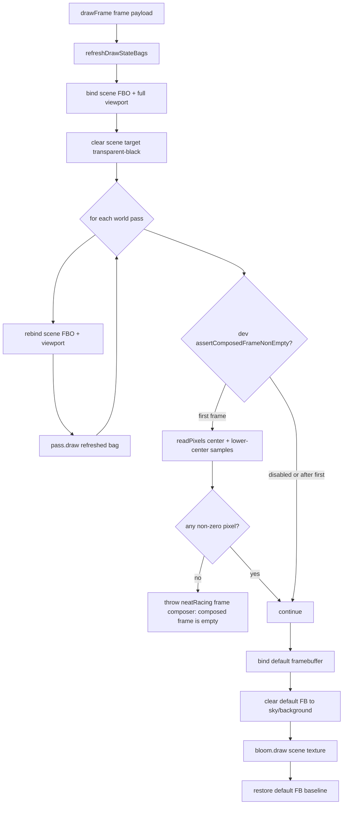

# Frame Composer Trace — P1-composition-green

Mermaid data-flow trace for the single-scene-transfer carrier used by the
Neat Racing game page. This diagram captures the fix-packet-P1-composition-green
changes: defensive per-pass scene-FBO rebind, dev-only empty-frame tripwire,
and the final baseline restore.

## Key contract notes

- **Defensive rebind**: every world pass is preceded by an explicit
  `gl.bindFramebuffer(scene)` + `gl.viewport(scene.width, scene.height)`. A pass
  that internally changes framebuffer state cannot blank later passes.
- **Dev tripwire**: `assertComposedFrameNonEmpty` reads both an 8×8 center
  sample and an 8×8 lower-center sample from the scene FBO after the first
  world render and throws a labeled error only if every sampled pixel is
  transparent black. The dual-region guard avoids the false positive caused by
  the chase camera leaving the frame center as empty sky. The flag defaults to
  off (zero-op) for release builds.
- **Host-owned default-FB clear**: before the additive bloom composite the
  composer clears the default framebuffer to a sky/background color so that
  unlit pixels are opaque and the dark page background no longer bleeds through.
- **Baseline restore**: the composer ends every tick with the default
  framebuffer bound so the host owns frame-scoped GL state.
