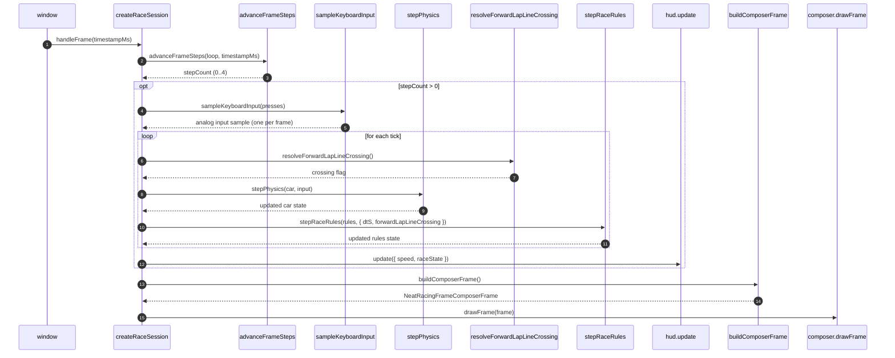

# Race Session Live Drive Loop Data Flow

> Permanent trace for `examples/neatRacing/host/race-session.ts` (slice
> `P1-drive-loop-live`, AC-024 / AC-033 / AC-042).
> The session turns browser `requestAnimationFrame` timestamps into a fixed
> 60 Hz physics + race-rules cadence and invokes the frame composer exactly
> once per frame.

## Per-frame sequence

## Key invariants

1. **One sample per frame (D5):** `sampleKeyboardInput` is called exactly once
   per drawing frame, even when `advanceFrameSteps` releases multiple catch-up
   ticks. The same sample object is replayed into every tick.
2. **60 Hz fixed step:** `NEATRACING_FIXED_TIMESTEP_SECONDS` is the only `dtS`
   ever passed to `stepRaceRules`; the accumulator in `render-loop.utils`
   clamps and releases ticks at that cadence.
3. **Lap crossing ordering:** `resolveForwardLapLineCrossing()` resolves from
   the car pose *entering* the tick, then physics advances, then rules uses the
   pre-tick crossing flag. This keeps each tick's rule input an independently
   observable record.
4. **HUD repaint once per frame:** `hud.update` runs only after the loop,
   using the final `car` and `rules` state for that frame. Zero-step frames
   skip HUD updates to avoid stale repeated paint.
5. **Composer draw once per frame:** `composer.drawFrame` is invoked after the
   simulation, including zero-step frames, so rendering continues regardless of
   accumulator starvation or clamping.
6. **Restart carrier (AC-033):** `modeSelector.onSwitch` is subscribed exactly
   once at creation. A switch seeds fresh car/rules states at the carried
   level (`nextRaceLevel ?? currentLevel`) and resets `loop.accumulatedMs` to
   zero, but keeps `lastTimestampMs` tied to the rAF timeline.
7. **Allocation-once (AC-042):** render-loop float buffers are allocated at
   session creation through the injected allocator seam and reused across
   every frame and restart. The neutral composer frame is a module-level
   singleton used until boot wiring injects a real `buildComposerFrame`.
