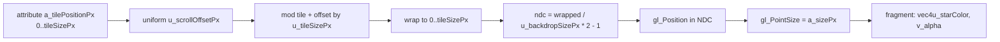

# Starfield Pass Data Flow

> Permanent trace for the `examples/neatRacing/engine/passes/starfield.pass.ts` fix (batch-102 render gap).
> The pass draws three parallax point-sprite layers into the scene FBO before the grid/track/car world passes.

## Shader coordinate flow

## Production uniform contract

- `u_tileSizePx` = `(NEATRACING_STARFIELD_TILE_WIDTH_PX, NEATRACING_STARFIELD_TILE_HEIGHT_PX)` (512×240).
- `u_backdropSizePx` controls how the wrapped tile maps into NDC:
  - **Horizontal axis:** `backdropWidthPx` equals the tile width (512) so the tiled starfield spans the full viewport width (x = 0..512 maps to NDC -1..+1).
  - **Vertical axis:** `backdropHeightPx` equals the fixed render height (720) so the 240 px tile maps to the top ~33% of the screen, keeping stars inside the above-horizon sky band (spec §6.2 / TP-19). It must **not** be the tile height, or the tile would fill the whole viewport and the ground grid would render behind stars.
- Old bug: using max-backing width (1920) × fixed render height (720) compressed the 512×240 tile into the top-left ~27% × ~33% of the viewport, producing only a few scattered dots in the corner.
- Fix: default `backdropWidthPx` to the tile width and `backdropHeightPx` to `NEATRACING_FIXED_RENDER_HEIGHT`; test fixtures may override either axis.
- `u_scrollOffsetPx` is recomputed per layer from camera yaw/pitch and the layer scroll ratio.

## Layer layout

- Three layers (far 35 stars, mid 28 stars, near 21 stars) are precomputed from deterministic xorshift32 RNG seeds at pass construction.
- One interleaved VAO per layer; per-frame draw path is `useProgram` → `bindVertexArray` → `uniform2f(scroll)` → `drawArrays(POINTS)` with zero allocation.

## Blend / depth state

- `gl.enable(BLEND)` with `gl.blendFunc(SRC_ALPHA, ONE_MINUS_SRC_ALPHA)` at construction.
- `gl.disable(DEPTH_TEST)` and `gl.depthMask(false)` so stars write purely to color.
- The frame composer later clears the scene FBO to transparent black before the starfield draw and rebinds the scene FBO before each world pass.
