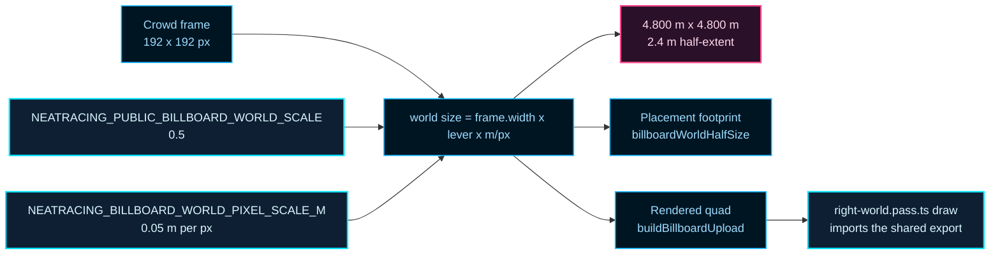
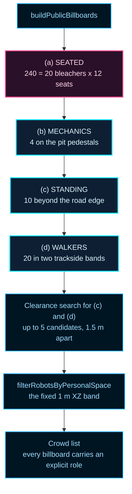
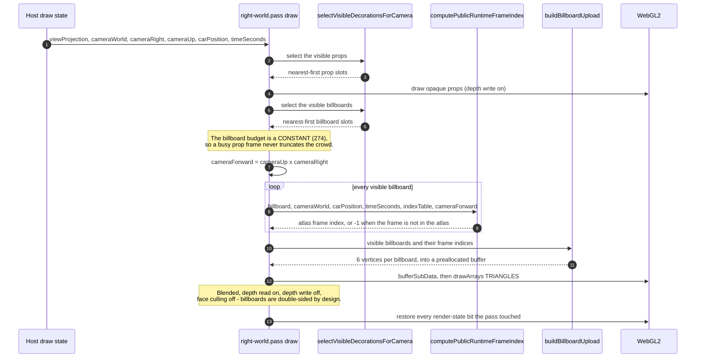

# NeatRacing Right-World Crowd Billboard Data Flow

> Permanent trace for the right-world crowd boundary: the recycled Neatenstein
> public/agent billboards that populate the right-hand side of the track
> (`examples/neatRacing/track/public.sprite.ts`,
> `examples/neatRacing/track/right-world.pass.ts` and
> `examples/neatRacing/track/right-world.builder.ts`). It covers the shared
> half-scale lever that sizes them, the four crowd roles, the fixed
> personal-space constant, and the per-frame render path that draws them.

The right world of a neatRacing track is the scenery side: neon props, a ring
of stepped bleachers, and a pit band of crew props between the road and the
stands. On its own that world reads as a set of glowing boxes. The crowd is what
turns it into a venue - and it is the only part of the right world that is not
voxel geometry.

Each spectator is a 2D sprite: a recycled Neatenstein robot frame, uploaded once
into a shared atlas and drawn as a camera-facing quad. That choice is what
makes a crowd of hundreds of quads affordable in a single draw call, and it is
why this boundary owns a scale lever of its own instead of inheriting the voxel
scale.

Three ideas carry the whole boundary:

- **A foot anchor.** A billboard's `position` is the surface it stands on, not
  its geometric center. The render pass expands the quad upward from that
  point, so a sprite stays glued to the ground or to a bleacher seat no matter
  how far away the camera is.
- **A camera-relative facing.** The atlas holds eight directions, so the module
  has to answer "which way is this robot looking, relative to the camera?". The
  seated, standing and mechanic roles look at the car; the walkers stroll in a
  preselected direction.
- **A shared, fixed scale.** Every crowd sprite is half the world size of the
  same pixel count in the voxel world, through one named lever. The perspective
  shrink is the pass's own `focal / distance` projection, not a per-distance
  factor baked into the sprite size.

## The shared half-scale lever

Two exported constants in `public.sprite.ts` size every crowd sprite:

| Constant | Value | Question it answers |
| --- | --- | --- |
| `NEATRACING_PUBLIC_BILLBOARD_WORLD_SCALE` | `0.5` | How large is a crowd sprite RELATIVE to the voxel world? |
| `NEATRACING_BILLBOARD_WORLD_PIXEL_SCALE_M` | `0.05` | How many METERS is one sprite pixel? |

They are deliberately two constants rather than one. The lever is a ratio and
the meter scale is an absolute, and the meter scale is also the unit the
placement footprint is measured in - so the footprint and the rendered quad
read the same number and can never disagree about the size of a sprite pixel.

The world size of a billboard is:

```
world size = frame.width * NEATRACING_PUBLIC_BILLBOARD_WORLD_SCALE * NEATRACING_BILLBOARD_WORLD_PIXEL_SCALE_M
```

The crowd frames are 192 x 192 px (a 48 x 48 logical sprite grid at
`ROBOT_SPRITE_SCALE = 4`), so the two readings of the same pixel count are:

| Reading | Arithmetic | World size |
| --- | --- | --- |
| The same pixel count at the voxel world scale | `192 px * 0.05 m/px` | 9.6 m |
| The crowd sprite, at the named lever | `192 px * 0.5 * 0.05 m/px` | 4.8 m |

Because the crowd frame is square, the halving applies to BOTH axes at once: a
crowd billboard is 4.800 m wide and 4.800 m tall, a 2.4 m half-extent on each
axis, aspect 1.0000. Every rendered crowd quad in the world measures exactly
that, and every visible crowd member measures the same height as every other
one.



### One lever, two consumers, one source of truth

The lever has exactly two consumers, and both read the SAME two constants:

- `billboardWorldHalfSize` turns a frame into the world-space footprint the
  placement code reserves on the ground or on a bleacher seat.
- `buildBillboardUpload` turns a frame into the world-space half-width and
  full-height of the quad that is uploaded to the GPU.

`right-world.pass.ts` therefore **imports**
`NEATRACING_BILLBOARD_WORLD_PIXEL_SCALE_M` from `./public.sprite` and declares
no module-local twin of it. A local copy would be free to drift; an import
cannot. The same shape holds for the lever itself: the pass reads
`NEATRACING_PUBLIC_BILLBOARD_WORLD_SCALE` from the sprite module rather than
repeating the number `0.5`.

### The lever is distance-independent

`computeBillboardScale(distance)` ignores its `distance` argument and always
returns the lever. That is deliberate. Perspective shrink is the projection's
job, and the projection the pass uses (`focal / distance`) is the SAME
projection the 3D voxels use. Sizing a billboard by distance as well would
apply the shrink twice and break the ratio contract between a crowd sprite and
the world around it.

## The four crowd roles

A crowd member is one of four roles, and the role is a first-class field on
every billboard rather than something inferred from a frame index:

| Role | Constant | Anchor | Runtime pose | Accent | Count |
| --- | --- | --- | --- | --- | --- |
| Seated spectator | `PUBLIC_SEATED_RUNTIME_ROLE` | the bleacher seat surface (`getBleacherSeatTopY`) | stand, gaze at the car | public neon | 240 |
| Trackside walker | `PUBLIC_WALKER_RUNTIME_ROLE` | the ground, in two bands beyond the road edge | walk1 / walk2 on a 2.4 s cycle | public neon | 20 |
| Standing spectator | `PUBLIC_STANDING_RUNTIME_ROLE` | the ground beyond the road edge | stand, gaze at the car | public neon | 10 |
| Pit-band mechanic | `PUBLIC_MECHANIC_RUNTIME_ROLE` | the inner pit-band pedestal | stand, gaze at the car | **team** accent | 4 |

The mechanic role is the only role that wears a team accent, so the pit band
reads as crew rather than as more of the colour-diverse public. The walkers are
the only role on the walk cycle, which is why they - and only they - need a
moving pose.

`resolvePublicRuntimeRole` is the single definition of the role-less default:
a billboard that carries no role is read as a **walker**. Both the frame-index
helper and the render pass resolve through it, so a billboard can never be
rendered by one consumer and dropped by the other.

### The build order is a budget decision

`buildPublicBillboards` places the crowd in a fixed order:



Seated spectators come FIRST on purpose. The personal-space filter keeps the
FIRST agent of each band, so a later band can never starve a bleacher seat: if
the order were reversed, the standing and walking agents would consume the
shared clearance and the stands would empty out. The mechanics are placed
second for the same reason, and because the pit band is a small, fixed set of
slots - the standing band is the one that can afford to lose agents.

### The budget arithmetic

Every number above is derived, not hand-written:

```
seated per bleacher = NEATRACING_BLEACHER_SEATS_PER_LEVEL (4) * NEATRACING_BLEACHER_LEVEL_COUNT (3) = 12
seated total        = 12 * NEATRACING_RIGHT_WORLD_BLEACHER_COUNT (20)                      = 240
off-bleacher cap    = NEATRACING_PUBLIC_OFF_BLEACHER_AGENT_ALLOWANCE                        = 34
density budget      = 240 + 34                                                            = 274
```

The off-bleacher cap of 34 is a CAP, never a target. The four mechanics, ten
standing spectators and twenty walkers together want exactly 34 slots, and the
allowance is spent by priority - mechanics first, then standing, then walkers -
so a shortage always falls on the walkers.

The 274 is also the per-frame render budget:
`NEATRACING_BILLBOARD_FRAME_BUDGET = NEATRACING_PUBLIC_BILLBOARD_DENSITY_BUDGET`. It
is a CONSTANT and it is completely independent of the prop LOD budget
(`NEATRACING_DECORATION_LOD_BUDGET = 128`), so a frame full of scenery never
truncates the crowd.

## The personal-space constant

The crowd has a spacing rule, and it lives in `right-world.builder.ts`:

| Constant | Value | Meaning |
| --- | --- | --- |
| `NEATRACING_ROBOT_PERSONAL_SPACE_M` | `1.0` | The personal space a robot keeps from its neighbours |
| `NEATRACING_ROBOT_PERSONAL_SPACE_EPSILON_M` | `1e-12` | The floating-point margin the comparison is allowed |
| `NEATRACING_ROBOT_PERSONAL_SPACE_CLEARANCE_M` | `1.0 - 1e-12` | The effective clearance the filter enforces |

The spacing rule is a constant in METRES. It is **not** derived from the sprite
size, and it must never be: a 4.8 m wide billboard is nearly five times the
1 m personal space, so any rule that scaled the clearance with the sprite
would empty the world. A regression guard places a probe pair 1.5 m apart -
closer than a single billboard is wide - and asserts that both survive, which
is exactly the case a sprite-derived clearance would have rejected.

### Why the epsilon exists

The bleacher stand-cell lattice is mathematically 1 m wide, but the world-space
seat positions come out of a ROTATED basis. Neighbouring cells therefore
measure a few `1e-14 m` short of 1 m. A strict `>= 1 m` comparison rejects
every second cell and truncates the crowd pick budget.

The `1e-12` margin is roughly thirty times the worst measured shortfall
(`2.99e-14 m`), so the effective clearance stays 1 m. The contract is expressed
against the margin, never relaxed: the number in the code that matters is
`NEATRACING_ROBOT_PERSONAL_SPACE_CLEARANCE_M`, and it is the clearance that is
enforced.

### Where it is enforced

The rule is applied at two points, on purpose:

1. **During placement.** `isOffBleacherSpotClear` runs a clearance search for
   each off-bleacher agent: the base offset plus up to five candidates
   `NEATRACING_PUBLIC_CLEARANCE_STEP_M` (1.5 m) apart, so an agent can be
   pushed at most 6 m further out than its band. An agent with no clear
   candidate is **skipped**. The crowd is a cap, never a quota.
2. **At the end of the build.** `filterRobotsByPersonalSpace` is the final
   thin: it walks the agents and keeps the FIRST of each band whose
   neighbours are all at least the clearance away.

Seated spectators are excluded from the clearance search - they are anchored to
their own seat surface, and the seat lattice already spaces them.

## The render path

`right-world.pass.ts` owns the per-frame draw. The pass is handed the camera
basis and the car pose, and it produces one draw call for the whole crowd.



### The per-frame steps

1. **Cull.** Billboards are culled against
   `NEATRACING_DECORATION_CULL_DISTANCE_M` (320 m) and then by the constant
   budget of 274. The budget is not reduced by the number of visible props.
2. **Face the camera.** The camera forward vector is derived ONCE per frame as
   `cameraForward = cameraUp x cameraRight` and written into a module-level
   scratch vector. The browser entry feeds `cameraUp = cameraRight x
   cameraForward`, so the two agree by construction, and deriving the third
   axis in the pass keeps the draw-state shape unchanged and the path
   allocation-free.
3. **Pick the frame.** `computePublicRuntimeFrameIndex` runs per billboard per
   frame, using the live camera and the live car position. The seated,
   standing and mechanic roles pick the direction that faces the car; the
   walkers pick their band direction and alternate walk1 / walk2 on the 2.4 s
   walk cycle. A look-around pause runs for 2.4 s out of every 16 s and applies
   to about a fifth of the walkers (chosen deterministically from the agent's
   seed and index); during that window a walker stands still and faces the car
   instead of walking.
4. **Upload.** `buildBillboardUpload` writes 6 vertices (2 triangles) per
   billboard into a preallocated `Float32Array`. The quad is expanded UPWARD
   from the foot anchor along `cameraUp`:

   ```
   scale  = computeBillboardScale(distance) * NEATRACING_BILLBOARD_WORLD_PIXEL_SCALE_M
   halfW  = (frame.width  * scale) / 2
   fullH  =  frame.height * scale
   ```

   With a 192 x 192 frame this is a 4.800 m x 4.800 m quad, and the 274-slot
   buffer is 274 * 6 * 5 floats = 32880 bytes.
5. **Draw.** One `drawArrays(TRIANGLES)` with `SRC_ALPHA` /
   `ONE_MINUS_SRC_ALPHA` blending, `depthMask(false)`, and
   `gl.disable(CULL_FACE)` - a billboard is a flat quad, so it must be visible
   from both sides.
6. **Restore.** The pass saves and restores the depth test, blend enable, blend
   function, depth mask, program, buffer, texture, active texture unit, the
   attrib 0/1/2 enable bits, and the cull-face state.

### The precomputed quad is deliberately ignored

`buildBillboard` in `public.sprite.ts` stores a `quad` on each billboard, but
that quad is in PROJECTION-space units. The pass does not read it: it rebuilds
world-space, camera-facing geometry every frame instead. Rebuilding is what
keeps the world unit system consistent between the placement code (metres) and
the WebGL vertex path, and it is what lets the quad follow the live camera
rather than the camera that existed when the crowd was built.

## Critical invariants

1. **The lever is shared, not copied.** `right-world.pass.ts` imports
   `NEATRACING_BILLBOARD_WORLD_PIXEL_SCALE_M` from `./public.sprite` and
   declares no module-local twin. The rendered quad height is
   `frame.height * NEATRACING_PUBLIC_BILLBOARD_WORLD_SCALE *
   NEATRACING_BILLBOARD_WORLD_PIXEL_SCALE_M` - the same expression the
   placement footprint uses.
2. **The lever is a ratio.** `NEATRACING_PUBLIC_BILLBOARD_WORLD_SCALE` is
   `0.5` and `NEATRACING_BILLBOARD_WORLD_PIXEL_SCALE_M` is `0.05`. Together
   they turn a 192 x 192 px crowd frame into a 4.800 m x 4.800 m billboard, a
   2.4 m half-extent and an aspect of exactly 1.0000.
3. **The size does not depend on the distance.**
   `computeBillboardScale(distance)` ignores its argument. Perspective shrink
   belongs to the shared `focal / distance` projection, and applying it twice
   would break the ratio between a crowd sprite and the world around it.
4. **The footprint and the quad agree.** Both the placement footprint and the
   rendered quad are computed from the same two constants, so a reserved slot
   and the sprite that fills it are the same size by construction.
5. **Every billboard carries a role, and a missing role means walker.**
   `resolvePublicRuntimeRole` is the single default, so the frame-index helper
   and the render pass can never disagree about a role-less billboard.
6. **The seated crowd is placed first.** The personal-space filter keeps the
   FIRST agent of each band, so placing the 240 seated spectators before the
   34 off-bleacher agents is what keeps the bleachers populated.
7. **The off-bleacher allowance is a cap.** 34 slots are shared by the 4
   mechanics, 10 standing spectators and 20 walkers, spent in that priority
   order. An agent that cannot find a clear spot is skipped, never squeezed in.
8. **Personal space is a fixed 1 m, not a sprite-derived value.** The constant
   is compared with a `1e-12` margin, which absorbs the `1e-14`-scale error of
   a rotated seat basis without relaxing the effective clearance. A 1.5 m
   probe pair must survive the filter.
9. **The render budget is a constant.** `NEATRACING_BILLBOARD_FRAME_BUDGET` is
   274 and is independent of the prop LOD budget of 128, so scenery pressure
   never truncates the crowd.
10. **The billboard draw is a single call.** The whole visible crowd is one
    `drawArrays(TRIANGLES)` over a preallocated 32880-byte buffer, with
    blending on, depth writes off and face culling off, and the pass restores
    every render-state bit it touched.

## Where to read next

| File | Owns |
| --- | --- |
| `examples/neatRacing/track/public.sprite.ts` | The crowd roles, the half-scale lever, the meter scale, the crowd build, the frame-index helper |
| `examples/neatRacing/track/right-world.builder.ts` | The personal-space constant and its filter, the bleacher geometry, the seat surface |
| `examples/neatRacing/track/right-world.pass.ts` | The atlas texture, the per-frame upload, the draw call, the render budget |
| `examples/neatRacing/track/decoration.lod.ts` | The cull distance and the prop LOD budget that the crowd budget is independent of |
