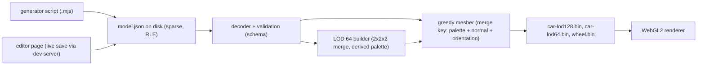
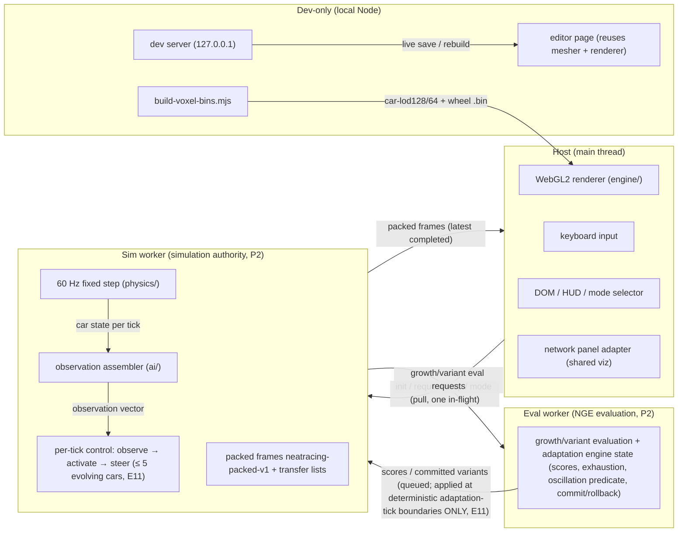

# NeatRacing — Virtua-Racing-Style Voxel Racer (Comprehensive Specification)

**Spec ID:** `neatracing-voxel-racer`
**Spec kind:** single source of truth for later planning (this file is a spec, not a step-packet tracker)
**Target folder:** `examples/neatRacing` (exists, currently empty — build in place)
**Deprecates:** `examples/racing_curriculum` (deprecation notices only; removal is a separate future workstream gated on explicit user confirmation)
**Constitution authority:** `plans/constitution.md` (exercised principles cited in §12)
**Spec-checklist self-check:** §19 (traceability 100% ≥ 80% threshold; 0 blocking gaps)

### Section map

| #   | Section                                      | Key identifiers                                                                               |
| --- | -------------------------------------------- | --------------------------------------------------------------------------------------------- |
| 1   | Mission & Positioning                        | —                                                                                             |
| 2   | Reference Research & Provenance              | §2.1 dead end; §2.2 physics reference                                                         |
| 3   | Locked Decisions Register                    | LD-01 … LD-34                                                                                 |
| 4   | Game Rules                                   | modes, levels, collisions                                                                     |
| 5   | Physics Model                                | §5.2 locked constants table                                                                   |
| 6   | Rendering Engine (WebGL2)                    | §6.4 neon look specs                                                                          |
| 7   | Voxel Data Pipeline                          | §7.2 on-disk format; §7.3 LOD rules + swap formula                                            |
| 8   | Editor & Local Dev Server                    | endpoints; editor features                                                                    |
| 9   | AI Progression (Phase 2)                     | promotion rule; oscillation fix; rival policy                                                 |
| 10  | Architecture & Folder Layout                 | folder tree; complexity rules                                                                 |
| 11  | Recycling Inventory                          | racing_curriculum / neatenstein / shared                                                      |
| 12  | Repo Constraints & Compliance                | hard rules; npm scripts; validation conventions                                               |
| 13  | Acceptance Criteria                          | AC-001 … AC-043 (§13.1/13.2/13.3; AC-040+ appended by the specialist-review patch)            |
| 14  | Explicit Non-Goals                           | 17 non-goals                                                                                  |
| 15  | Risks & Mitigations                          | R-01 … R-09                                                                                   |
| 16  | Tuning Points                                | TP-01 … TP-21 (TP-16+ appended by the specialist-review patch; TP-20/21 by the round-2 patch) |
| 17  | Phases → Steps → Slices Preview              | 3 phases; 13 steps; 50 slices; 2–5 slices/step                                                |
| 18  | Traceability Table (AC ↔ files ↔ validation) | 43/43 rows                                                                                    |
| 19  | Spec Self-Check (spec-checklist report)      | pass; 100% coverage                                                                           |
| 20  | Open Questions (all RESOLVED by owner)       | OQ-001 … OQ-003                                                                               |

### AC counts per phase

| Phase                                               | AC range                         | Count  |
| --------------------------------------------------- | -------------------------------- | ------ |
| Phase 1 — Graphics engine + manual keyboard driving | AC-001 … AC-024, AC-040 … AC-042 | 27     |
| Phase 2 — AI migration / NGE                        | AC-025 … AC-034, AC-043          | 11     |
| Phase 3 — Polish + deprecation prep                 | AC-035 … AC-039                  | 5      |
| **Total**                                           | AC-001 … AC-043                  | **43** |

---

## 1. Mission & Positioning

NeatRacing is a **Virtua-Racing-style arcade racing flagship demo** for
NeatapticTS: a fixed far-chase-camera racer with neon visuals, a real
**WebGL2 voxel engine**, manual keyboard driving (Phase 1), NGE-driven AI
agents (Phase 2), and polish + deprecation coordination (Phase 3).

Positioning inside the examples learning path:

- It is the **repo's first real WebGL2 renderer**. Both existing flagship
  demos are Canvas 2D (Neatenstein's raycaster renders to a 2D framebuffer;
  Flappy Bird is Canvas 2D). NeatRacing introduces the first GPU-shaded 3D
  pipeline with a voxel asset pipeline, greedy meshing, LOD tiers, and a
  world-space neon background.
- It is the **successor of `examples/racing_curriculum`**: the racing domain
  knowledge (host/worker split, packed frames, observation tiers, NGE growth,
  seeded track generator, scripted controller) migrates forward, and the old
  demo is deprecated (not removed) once parity is demonstrated.
- It teaches the **voxel data pipeline end to end**: authored sparse voxel
  JSON on disk → live dev-server editing → greedy-meshed binary LODs →
  GPU-rendered cars with glow/glass semantics.
- It demonstrates **human-vs-evolution play**: after Phase 2 a top-right mode
  selector toggles AI vs manual, and the human drives car 0 against
  continuously evolving agents.

The demo is quality-focused (60 fps target, adaptive quality drops
LOD/prop density before dropping frames) and deterministic in its simulation
worker (60 Hz fixed timestep, seeded track, reproducibility tuple).

---

## 2. Reference Research & Provenance

### 2.1 Documented dead end — `wanszai/Virtua-Racing---XBOXONE-Windows`

The suggested reference repository is a **ROM-loader homebrew**: it requires a
user-supplied `vr.zip` (original game ROM) and provides **no physics source
code** to recycle. It is recorded here as a **dead end** and MUST NOT be cited
as a physics reference anywhere in the implementation.

### 2.2 Physics reference — `jakesgordon/javascript-racer` (canonical, locked)

The arcade physics tuning baseline comes from the canonical JavaScript arcade
racer constants (see §5). These constants are adapted into the existing
top-down 2D-world environment step service pattern from
`examples/racing_curriculum/environment/environment.step.service.ts`. The
reference's exponential fog density value `5` is recorded as **context only**:
it is expressed in segment-length units, is **NOT transcribed** into
NeatRacing, and the 3D distance fog defines its own named equation and units
(§6.6, TP-05).

### 2.3 Voxel format research (informs §7, not imported)

- **Tiberian Sun VXL:** sparse columns — per (x, y) a column of
  `(colorIndex, normalIndex)` pairs, 255³ size cap, companion `.HVA` files
  for rotation frames and anchors. Lesson taken: **sparse storage is the right
  memory model** for 128³ models. The `.HVA` multi-frame approach is
  **rejected**: NeatRacing bodies are a single mesh rotated in 3D (no sprite
  poses), per locked decision.
- **MagicaVoxel `.vox`:** `SIZE` + `XYZI` chunk (4 bytes per solid voxel:
  x, y, z, colorIndex — sparse) + `RGBA` palette chunk (256 colors). Lesson
  taken: **palette-indexed sparse voxels with a 256-entry palette**. NeatRacing
  extends palette entries with alpha and a glow byte (see §7.2).

### 2.4 Chosen on-disk representation (locked recommendation)

JSON, slice-major, RLE hex rows, palette entries `[r, g, b, a, glow]`, plus
per-model metadata. Full normative definition in §7.2. The server reads and
writes it; the build script converts it to `.bin` (§7.4).

---

## 3. Locked Decisions Register (do NOT reopen)

These decisions are user-confirmed. Any change request against this list must
be escalated to the repository owner, not relitigated in a slice.

| ID    | Decision                                                                                                                                                                                                                                                                                                                                                            |
| ----- | ------------------------------------------------------------------------------------------------------------------------------------------------------------------------------------------------------------------------------------------------------------------------------------------------------------------------------------------------------------------- |
| LD-01 | Fixed far chase camera; **no** toggleable views.                                                                                                                                                                                                                                                                                                                    |
| LD-02 | Automatic transmission only; no manual transmission.                                                                                                                                                                                                                                                                                                                |
| LD-03 | **No** pit stops (deliberate complexity cut; AI effort goes to team-work + complex physics).                                                                                                                                                                                                                                                                        |
| LD-04 | No damage/crash deformation (kept as a documented future option, §14).                                                                                                                                                                                                                                                                                              |
| LD-05 | Collisions are arcade elastic bounce, including car-vs-car.                                                                                                                                                                                                                                                                                                         |
| LD-06 | Single screen only; one track at launch (engine validation first).                                                                                                                                                                                                                                                                                                  |
| LD-07 | **No audio.**                                                                                                                                                                                                                                                                                                                                                       |
| LD-08 | Reverse/mirror course variants come later (free — deterministic generator).                                                                                                                                                                                                                                                                                         |
| LD-09 | Human mode: 20-lap race WITH checkpoint time extension (VR arcade style).                                                                                                                                                                                                                                                                                           |
| LD-10 | AI mode: runs until growth/learning goals are met (goals in §9.4).                                                                                                                                                                                                                                                                                                  |
| LD-11 | Level progression: lvl 1 = player alone; lvl 2 = +1 rival; lvl 3 = +4 rivals.                                                                                                                                                                                                                                                                                       |
| LD-12 | After Phase 2: top-right mode selector (Neatenstein style) toggling AI vs manual; switching mode in EITHER direction restarts the race/simulation. Human takes car 0 and races against evolving agents.                                                                                                                                                             |
| LD-13 | Arcade grip, Virtua-Racing-style top speed feel (~320 km/h), deterministic 60 Hz fixed timestep in the simulation worker.                                                                                                                                                                                                                                           |
| LD-14 | Physics tuning baseline from `jakesgordon/javascript-racer` constants (§5.2); `wanszai` repo is a dead end (§2.1).                                                                                                                                                                                                                                                  |
| LD-15 | Car state keeps `yawRate` and `slipAngle` (sensors use them).                                                                                                                                                                                                                                                                                                       |
| LD-16 | WebGL2-only renderer with graceful fallback message; smooth upscale (`image-rendering: auto` — the pixels ARE the voxels; pixelated would show "pixels on pixels").                                                                                                                                                                                                 |
| LD-17 | Canvas strategy (Neatenstein parity): fixed backing-store height 720 px (`NEATRACING_FIXED_RENDER_HEIGHT = 720`), width proportional to CSS client aspect ratio, CSS stretches.                                                                                                                                                                                     |
| LD-18 | 60 fps target; quality-focused adaptive quality: auto-drop LOD/prop density before dropping frames.                                                                                                                                                                                                                                                                 |
| LD-19 | Voxel car: 128×128×128 grid. LOD 64³ via 2×2×2 merge with the exact color/glow/black rules of §7.3. 64³ gets a derived palette. A 32³ tier ONLY if quad-count math proves it necessary for far traffic (default: not built).                                                                                                                                        |
| LD-20 | LOD swap is distance-based via projected-pixel math with the formula of §7.3.2; the constant is computed-from-car-dims (specialists verify).                                                                                                                                                                                                                        |
| LD-21 | Wheels: separate small rotating voxel models in a compact format matching the car's voxel world scale; wheel grid follows the 0=down rule; mounted rotated 90° so the spin axis is lateral; body is a single mesh rotated in 3D (no sprite poses).                                                                                                                  |
| LD-22 | Lighting: single directional sun + hemisphere ambient + distance fog; blob shadows under cars (no shadow maps); cheap bloom (brightness threshold + small blur + additive) for glow.                                                                                                                                                                                |
| LD-23 | Glow/glass semantics: a fully transparent voxel may carry color + glow → renders as shining glass of that color (glow only, no body); glass is typically light-blue tint; black (0,0,0) = no color, no shine regardless of glow value.                                                                                                                              |
| LD-24 | Neon look: flappy star sky, NO clouds — 3-layer parallax starfield (§6.4.1); Neatenstein-style world-space neon ground grid (§6.4.2); non-interactive light pulses (§6.4.3); few colors overall; team-color remap like Neatenstein agents.                                                                                                                          |
| LD-25 | Track rendering: voxel-faced ribbon snapped to a coarse voxel grid (road/curb/grass slabs), greedy-meshed, deterministic from the seeded track generator. Voxel scenery props optional per course.                                                                                                                                                                  |
| LD-26 | NO bundled human-editable JS data file (unlike `robot-sprite-data.js`). Models live on disk and are edited LIVE through a LOCAL Node server (dev-only). The dev opens locally rendered docs on a special URL that is not listed/linked for the public web.                                                                                                          |
| LD-27 | Server: minimal Node http server, no express, binds `127.0.0.1` only, serves editor + game page, REST-ish endpoints (§8.2). Editor saves immediately (no import/export files at all).                                                                                                                                                                               |
| LD-28 | Editor: separate page under `examples/neatRacing/editor/`; 3D preview reuses the game's greedy mesher + WebGL renderer (dogfooding); orbit click-drag + scroll zoom; CAD-style orthographic front/side/top views; palette editing; 3-step undo/redo; model dropdown; mirror-X symmetry ON by default (only half the model is stored); live-save through the server. |
| LD-29 | Initial car: procedurally generated F1-style voxel car from a generator script (Node `.mjs`, following the `examples/neatenstein/scripts/generate-robot-pngs.mjs` precedent), hand-tuned in the editor afterward.                                                                                                                                                   |
| LD-30 | Phase 2 migrates the NGE controller + runtime adaptation growth engine from `racing_curriculum` with the recycle inventory of §11 and the promotion/propagation rules of §9.                                                                                                                                                                                        |
| LD-31 | Root-cause fix to carry: `RACING_OSCILLATION_MIN_NEURONS = 200` oscillation-penalty boundary is the cause of racing_curriculum's "unstable around 200 nodes" behavior; NeatRacing retunes it (§9.5).                                                                                                                                                                |
| LD-32 | Visualizer: right-side network panel shows ONLY the most-forward agent (current winner at all times), via a thin adapter over `examples/shared/network-visualization`.                                                                                                                                                                                              |
| LD-33 | `examples/racing_curriculum` stays until the user confirms removal — dedicated removal step later (this workstream only adds deprecation notices, §13 Phase 3).                                                                                                                                                                                                     |
| LD-34 | NEVER run git (git is uninstalled in this repo; see §12.1).                                                                                                                                                                                                                                                                                                         |

---

## 4. Game Rules

### 4.1 Modes

- **Manual (human) mode** — available from Phase 1.
  - 20-lap race (**`NEATRACING_HUMAN_RACE_LAPS = 20`**) with **checkpoint
    time extension** (VR arcade style): initial budget
    **`NEATRACING_CHECKPOINT_INITIAL_BUDGET_S = 60`** s, extended by
    **`NEATRACING_CHECKPOINT_PER_LAP_EXTENSION_S = 25`** s at each lap-line
    crossing (OQ-001 RESOLVED — TP-13 records the named constants).
  - **Human level advancement (OQ-002 RESOLVED):** completing the 20-lap
    race advances the player to the next level for the **NEXT race**
    (§4.2 ladder; at lvl 3 — the cap — the player keeps racing lvl 3). The
    completed race is a session boundary: the next race starts as a NEW
    session at the next level's rival count with a fresh reproducibility
    tuple (same round-boundary discipline as AI promotion, §9.4) — **no
    mid-race car materialization ever occurs**.
  - Auto transmission only; fixed far chase camera; no pit stops; no damage.
  - Rival baseline: scripted waypoint drivers (recycled `scripted.controller`)
    with **NEW per-course speed profiles** — a deterministic throttle table
    keyed by course/segment (E7; not a recycled feature, §9.6) — evolving
    agents replace them in AI mode.
- **AI mode** — wired in Phase 2.
  - Runs a **minimum of 20 laps**
    (**`NEATRACING_AI_MIN_SESSION_LAPS = 20`**, OQ-002 RESOLVED) with **no
    upper lap limit**: the three-part promotion predicate (§9.4) is
    evaluated at forward finish-line crossings **only once
    `sessionLaps ≥ NEATRACING_AI_MIN_SESSION_LAPS`**, and the session
    continues until promotion fires (§9.4).
  - The human takes **car 0** and races against evolving agents (LD-12).
  - The session auto-advances through levels via the promotion rule (§9.4).

### 4.2 Level progression (both modes share the car-count ladder)

| Level | Cars on track | Composition       |
| ----- | ------------- | ----------------- |
| lvl 1 | 1             | player alone      |
| lvl 2 | 2             | player + 1 rival  |
| lvl 3 | 5             | player + 4 rivals |

- AI-mode level advancement is driven by the promotion rule (§9.4), gated
  by the session-lap floor (`NEATRACING_AI_MIN_SESSION_LAPS = 20`, §9.4).
- Human-mode level (OQ-002 RESOLVED; supersedes the E9 "fixed level
  forever" default): **advances at the race-completion boundary** —
  completing the 20-lap race starts the next race at the next level; the
  first session starts at **lvl 1** (`NEATRACING_HUMAN_START_LEVEL = 1`);
  lvl 3 is the cap. **No mid-race rival insertion ever occurs.** Mode
  switching AI ↔ manual **restarts the simulation/race in both directions**
  (LD-12).

### 4.3 Collisions

- Arcade **elastic bounce** for car-vs-car and car-vs-track-boundary.
- No deformation, no damage state, no crash penalties beyond the bounce
  itself (LD-04).

### 4.4 Session/frame rules

- Single screen only; no split-screen (§14).
- One track at launch. Reverse/mirror variants are a later free addition
  riding the deterministic generator (LD-08).

---

## 5. Physics Model

### 5.1 Simulation model

- **Top-down 2D world** (`x`, `y`, `heading`) exactly like the recycled
  environment step service — simulation truth stays 2D in the worker; the
  WebGL renderer projects that world into 3D (flat track, elevation 0 at
  launch).
- **Deterministic 60 Hz fixed timestep** (`FIXED_TIMESTEP_MS = 1000/60`,
  `FIXED_TIMESTEP_SECONDS = 1/60`) inside the simulation worker; host
  rendering is decoupled from sim ticks via **accumulator-based fixed
  stepping** (§6.3): `FIXED_TIMESTEP_MS = 1000/60` and
  `MAX_CATCHUP_STEPS_PER_FRAME = 4`; the tick count per rAF frame is
  accumulator-driven — **0 or 1+ steps, NEVER forced-min-1** (P1; in-repo
  precedent: `examples/racing_curriculum/browser-entry/browser-entry.ts`).
  High-refresh displays (120 Hz / 144 Hz) therefore run 0 or 1 step per frame
  and the simulation still advances exactly 60 ticks/s (AC-003).
- **Frame pacing / backpressure policy (P3, pull model):** the host pulls —
  at most **ONE in-flight step request** at a time; the host always renders
  the **latest completed frame (latest-wins)**, discarding stale intermediate
  states; catch-up is capped by `MAX_CATCHUP_STEPS_PER_FRAME = 4`; the worker
  **never self-posts frames** (it replies to host step requests only). This
  keeps the tick rate independent of display refresh and prevents request
  pile-up when a step is slow (AC-026 extension; see §9.2).
- Car state keeps **`yawRate` and `slipAngle`** (LD-15) so sensors/observations
  can consume them (design hook lands in Phase 1 state, consumed in Phase 2).
- **Keyboard sampling rule (D5):** keyboard state is sampled **ONCE per rAF
  frame**; the same sample applies to **EVERY catch-up tick** in that frame
  (matches the recycled per-tick while-loop precedent in
  `browser-entry/browser-entry.ts` — one input read feeding the catch-up
  loop).
- 1 world unit = 1 meter for rendering scale; the top-speed feel target is
  ~320 km/h ≈ **89 world-units/second** (TP-01).
- **Car collision dims are NAMED FIXED PHYSICS CONSTANTS (D6):**
  `NEATRACING_CAR_COLLISION_RADIUS_M` (and, if needed, a length/width pair)
  are fixed physics constants — they are **NEVER derived from voxel models**;
  `.bin` rebuilds are renderer-only artifacts with **zero sim-side effect**
  (keeps live model editing gameplay-neutral).

### 5.2 Locked tuning baseline (javascript-racer constants, adapted)

| Constant (named in code) | Value                                                                                                                                                       | Source                                                                                                  |
| ------------------------ | ----------------------------------------------------------------------------------------------------------------------------------------------------------- | ------------------------------------------------------------------------------------------------------- |
| `ACCEL`                  | `maxSpeed / 5`                                                                                                                                              | javascript-racer                                                                                        |
| `BRAKING`                | `−maxSpeed`                                                                                                                                                 | javascript-racer                                                                                        |
| `NATURAL_DECEL`          | `−maxSpeed / 5`                                                                                                                                             | javascript-racer                                                                                        |
| `OFF_ROAD_DECEL`         | `−maxSpeed / 2`, with off-road speed floor `maxSpeed / 4`                                                                                                   | javascript-racer                                                                                        |
| `CENTRIFUGAL`            | outward push `0.3 × curvature × speedPercent²` (multiplier 0.3, TP-02)                                                                                      | javascript-racer                                                                                        |
| `STEERING_RATE`          | `dx = dt · 2 · speedPercent` (cross the road in ~1 s at top speed; TP-04)                                                                                   | javascript-racer                                                                                        |
| `FOG_DENSITY`            | named constant `FOG_DENSITY_1_PER_M`, default ~0.006 1/m (≈ 1/(half draw distance); see equation below) (TP-05, tuned against `NEATRACING_DRAW_DISTANCE_M`) | NeatRacing-specific (G10: javascript-racer's raw `5` is in segment-length units and is NOT transcribed) |

These constants are adapted into the existing top-down env step service
pattern (`environment.step.service.ts` shape: named constants, pure step
function, deterministic). Off-road detection uses the track ribbon lateral
bounds; the off-road floor prevents decelerating to zero off-track.

**Fog equation (normative, §6.6):** `fogFactor = exp2(−(density · d)²)` with
`density` in **1/m** and `d` = view distance in meters; the transmittance is
`1 − fogFactor`. `FOG_DENSITY_1_PER_M` is tuned against
`NEATRACING_DRAW_DISTANCE_M` (TP-16) so the fade reaches ~50% at roughly half
the draw distance. javascript-racer's `5` is in segment-length units and MUST
NOT be transcribed (G10).

**Draw distance (named constant, G11):**
`NEATRACING_DRAW_DISTANCE_M` — default starting value **320 m** (tuning range
~250–400 m; TP-16), sized for a ~320 km/h arcade feel. It is the single input
to: the 32³ LOD gate (§7.3.3), fog tuning (§6.6), grid fade (§6.4.2), track
mesh extent (§6.7), LOD budget (§7.3.4), and the sky band height (§6.4.1).

### 5.3 Determinism contract

Same `(seed, inputs, track tuple)` → identical car states across the same
runtime (RED test in Phase 1). The full worker-level reproducibility tuple
lands in Phase 2 (§9.7).

---

## 6. Rendering Engine (WebGL2)

### 6.1 Context strategy

- **WebGL2-only.** `canvas.getContext('webgl2')`; if unavailable, show a
  graceful fallback message element (no crash, no blank canvas).
- `webglcontextlost` / `webglcontextrestored` handled: the `webglcontextlost`
  handler **MUST call `event.preventDefault()`** (G5 — without it the context
  is not recoverable), suppress rendering, and reinitialize GPU resources on
  `webglcontextrestored` (AC-002; risk R-01).
- **Smooth upscale:** the canvas CSS uses `image-rendering: auto`. The pixels
  ARE the voxels; a pixelated upscale filter would show "pixels on pixels"
  (LD-16).

### 6.2 Canvas strategy (Neatenstein parity, LD-17)

- Fixed backing-store height **720 px** — `NEATRACING_FIXED_RENDER_HEIGHT =
720` (constant, mirroring `NEATENSTEIN_FIXED_RENDER_HEIGHT = 480`).
- Backing width computed proportionally from the CSS client aspect ratio
  (`round(720 × clientWidth/clientHeight)`), clamped by a **width fallback
  ladder** ending at `NEATRACING_MAX_BACKING_WIDTH = 1920` (P6 — ultrawide
  32:9 would otherwise double fill rate vs 16:9; `racing_curriculum`
  precedent `MAX_CANVAS_WIDTH_PX = 1600`), with viewport fallbacks when
  client dimensions are zero (same fallback ladder shape as
  `canvas-dimensions.utils.ts` in Neatenstein).
- CSS stretches the backing store to the layout box.

### 6.3 Render loop & frame budget

- 60 fps target. Render-loop utilities recycle the Neatenstein cadence
  **delta clamp** pattern only (`render-loop.utils.ts`, §11.2). The
  **FPS-scaled tick advance (`advanceSimTick` with its forced-min-1 step) is
  NOT recycled** — it would violate the 60 Hz sim rate on 120/144 Hz displays.
  NeatRacing uses **accumulator-based fixed stepping** instead (P1):
  - `FIXED_TIMESTEP_MS = 1000/60`;
  - `MAX_CATCHUP_STEPS_PER_FRAME = 4` (prevents spiral-of-death);
  - ticks per rAF frame = accumulator-driven: `floor(accumulatedMs /
FIXED_TIMESTEP_MS)` capped at 4 — **0 or 1+ steps, never forced-min-1**
    (in-repo precedent: `racing_curriculum/browser-entry/browser-entry.ts`).
  - AC-003 asserts exactly 60 ticks/s across 60/120/144 Hz delta cases
    (16.67/8.33/6.94 ms).
- Adaptive quality is quality-first: drop LOD tier / prop density **before**
  dropping frames (§9 — Phase 3 controller, AC-035).
- **Zero per-frame allocation rule (P9):** the render loop performs ZERO
  per-frame heap allocations — matrices/vectors/quads are preallocated and
  reused across frames (validated by a fixture that runs N frames and asserts
  a stable allocation count via a counting allocator/test double), and pass
  state objects are reused. Where feasible, the per-frame host→worker
  transfer prefers a **single packed ArrayBuffer (with offsets)** over 10–11
  separate transfers; this packing is an **optimization option, not a
  mandate** (the racing precedent uses per-field typed-array transfer lists
  and may be kept if packing complicates it).

### 6.4 Neon background & world dressing (locked look, LD-24)

#### 6.4.1 Starfield (flappy parity, NO clouds)

Three parallax star layers rendered by a WebGL background pass, ported from
the flappy Canvas 2D starfield **layer specs** (constants parity, new
implementation):

| Layer | Seed | scrollRatio | starCount | sizes (px) | alpha range | blur (px) |
| ----- | ---- | ----------- | --------- | ---------- | ----------- | --------- |
| far   | 1337 | 0.03        | 35        | 1–2        | 0.08–0.22   | 4         |
| mid   | 2777 | 0.04        | 28        | 1–3        | 0.10–0.28   | 6         |
| near  | 4242 | 0.05        | 23        | 2–4        | 0.12–0.34   | 8         |

Single cyan fill `rgba(95,255,255,1)`. **No clouds** anywhere in the sky.
Parity is asserted against `examples/flappy_bird/constants/constants.starfield.ts`
values (AC-004).

**3D driver (G6 — normative):** the starfield is a **2D backdrop pass**
(drawn first, no depth write) whose layers scroll as a function of the 3D
camera pose:

- `offsetX = −(yaw / 2π) × tileWidth × scrollRatio` — per-layer `scrollRatio`
  is **retained** (0.03/0.04/0.05) so far/mid/near layers shear at different
  rates for the depth illusion.
- `offsetY` is driven by **camera pitch** (per-layer, scaled by the same
  scroll ratio): as the chase camera pitches down toward the horizon band,
  stars scroll up.
- The backdrop spans a named **sky band height** —
  `NEATRACING_SKY_BAND_HEIGHT_PX` (constant; sized to the above-horizon band
  at 720p, default 240 px, TP-19) — so stars never draw over the ground; the
  horizon line sits at the band's bottom edge, consistent with
  `NEATRACING_DRAW_DISTANCE_M` (TP-16).
- The layers remain procedurally seeded (1337/2777/4242) and deterministic;
  the pass is a pure function of `(yaw, pitch, tile constants)` — no
  per-frame allocation.

#### 6.4.2 World-space neon ground grid (Neatenstein parity)

A **coherent, always-visible, world-space** neon grid that keeps direction as
the player moves (world-anchored lines, not camera-relative tiling):

- Grid pitch **1.0 world unit** (mirrors
  `NEATENSTEIN_FLOOR_GRID_SPACING_WORLD = 1.0`).
- Alpha fade **0.05 (far) → 0.58 (near)** (mirrors
  `NEATENSTEIN_FLOOR_MIN_ALPHA/MAX_ALPHA`). **Neatenstein nuance (G7):** in
  the active per-pixel path these are the MIN/MAX constants of a fog-style
  envelope — alpha resolves as `MAX_ALPHA × (1 − fogFactor)` with `MIN_ALPHA`
  the floor at the far end, not two separate hardcoded stops.
- **Double-stroke glow via fragment shader (G7 — replaces the GL-line idea;
  `gl.lineWidth > 1` is unsupported in WebGL2/ANGLE):** the grid is a
  **fragment-shader ground-plane pass** — a full-screen/ground-plane quad
  where line intensity is computed per fragment:
  - intensity from distance to `fract(worldXZ / 1.0)` grid lines;
  - screen-pixel widths via `fwidth` (GLSL ES 3.00):
    `thresholdWorld = widthPx × fwidth(coord)` — **2 px core** and **4 px halo
    at 0.8× alpha** (mirrors `NEATENSTEIN_FLOOR_LINE_WIDTH_PX = 2`,
    `NEATENSTEIN_FLOOR_GLOW_WIDTH_PX = 4`,
    `NEATENSTEIN_FLOOR_GLOW_ALPHA_MULTIPLIER = 0.8`);
  - **distance fade 0.05 → 0.58** across `NEATRACING_DRAW_DISTANCE_M` (TP-16)
    so the grid dissolves coherently at the draw horizon.
- Alpha endpoints are TP-11.

#### 6.4.3 Non-interactive light pulses

World-space dots: color `#B7FF00` (185, 255, 0), glow alpha **0.42**
(mirrors `PULSE_GLOW_ALPHA`), lifetime-based alpha envelope,
**depth-tested**, never interactive (no gameplay effect). Deterministic
placement from the seed.

### 6.5 Car rendering (voxel pipeline consumer)

- Voxel meshes from the §7 pipeline, drawn with the §6.6 lighting model.
- Body: **single mesh rotated in 3D** (no sprite poses).
- Wheels: separate small voxel models, mounted rotated 90° so the spin axis
  is lateral (like a real tire), spinning according to ground speed (LD-21;
  full mount contract in §7.4).
- **Team-color remap:** a designated palette slot remaps to team colors at draw
  time (Neatenstein agent parity) without rebuilding bins (AC-014).
- **Blob shadows:** soft dark quads under cars; no shadow maps (LD-22). Per
  G9: blob shadows are drawn **after opaque ground with depth-write OFF**,
  offset **y + 0.01 m** above the ground plane to avoid z-fighting with the
  track slabs; they depth-test ON so cars/props occlude them correctly.
- **Glass pass (G4 — concrete policy for LD-23 glass voxels):**
  - A **dedicated glass pass runs after ALL opaque geometry** (bodies,
    wheels, track, blob shadows).
  - State: **depth-test ON, depth-write OFF, back-face culling ON**.
  - Glass quads are tinted with **premultiplied-alpha color** and add a
    **glow contribution** (additive) per glass voxel's palette entry.
  - **Draw order:** cars are drawn **far → near** as cheap insurance (a sort
    over ≤ 5 cars is negligible).
  - **Stacked glass inside one car (e.g., canopy + windscreen layers):**
    double-tint is **explicitly accepted** as the locked behavior — arcade
    glass is thin and tint is mild, and per-layer sorting within a model
    would cost more than it buys. The fully-additive-glow alternative
    (glow-only compositing, no alpha tint, commutative → sort-free) is
    recorded as a tuning-time escape hatch but is NOT the default.
  - Validation extends AC-013 (glass renders through the glass pass with the
    exact GL state above; black never shines in the glass pass either).

### 6.6 Lighting & post

- Single directional **sun** + **hemisphere ambient** + **distance fog**
  (exponential-squared; named equation and units per §5.2 —
  `fogFactor = exp2(−(FOG_DENSITY_1_PER_M · d)²)`, density in 1/m, tuned
  against `NEATRACING_DRAW_DISTANCE_M`; TP-05/TP-16). javascript-racer's raw
  `5` (segment-length units) is NOT transcribed (G10).
- **Cheap bloom** for glow (G8, TP-10): brightness-threshold pass → **ONE
  separable blur pass** on a **half-res 640×360 target** (720/2 × 405/2
  derived from the fixed 720p backing store; named
  `NEATRACING_BLOOM_TARGET_WIDTH/HEIGHT`) with a **named tap cap ≤ 13 taps**
  (`NEATRACING_BLOOM_MAX_TAPS = 13`) → **additive composite** onto the
  scene. Bright-pass input = **glow voxels (§7.2 glow byte, black excluded)
  - starfield + pulses**. Bloom is on the AC-035 adaptive-quality drop list
    with an explicit off-switch (first quality drop before LOD).
    Glow semantics come from §7.2 palette glow bytes.

### 6.7 Track rendering (LD-25)

- The seeded track generator (recycled, §11) produces the closed-loop spline.
- The ribbon is **snapped to a coarse voxel grid** and extruded into
  **road / curb / grass slabs** (flat, voxel-faced) at a **named track slab
  voxel pitch of 0.5 m** (TP-19 starting value; tuning range 0.5–1 m), with a
  **separate slab palette** (road/curb/grass/line colors, glow accents
  allowed) (G12).
- **Scale rule (G12):** the track does **NOT** share the car voxel world scale
  — only cars/wheels share `NEATRACING_VOXEL_WORLD_SIZE` (§7.3.4); slabs use
  their own pitch so the track's voxel resolution is a track-only property.
- Slabs are **greedy-meshed** with the same merge contract as cars (§7.3.1),
  and the slab mesh extent covers `NEATRACING_DRAW_DISTANCE_M` (TP-16) so the
  road fades with the fog, never clips.
- Deterministic: same `(seed, layoutVersion, sizeBucket)` → byte-identical
  track mesh (AC-017).
- Voxel scenery props are **optional per course** (off by default at launch).

---

## 7. Voxel Data Pipeline

### 7.1 Overview



- **Authored artifact:** the sparse model JSON on disk (edited live via the
  editor; hand-tuned edits are authoritative after the initial generation).
- **Generated artifacts (read-only, trace edits to the generator/editor):**
  the `.bin` LOD binaries are build-script outputs; never hand-edit them
  (§12.1 repo constraint).

### 7.2 On-disk model format (normative, LD-26 / §2.4)

A single JSON document per model (e.g. `assets/models/car-f1.model.json`):

- **`meta`**: `{ "name": "car-f1", "dims": [128, 128, 128], "symmetric": true }`.
- **`palette`**: array of entries `[r, g, b, a, glow]`, each 0–255.
  - **Index 0 is reserved as EMPTY** (air; never rendered, never counts in
    averages).
  - `glow` 0–255 drives the bloom/shine pass (§6.6).
  - A fully transparent entry (`a === 0`) with color + `glow > 0` renders as
    **shining glass** of that color (glow only, no body quads). Glass is
    typically a light-blue tint.
  - **Black (`r === g === b === 0`) is the exception: no color, no shine even
    if `glow` is set** — enforced in the mesher and in the LOD builder
    (LD-23 / AC-013).
- **`slices`**: 128 slices **seen from the FRONT** (slice index = depth along
  the car's forward axis), each slice is 128 rows (height) × 128 cols (width).
  - **ROW 0 = GROUND/down** (0 is down on the vertical axis) — same rule for
    wheel models.
- **RLE hex rows:** each row is a string of `<runLen:2hex><paletteIdx:2hex>`
  pairs (run length 1–255 hex, palette index 0–255 hex). The runs of a row
  MUST sum to the row width. Examples: a full-empty row is `"8000"`
  (128 = 0x80 of index 0); `"0a034000"` decodes to 10 voxels of color 3 then
  64 empty.
- **Mirror-X symmetry (LD-28):** cars are symmetric — only **half the model is
  stored**. When `symmetric: true`, each row stores 64 cols (runs sum to 64)
  and the loader mirrors cols 0–63 → 64–127 (col c ↔ col 127−c). When
  `symmetric: false`, rows must sum to the full 128. The editor keeps
  mirror-X **ON by default**.
- **Validation (decoder, test-enforced):** reject rows whose runs sum to the
  wrong width, invalid hex, out-of-range palette indices, `dims` ≠ 128³ (or
  the declared dims), and missing metadata.

### 7.3 Greedy meshing, `.bin` format, LOD

#### 7.3.1 Greedy mesher merge contract

- Quads merge along a face run **only when the merge key matches**: the merge
  key is **(palette index, normal axis, face orientation)**. Because the key
  includes the palette index, merged quads share one flat color → flat
  single-light shading stays identical to unmerged rendering.
- Output quad record: `{ position, normalAxis, width, height, paletteIndex }`
  (face orientation implied by normal axis + winding).
- **T-junction cracking (G3):** greedy merging produces T-junctions where a
  long quad edge abuts two shorter quads. The mesher **welds all vertices on
  the integer voxel lattice into a shared indexed buffer** AND **splits long
  quad edges at neighboring T-points** (fan-split; free under flat palette
  shading since the split introduces no color boundary). Both measures
  together make seams crack-free at all view angles.
- **Merge-contract shading invariant (G3, pinned):** the weld/merge contract
  is sufficient **only while shading is per-fragment, a pure function of
  (palette color, signed normal, depth) — no per-vertex lighting, no ambient
  occlusion, no neighbor-dependent terms**. Any future feature that makes a
  fragment's color depend on neighboring geometry (AO, per-vertex lighting)
  breaks the merge equivalence and MUST be refused or gated by an explicit
  spec amendment; slices assert this invariant via the AC-009 fixture.
- The mesher is the **single shared implementation** for car bodies, wheels,
  track slabs, and the editor preview (dogfooding, LD-28).

#### 7.3.2 `.bin` LOD format

- **Header:** magic + version + dims + palette-with-glow (RGBA + glow byte per
  entry).
- **Body:** greedy-meshed quad array (position, normal axis, w/h, palette
  index).
- Round-trip: writer output re-parsed by the loader is byte-identical;
  loader rejects bad magic/version (AC-010).
- Build script (Node `.mjs`, run via npm script and server-triggered rebuild)
  emits `assets/bins/car-lod128.bin`, `car-lod64.bin`, and the wheel bins.

#### 7.3.3 LOD 64³ build rules (LD-19, locked; G2 — closed edge cases)

Built by merging **2×2×2 blocks** from the 128³ grid. The rules below are
normative and enumerate every case:

1. **Contributing cells** = the block's **non-empty** cells (palette index
   ≠ 0).
2. **EMPTY cells (palette index 0) are ignored entirely** — they do not count
   toward averages, glow, or "single color" decisions. An **all-empty block
   → empty output** (no geometry). A block with empties + solids → **the
   solids decide** (rules 3–9 over the contributing cells only).
3. **BLACK cells are SOLID geometry** (they are not a synonym for empty):
   they pass through unchanged under the single-index rule (rule 4) and are
   excluded ONLY from multi-color averages (rule 5) and from glow (rule 8).
4. **Single palette INDEX rule:** a block whose contributing cells share a
   single palette **INDEX** → that palette entry, verbatim (its RGBA and
   glow pass through unchanged, including black).
5. **RGBA average (multi-index blocks):** the RGBA average is computed over
   **contributing (non-empty) cells only**; **black cells are excluded** from
   the color average (their `(0,0,0)` would drag every mixed block toward
   black).
6. **Glow average:** glow is averaged over contributing cells only, and
   **black cells' glow is excluded** from mixed averages (black never
   contributes shine, LD-23).
7. **Rounding mode:** all averages round **half-up** (round-half-up on each
   channel). A derived entry that lands exactly on `(0,0,0)` (e.g., an
   average of black+black only — identical index, covered by rule 4 — or a
   legitimate dark mix) has its **glow FORCED to 0** in the LOD builder: the
   **black exception is enforced in BOTH the mesher and the LOD builder**.
8. **Derived-alpha policy:** derived alpha snaps to **{0, 255}** — average
   alpha `< 128` → **glass-glow entry** (color averaged, alpha 0); `≥ 128` →
   **opaque entry**. No partial-alpha body quads exist (partial alpha would
   need per-quad glass-pass routing; the snap keeps the two-tier material
   model of §6.5).
9. **Derived palette hygiene (G2 + P4/F6):**
   - identical derived `(r, g, b, a, glow)` tuples are **deduplicated** (one
     entry, referenced by many blocks);
   - averages are **quantized to ≤ 5 bits/channel** (values snap to the
     32-step 5-bit grid, e.g. `Math.round(v / 255 * 31) / 31 * 255`) before
     dedup — quantization is what keeps the palette small;
   - **hard cap 256 entries**: when a model's derived averages exceed 256
     distinct entries, the excess **merges to the nearest existing entry**
     (smallest RGB distance; deterministic tie-break by palette index), and a
     **fixture test deliberately exceeding 256 distinct averages** asserts
     the cap and the merge-to-nearest fallback (AC-011).

**32³ tier gate (default: NOT built):** a 32³ tier is added only if
quad-count math proves it necessary for far traffic — i.e., if the estimated
far-traffic quad budget at `NEATRACING_DRAW_DISTANCE_M` (TP-16) exceeds the
frame budget with 64³. The estimate must be recorded in the plan before any
32³ slice is inserted (LD-19; non-goal until then, §14).

#### 7.3.4 LOD swap distance (LD-20, computed-from-car-dims; G1 + P4)

**Cubic-voxel assumption (G1, explicit):** voxels are **cubic**, and the
car's longest dimension — length ≈ 4.5 m — fills the 128 axis. Therefore the
named constant:

```text
NEATRACING_VOXEL_WORLD_SIZE = carLength / 128 ≈ 4.5 / 128 ≈ 0.035156 m
```

**Derivation (explicit, G1):** the coarse 64³ tier merges 2×2×2, so its
voxel is **2× the fine voxel** in each axis. The worst-case position error of
a coarse-vs-fine surface is **half the coarse voxel** — which equals **one
fine voxel** — and because voxels are cubic this bound is the same on every
axis: the error is **isotropic** (max per-axis error = one fine voxel =
`NEATRACING_VOXEL_WORLD_SIZE`).

Swap when the max geometric error projects below ~0.5 px at 720p / 60° FOV:

```text
errWorld  = NEATRACING_VOXEL_WORLD_SIZE ≈ 0.035156 m
focalPx   = (720 / 2) / tan(30°)        ≈ 623 px
swapDist  = errWorld × focalPx / 0.5     ≈ 44 m
```

- The spec locks the **formula**, not a hardcoded magic number: the constant
  is **computed from car dimensions, the fixed render height, and the FOV**
  (specialists verify the arithmetic; unit test asserts the formula within
  tolerance, AC-012).
- **Half-diagonal note (G1):** a half-diagonal bound would be
  `0.035·√3` m instead of the axis-aligned bound; the **0.5 px swap knob
  (TP-06) absorbs this** — the swap threshold is a tuning point, so the
  tighter isotropic derivation is conservative-correct rather than fragile.
  Chase-cam longitudinal error projects ≈ 0 (the camera looks down the car's
  travel axis), so the isotropic axis-aligned bound is the right
  conservative-correct model.
- Swap distance threshold (0.5 px) is TP-06; the derived ~44 m value is a
  consequence, not an input.
- **Hysteresis (P4):** the swap is driven by the pixel-error formula with
  **hysteresis** (separate near/far thresholds, e.g. ±10%, TP-06) so
  overtaking cars do not rapid-toggle tiers at the boundary.
- Mitigation for swap pop: swap at the computed distance (risk R-03).

**Quad-count math (P4 — owner-informational note, does NOT change the locked
LD-19/LD-20 decisions):** 5 cars × greedy-meshed 128³ ≈ **10–40 k triangles**
≈ **0.5–2% of a weak iGPU's triangle budget** → the 64³ car tier's saving is
**≤ ~1% GPU**. The 64³ tier stays **BUILT (owner-locked)** and swap-driven by
the pixel-error formula — the swap is imperceptible by design at the 0.5 px
bound. The **real LOD win is track chunks/props**, and the LOD builder
machinery (derived palettes, merge rules, §7.3.3) is **scoped to serve
those** as well.

### 7.4 Wheels (LD-21; G9 — pinned mount contract)

- Wheels are separate **small rotating voxel models** in the same compact
  JSON format, at the car's voxel world scale (`NEATRACING_VOXEL_WORLD_SIZE`,
  §7.3.4 — wheels share the car voxel scale; the track does NOT, §6.7),
  default grid 32³ (TP-14), following the 0=down row rule.
- **Wheel pivot & hub (G9, pinned):** the wheel's rotation pivot is the
  **disc's geometric center**, mounted at **hub height = the wheel's world
  radius** so the **contact patch sits at y = 0** (0 = down per §7.2 row
  rule; the ground plane is y = 0 for a flat track).
- **Authoring frame (G9, pinned):** the disc plane **contains the vertical
  (y) axis** in the model's authoring frame; the spin axis is the model's
  **depth axis** pre-mount; the **mount rotates the model 90°** so the spin
  axis becomes **lateral** (car-right axis) on the car, like a real tire.
- Rotation advances with ground speed (`ω = v / r`).
- **Spin strobing cap (G9):** at ~320 km/h with r ≈ 0.33 m,
  `ω ≈ 270 rad/s ≈ 257°/frame` at 60 fps — fast enough to strobe/alias
  backwards. The displayed spin rate is **quantized/capped** at
  `NEATRACING_MAX_VISUAL_WHEEL_REV_PER_S = 2` rev/s (named constant;
  deterministic function of true speed, applied after true `ω` is computed
  so physics is unaffected).

---

## 8. Editor & Local Dev Server

### 8.1 Principles

- **No bundled human-editable JS data file** (unlike `robot-sprite-data.js`).
  Model files live on disk and are edited LIVE through a local Node server
  (dev-only) (LD-26).
- The dev spins the server locally and opens the locally rendered page on a
  special URL that is **not listed/linked for the public web** (the server
  requires Node and binds loopback only, so it can only run locally anyway).

### 8.2 Dev server (LD-27, zero-dependency)

- Minimal **Node http server** (no express) — repo prefers zero-dependency
  code (hand-rolled PNG codec precedent in
  `examples/neatenstein/scripts/`).
- Binds **127.0.0.1 only** on the named port
  **`NEATRACING_DEV_SERVER_PORT = 8787`** (OQ-003 RESOLVED).
- Serves: the game page at `/`, the editor at `/editor/`, and static model
  assets. The dev server builds the host/editor pages **at server start via
  the esbuild API** (dev-only); the public `docs/assets` bundle is the Phase 3
  flagship artifact, and the dev server never depends on it.
- REST-ish endpoints:
  - `GET /api/models` — list models.
  - `GET /api/models/:name` — get model JSON.
  - `PUT /api/models/:name` — save model (live, immediate).
  - `POST /api/models/:name/rebuild` — trigger LOD mesh (`.bin`) rebuild.
  - `POST /api/models/:name/validate` — schema validation without saving.
- **File-write safety (risk R-05):** reject paths outside the models directory
  (path traversal), reject invalid payloads (schema §7.2) with 4xx, atomic
  write pattern (write temp + rename), and no symlink escape.
- **Host/Origin validation (S1):** the loopback bind alone does not stop
  DNS rebinding or cross-site requests against the safelisted POST rebuild
  endpoint. On EVERY request:
  1. the **`Host` header must be exactly `127.0.0.1:8787` or
     `localhost:8787`** (port = `NEATRACING_DEV_SERVER_PORT`) — all other
     values → **403** (kills DNS rebinding);
  2. on every state-changing endpoint (PUT save, POST rebuild, POST
     validate), if an `Origin` header is **present** it must match the same
     allowlist — otherwise **403** (kills cross-tab CSRF);
  3. the server **NEVER emits `Access-Control-*` headers** and answers
     `OPTIONS` with **405**.
- **Rebuild invocation pin (S2):** rebuild spawns with FIXED argv —
  `spawn(process.execPath, [<fixed absolute build-script path>])` with
  `shell: false`; **NO `exec`/`execSync`/shell-string anywhere** in the
  server module (source-text inspected, repo precedent); the ONLY
  client-derived value permitted is a **model name already resolved against
  the server's model enumeration** (passed as a lone positional arg). The
  server additionally enforces **single-flight: ONE rebuild in flight
  (global or per-model)**; concurrent triggers coalesce **latest-wins**.
  This complements the §8.3 editor-scoped one-in-flight policy with a
  server-side guard.
- **Body limits (S3):** named constant
  `NEATRACING_MAX_SAVE_BODY_BYTES = 8 MiB` (legit worst case ≈ 4–5 MB
  RLE-hex JSON; crafted bodies are unbounded without a cap): enforced via
  **`Content-Length` check + streaming abort → 413** on overflow;
  body-bearing requests require **`Content-Type: application/json`** →
  **415** otherwise.
- **Model-name shape (S4):** the `:name` route parameter must match
  `^[a-z0-9][a-z0-9-]{0,63}$` checked on the **DECODED path segment BEFORE
  any join** (no `/`, `\`, `..`, `%`); PUT to a name **not in the server's
  model enumeration → 404** (no create-via-PUT). This makes traversal
  rejection structural (the regex cannot encode a path separator).
- **Method allowlist & response hygiene (S5):** per-route method allowlist
  (anything else → **405**); static serving confined to explicit directory
  prefixes with `resolve` + prefix containment checks and **no directory
  listing**; error response bodies carry `{status, code}` ONLY — no
  filesystem paths, no stack traces; the model schema rejects **UNKNOWN
  top-level keys** (strict `meta`/`palette`/`slices` enumeration).
- **Server-side backup rotation (S6):** each successful save rotates a small
  **last-3 backup** (`model.json.bak1..bak3` or a `.backups/` dir).
  Rationale: atomic temp+rename protects against crash corruption, not
  against a schema-valid-but-bad overwrite; **git is unavailable in this
  repo (LD-34)**, so the authored JSON (the source of truth) has no other
  recovery net. Models are KB–MB; cost negligible.
- Implemented in TypeScript with **pure request-handler functions** (request
  → response) so unit tests need no real sockets; run via ts-node (repo
  precedent: `start:ts`).

### 8.3 Editor (LD-28)

- Separate page under `examples/neatRacing/editor/`.
- **3D preview reuses the game's decoder + greedy mesher + WebGL renderer**
  (dogfooding — the editor imports the same modules; no reimplementation).
- **Navigation:** orbit by click-drag; zoom by scroll wheel; CAD-style
  orthographic front/side/top views for precise slice work.
- **Palette editing:** add colors, tune alpha and glow (0–255).
- **3-step undo/redo** (count-bounded stack of 3; oldest evicted) stored as
  **dense `Uint8Array` snapshots** within the named editor byte budget
  (`NEATRACING_EDITOR_UNDO_BUDGET_BYTES ≤ 8 MB`, P7 — the editor may hold ONE
  dense 2.1 MB working volume for O(1) voxel paint; the GAME RUNTIME stays
  sparse, AC-036).
- **Model dropdown** selects which model is edited.
- **Mirror-X symmetry ON by default** (only half stored; §7.2).
- **Live save:** every edit saves immediately through the server; **no
  import/export files at all**.
- **Save → rebuild pipeline policy (P5):** saves trigger/allow `.bin`
  rebuild under a bounded policy so the game picks up changes on next load
  without stalling the editor:
  - **250 ms trailing debounce** on live saves during a drag/edit burst
    (still human-immediate for a finished edit);
  - **at most one in-flight rebuild, latest-wins** (a save arriving while a
    rebuild runs cancels the superseded rebuild's result);
  - **dirty-slice preview remesh during drag**: only the edited slice's AABB
    ± 1 slices re-meshes for the live 3D preview;
  - **full rebuild on pointer-up** (the debounce flushes into one full
    rebuild);
  - **named budget: full rebuild p95 ≤ 300 ms**
    (`NEATRACING_REBUILD_P95_BUDGET_MS = 300`) with a fixture test (AC-041).

### 8.4 Initial asset generation (LD-29)

- `examples/neatRacing/scripts/generate-car-voxel.mjs` (Node `.mjs`,
  `generate-robot-pngs.mjs` precedent) procedurally generates the initial
  **F1-style voxel car** and **wheel** model JSONs that pass schema
  validation and produce non-empty meshes.
- After generation, the car is hand-tuned in the editor; hand edits become
  authoritative (the generator is not re-run over tuned models).

---

## 9. AI Progression (Phase 2; design hooks land in Phase 1)

### 9.1 Migration scope

Migrate the **NGE controller + runtime adaptation growth engine** from
`racing_curriculum`, together with the recycled architecture of §11: host/
worker split, packed SoA frames, observation assembler tiers, reproducibility
tuple, seeded track generator, scripted controller.

### 9.2 Worker architecture & packed frames

- Host owns DOM/canvas/input; **sim truth lives in the worker**.
- Packed SoA render frames with schema sentinel **`'neatracing-packed-v1'`**
  (the NeatRacing analogue of `'racing-packed-v1'`) + zero-copy
  **transfer-list resolver** pattern (AC-025). **All packed frame channels
  are `Float32Array`** (D8a; racing precedent — every channel in
  `simulation-worker.types.ts` is `Float32Array`; `serialize()` round-trips
  are Float32-lossy-but-deterministic, which is fine for replay parity).
  **`featureFlags` bit table (D8b, explicit):** bit 0 = `tiresEnabled`,
  bit 1 = `radioEnabled`, bit 2 = `pitsEnabled` (recycled bit assignments,
  `simulation-worker.types.ts:38`). NeatRacing pins **tires = 0** (no tire
  wear) and **pits = 0** (no pit stops, LD-03), but keeps **radio = 1** —
  the self-radio and teammate-radio tails SURVIVE in the NeatRacing
  observation layout (§9.3: +7 self radio at Tier B, +21 teammate radio at
  Tier C). **Observation layout is a pure function of `(level, agentCount)`
  (D8c)** — the 82/89/110 layout (§9.3) is fully determined by the level
  tier, **not** by the feature flags, so **no independent schema version
  token is added**; `packSchemaVersion` in the tuple continues to version
  the packed-frame layout itself.
- **Two-worker split (P2 — BLOCKER fix, mandatory):** NGE growth/variant
  evaluation is **NOT run inline in the 60 Hz sim worker tick** (256 variants
  × every-4-ticks cadence would cost ~8–26 ms inside one 16.6 ms tick at
  promoted sizes — the recycled `runtime.adaptation` cadence is
  `mode: 'every_n_ticks', everyNTicks: 4`). NeatRacing splits into:
  - a **sim worker** (60 Hz physics only) and a **separate eval worker**
    (growth/variant evaluation), following the neatenstein dedicated
    `eval.worker.ts` precedent (`examples/neatenstein/browser-entry/worker/`)
    plus the bounded-concurrency harness
    (`examples/neatenstein/browser-entry/harness/bounded-concurrency.ts`)
    to cap live-mode `parallelVariantCount`;
  - a **named per-tick adaptation budget: ≤ 2 ms residual adaptation work in
    the sim worker per tick** (`NEATRACING_ADAPTATION_TICK_BUDGET_MS = 2`,
    TP-18) — everything heavier goes to the eval worker;
  - bounded live-mode `parallelVariantCount` (named constant, TP-18) instead
    of the curriculum demo's 256.
  - AC-043 asserts the per-tick adaptation cost stays within budget
    (observable via test-double timers).
- **Adaptation state ownership across the worker split (E11 — boundary
  paragraph):** the two-worker split MUST respect the following ownership:
  - **(a) Per-tick CONTROL lives in the SIM worker.** The per-car
    observe → activate → steer path for the up-to-5 evolving cars is cheap
    forward inference and stays **inside the 60 Hz tick**; it is never
    delegated to the eval worker.
  - **(b) The growth/variant EVALUATION engine lives in the EVAL worker.**
    Score windows, exhaustion counters, oscillation-predicate state, and
    commit/rollback bookkeeping are eval-worker state.
  - **(c) Eval results re-enter the sim at DETERMINISTIC boundaries only.**
    In-flight eval replies are queued by the sim worker and applied at the
    **next adaptation tick at/after the request tick** — **never on
    eval-reply arrival** (reply arrival is wall-clock dependent; applying on
    arrival would make tick-T state a function of machine speed). Observable
    sim state at tick T is a pure function of `(tuple, T)` (D2).
  - **(d) Promotion round boundaries reset the adaptation engine.** At a
    round boundary (§9.4/E6) in-flight eval requests are **cancelled**, and
    the adaptation engine state resets with the new round (seed network +
    fresh tuple) — no eval reply from a superseded round can mutate the new
    round's state.
- **Eval-worker determinism (D2):**
  - (a) eval replies are queued and applied **ONLY at deterministic
    boundaries** (E11(c) above): observable state at tick T is a pure
    function of `(tuple, T)`;
  - (b) eval-worker variant RNG streams derive from the tuple seed via the
    §9.7.2 derivation table with the recycled per-variant stride —
    `NGE_VARIANT_PATCH_SEED_OFFSET = 1_000` base and
    `NGE_VARIANT_PATCH_SEED_STRIDE_FACTOR = 4` per patch slot
    (`src/neat/nge-juvenile/neat.nge-juvenile.constants.ts` precedent);
  - (c) the eval worker **never consumes or advances sim-worker network RNG
    state**; sim-worker per-network RNG advances only from sim-side
    commits.
- **Frame pacing (P3):** pull model — at most ONE in-flight step request,
  host renders the latest completed frame (latest-wins),
  `MAX_CATCHUP_STEPS_PER_FRAME = 4`, worker never self-posts frames (§5.1).
- Phase-1 design hooks: the step service, car state (incl. `yawRate`,
  `slipAngle`), and race state machine are already worker-ready and
  deterministic.

### 9.3 Observations (E2 — normative NeatRacing vector; recycled counts NOT copied)

The recycled assembler's tier widths 103/124 include a **4-channel
tire-health tail and an 8-channel pit/strategy tail** — both are **dead
channels in NeatRacing** (no pit stops, no tire wear; LD-03). They are
**DROPPED**, and the observation vector is defined **normatively** below.

**Channel layout per tier (normative):**

| Block                  | Channels                                                                    | Count | Notes                                                         |
| ---------------------- | --------------------------------------------------------------------------- | ----- | ------------------------------------------------------------- |
| Track-relative base    | car pose, heading, speed, 5 look-ahead segments × 8 channels, memory traces | 70    | recycled Tier-1 base, scales unchanged (§11.1)                |
| Self radio             | 7                                                                           | 7     | recycled self-radio tail (Tier-2 seam)                        |
| Wheel slip (per wheel) | slip indicator from `yawRate`/`slipAngle` (LD-15) per wheel                 | 4     | NEW — repurposed from the recycled 12 dead channels           |
| Rival gaps             | ego-relative gap channels for tracked rivals                                | 8     | NEW — repurposed from the recycled 12 dead channels           |
| Teammate radio         | 3 slots × 7 channels                                                        | 21    | recycled teammate tail, re-laid out for the NeatRacing ladder |

**Tier definitions and counts (normative; base 70):**

| Tier           | Blocks appended                | Width               |
| -------------- | ------------------------------ | ------------------- |
| Tier A (lvl 1) | base + wheel slip + rival gaps | 70 + 4 + 8 = **82** |
| Tier B (lvl 2) | Tier A + self radio            | 82 + 7 = **89**     |
| Tier C (lvl 3) | Tier B + teammate radio        | 89 + 21 = **110**   |

- The 12 recycled dead channels are **repurposed**, not dropped: 4 wheel-slip
  channels (consumed from `yawRate`/`slipAngle`, LD-15) + 8 rival-gap
  channels. **Final counts: 82 / 89 / 110.**
- **Tier→level mapping (E2):** lvl 1 → Tier A, lvl 2 → Tier B, lvl 3 →
  Tier C. **Opponent-perception (rival-gap) slots ≥ 4 at lvl 3** (4 rivals —
  the 8 rival-gap channels cover the 4-rival case); **the teammate tail
  stays 3 slots × 7 = 21 channels** (the teammate-radio block is distinct
  from rival-gap perception; 89 + 21 = **110** at lvl 3 depends on the tail
  staying 21).
- **Team layouts (E2, new — the recycled `[0,1]` / `[0,0,1,1]` /
  `[0,0,0,1,1,1]` grids do NOT match the 1/2/5-car ladder):**
  `NEATRACING_TEAM_LAYOUTS: lvl 1 = [0]` (solo), `lvl 2 = [0, 1]`,
  `lvl 3 = [0, 1, 1, 1, 1]` (human/team A in car 0, 4 rivals in team B).
- **Track-relative features only — NO per-model raycasting** (LD-30).
- Observation scales recycled unchanged where possible; AC-027 asserts the
  **NEW counts and channel semantics** (82/89/110, wheel-slip, rival-gap,
  teammate slots), NOT recycled parity.

### 9.4 Promotion rule & goals (LD-10 / LD-30; E1 — three-part pure predicate)

Promotion is **not gameable**: node count alone (or one lucky crossing) does
not promote. The promotion rule is a **THREE-PART pure predicate** in
`ai/promotion.rules.ts` — **all three conditions must hold at the crossing
tick**:

**Session-lap floor precondition (OQ-002):** the predicate is evaluated at
forward finish-line crossings **only once
`sessionLaps ≥ NEATRACING_AI_MIN_SESSION_LAPS = 20`** (named constant). The
floor is a **PRECONDITION of evaluation, not a fourth condition** — the
predicate itself stays three-part.

- **(a) Forward finish-line crossing after one complete circuit** — the car
  crosses the start/finish line in the forward direction having completed at
  least one full lap since its last crossing (no back-and-forth over the
  line, no crossing on the first pass).
- **(b) Node count above threshold at the crossing tick** —
  `nodeCount > 300` promotes the session to **lvl 2**; `nodeCount > 600`
  promotes to **lvl 3** (thresholds 300/600 stay TP-07, arbitrary starting
  tuning points).
- **(c) Drivability gate over the crossing lap** — measured over the lap
  that just completed:
  - mean forward speed ≥ a **named fraction of the scripted-baseline lap
    pace** (`NEATRACING_DRIVABILITY_SPEED_FRACTION`, TP-17) — **the
    scripted-baseline lap pace is PINNED: the per-course profile-augmented
    scripted controller (AC-028's NEW profile table) run on the SAME
    track/seed in a scripted-input probe episode** (no human input, no
    evolving agents — a pure baseline episode whose mean lap speed is a
    deterministic function of the track tuple);
  - oscillation metric ≤ bound (`NEATRACING_DRIVABILITY_OSCILLATION_MAX`,
    TP-17 — reuses the TP-09 oscillation metric shape, deadband
    `RACING_OSCILLATION_MIN_MEAN_STEERING = 0.15` preserved);
  - off-track time ≤ bound
    (`NEATRACING_DRIVABILITY_OFF_TRACK_MAX_FRACTION`, TP-17).
    All three thresholds are named tuning constants (TP-17). **One red test per
    condition** (a/b/c) plus one all-conditions test (AC-031 extension).
- **Naming (E1):** the crossing network becomes the **SEED NETWORK of the
  next round** (NOT "the baseline" — that collides with the growth engine's
  baseline-score term; see §9.6/E8).
- **Promotion is a ROUND BOUNDARY (E6, §4.2):** the crossing network seeds a
  **NEW session with a FRESH reproducibility tuple** (new `agentCount`, new
  `opponentSnapshot` matching the new level's car count), the
  **adaptation-engine state resets**, and the **innovation counter carries
  with the seed network**. **No mid-session car materialization** — cars for
  the new level exist from the first tick of the new round. **The fresh
  round tuple/payload carries two EXPLICIT named fields (D4):** (1)
  `seedNetwork` — the crossing network's `CarGenome.serialize()` payload
  (Float32Array) + NGE envelope, serialized as a typed array (NOT `toJSON` —
  typed-array serialization avoids key-order sensitivity), and (2)
  `carriedInnovationCounter` — the innovation counter value carried from the
  prior round. With these two named fields the round N+1 session is
  **replayable from its own tuple alone** (AC-026/AC-031).
- AI-mode goal semantics: a session runs a **minimum of
  `NEATRACING_AI_MIN_SESSION_LAPS = 20` laps**, then until the current
  level's promotion goal is met; at lvl 3 the session keeps evolving until
  the user stops it or switches mode (LD-10).

### 9.5 Oscillation-penalty root-cause fix (LD-31; E3 — BOTH mechanisms, one predicate)

The 200-gate in racing_curriculum has **TWO coupled mechanisms**:

1. the **multiplicative oscillation penalty** inside the variant scorer
   (`scoreRacingVariant` / `evaluateRacingTrendScore`, weight
   `RACING_OSCILLATION_PENALTY_WEIGHT = 0.25`), and
2. the **additive growth-commit threshold boost**
   (`resolveOscillationThresholdBoost`: `+0.03`
   (`RACING_OSCILLATION_IMPROVEMENT_THRESHOLD_BOOST`) when the oscillation
   metric exceeds `RACING_OSCILLATION_COMMIT_THRESHOLD = 0.5` at ≥ 200
   nodes).

Both fire at `RACING_OSCILLATION_MIN_NEURONS = 200`. The retune names and
retunes **both** with **ONE shared predicate** (AC-030):

- **Engage iff:** `nodeCount ≥ the current level's promotion threshold`
  (TP-07: 300 at lvl 1→2, 600 at lvl 2→3 — replaces the hardcoded 200) **AND**
  sustained oscillation over TP-09 grace ticks;
- **engage/disengage hysteresis** — no step changes: the penalty/boost ramp
  in/out over the grace window, so a boundary-crossing network cannot see an
  instantaneous score jump (the original rollback-cascade trigger);
- **evaluated once per adaptation tick** (not per variant), **applied
  symmetrically to baseline and variant scores** (the comparison stays
  fair — the commit inequality is unaffected by a symmetric penalty);
- the **`RACING_OSCILLATION_MIN_MEAN_STEERING = 0.15` deadband is preserved**
  (gentle chicane corrections are still not penalized).

Below-threshold networks must not be penalized in a way that triggers
rollback cascades (AC-030).

**Engage/promotion boundary note (intentional, do NOT "fix"):** the
oscillation predicate engages at `nodeCount ≥` the TP-07 threshold while
promotion (§9.4) fires at `nodeCount >` the same threshold. This asymmetry
is **INTENTIONAL**: the penalty is active at exactly the threshold before
promotion can first fire (`> threshold`), so the hysteresis grace ramp has
already engaged when a promotable crossing occurs — there is **no step
change** in the penalty at the promotion instant. Slice authors MUST NOT
normalize the two operators to a common strict/non-strict comparison.

### 9.6 Rival policy & fitness (locked, LD-30; E4/E7/E8)

- **Main agent:** independent, continuously updating, no peers, **no full
  reset** on rival success.
- **Rival propagation operator (E4, named):** when a rival crosses the line,
  the other rivals' minds are replaced by **weight-nudge mutations of the
  winner's serialized weights** — `CarGenome.serialize()` (Float32Array
  payload, recycled coevolution protocol) + **one bounded `MOD_WEIGHT`
  round** (small delta range, seeded) — leaving **structural growth to each
  rival's own adaptation engine** (the propagation operator touches weights
  only, never topology). Swaps are applied at **LAP/line boundaries, never
  mid-lap**. The **crossing-network snapshot + mutation RNG seed/stream are
  serialized into `opponentSnapshot` at each swap** so the reproducibility
  tuple replays swap events (§9.7). The **lvl-2 case is a documented no-op**
  (single rival — nobody to propagate to); the **lvl-3 case (4 rivals) is
  tested** (AC-032). Considered-and-recommended: reset-others to
  winner-mutations **YES for rivals, NO full reset for main agent**.
- **Fitness shaping (E8, TP-08):** fitness is a **pure function**
  `fitness(position, time, lapProgress)` and **HIGHER-IS-BETTER** — the
  growth-engine commit rule (`bestVariantScore > baselineScore + threshold`)
  requires it; the recycled team-fitness resolver is **lowest-position-wins**,
  so the position term is **inverted: `maxCars − position`** (P1 finishing
  position scores highest). Named weight constants
  (`NEATRACING_FITNESS_WEIGHT_POSITION/TIME/LAP_PROGRESS`, TP-08). **Formula
  shape is contract; weights stay TP.** Red-test invariants: strict
  monotonicity in each term (holding the others fixed) + determinism (same
  inputs → same fitness).
- Phase-1-adjacent baseline: **scripted waypoint rivals** (recycled
  `scripted.controller`) drive the human-mode rivals (AC-028). **Per-course
  speed profiles do NOT exist in the recycled controller** (it has
  `SCRIPTED_THROTTLE_CONSTANT = 0.82` + proportional steer only, E7):
  per-course speed profiles are **NEW NeatRacing functionality** — a
  deterministic throttle table keyed by course/segment, unit-tested; §11.1
  and AC-028 do NOT attribute it to recycling.

### 9.7 Reproducibility (E5 — scope)

- Reproducibility tuple adapted from racing_curriculum's benchmark-local
  tuple: `(seed, agentCount, packSchemaVersion, opponentSnapshot, trackId,
featureFlags)` → same tuple → identical frame on the same runtime (AC-026).
- **Exact-replay scope (E5):** exact replay is guaranteed **for human-input-FREE
  (all-AI) sessions**. Sessions with a human driving (AI mode puts the human
  in car 0) are **best-effort unless a recorded input stream is added to the
  tuple** (a future extension, not in scope). AC-026 is worded "for sessions
  with no live human input."
- Rival swap events replay through the `opponentSnapshot` payload (E4:
  crossing-network snapshot + mutation RNG seed/stream serialized at each
  swap).
- Seeded track generator: `seed + layoutVersion + sizeBucket` determinism
  preserved (recycled, §11).

#### 9.7.1 RNG discipline (D1 — BLOCKER fix, normative)

The recycled runtime adaptation engine defaults to `Math.random`
(`racing_curriculum/controller/runtime.adaptation.ts:469` —
`const randomSource = options.random ?? Math.random`). A spec that claims
same-tuple → identical frames while leaving that default wired is a
numerically untestable contract. NeatRacing therefore pins:

1. **ALL sim-side randomness derives from the tuple seed.** No sim-side code
   path may call `Math.random` (or any other ambient source); everything
   draws from a **named child-seed derivation** (§9.7.2).
2. **`createRuntimeAdaptationEngine` MUST be constructed with an explicit
   `random:` stream** — a seeded **xorshift32** stream derived from
   `(tupleSeed, carIndex)` via the §9.7.2 mix, mirroring the track
   generator's combined-seed hash pattern
   (`track/track.generator.ts` `resolveCombinedSeed`: 32-bit combine with
   `0x9e3779b9` golden-ratio xor + FNV-style `Math.imul(..., 16777619)`
   folding, `>>> 0`).
3. **Every car network MUST be `setSeed()`-ed with its derived seed**
   (recycled precedent:
   `workers/simulation-worker/simulation-worker.coevolution.service.ts:323`
   — `network.setSeed(seed)` inside `createCarGenome`).
4. **AC-026 is extended:** two same-tuple runs must produce **byte-identical
   frames across ≥ 32 adaptation ticks** (named
   `NEATRACING_REPLAY_ADAPTATION_TICKS = 32`), not just N physics ticks —
   so the adaptation-engine RNG path is inside the replayed surface.

#### 9.7.2 Seed-derivation table (D3)

Every stochastic surface has a named child seed derived from the tuple seed:

```text
childSeed(surface) = mix(tupleSeed, surfaceTag)   // mix: §9.7.1 xorshift32 combine
```

| Surface                      | Derivation                                                                                                                                                                                                                                       | Consumed by                                         |
| ---------------------------- | ------------------------------------------------------------------------------------------------------------------------------------------------------------------------------------------------------------------------------------------------ | --------------------------------------------------- |
| `track`                      | `mix(tupleSeed, 'track')` (recycled `resolveCombinedSeed` over `seed + layoutVersion + sizeBucket`)                                                                                                                                              | track generator                                     |
| `car-i network`              | `mix(tupleSeed, 'car-' + i)`                                                                                                                                                                                                                     | `setSeed(i)` per car network                        |
| `adaptation-i`               | `mix(tupleSeed, 'adaptation-' + i)`                                                                                                                                                                                                              | `createRuntimeAdaptationEngine({ random })` per car |
| `variant stream`             | `mix(tupleSeed, 'variant')` + per-variant stride (D2: `NGE_VARIANT_PATCH_SEED_OFFSET = 1_000` base + `variantIndex × NGE_VARIANT_PATCH_SEED_STRIDE_FACTOR = 4` per patch slot — recycled `src/neat/nge-juvenile/neat.nge-juvenile.constants.ts`) | eval-worker variant RNG                             |
| `rival-swap mutation stream` | `mix(tupleSeed, 'rival-swap')` + per-event stride, serialized into `opponentSnapshot` (E4)                                                                                                                                                       | rival propagation operator                          |

**VISUAL-ONLY surfaces (exemption, explicit):** starfield layers, pulses,
scenery placement derive from a separate named `NEATRACING_VISUAL_SEED` that
is **OUTSIDE the frame contract** — they never touch sim state, so they are
**exempt from replay byte-parity** (AC-026 does not assert visual-channel
seeds; the frame channels listed in §9.2 are the parity surface).

**Initial car placement is FIXED (no RNG):** the initial placement of each
car is a pure function of `carIndex` (racing precedent places cars
deterministically at the start line — staggered grid slots computed from
`carIndex`, no RNG draw).

#### 9.7.3 Acceleration scope note (D7)

NeatRacing Phase 2 **DISABLES the GPU batched-activation hint in the sim
worker** (simplest deterministic scope: eval determinism is "same runtime +
same device" for the eval worker, and the sim worker stays pure-CPU
deterministic). The racing precedent
`workers/simulation-worker/simulation-worker.gpu.ts` is **intentionally NOT
recycled** for Phase 2; GPU parity validation (same-tuple replay across
CPU/GPU activation paths) is a **documented future option**, out of scope
here.

### 9.8 Visualizer (LD-32)

- Right-side network panel shows **ONLY the most-forward agent** (the current
  winner at all times).
- Thin adapter over `examples/shared/network-visualization` (racing_curriculum
  adapter pattern + `installRacingNetworkResize`-style resize service).

---

## 10. Architecture & Folder Layout

### 10.1 Runtime architecture



### 10.2 Planned folder layout (examples/neatRacing)

```text
examples/neatRacing/
  index.html                      # game page (loads docs/assets bundle)
  README.md                       # generated/refreshed via npm run docs
  browser-entry/
    browser-entry.ts              # boot: window.neatRacingStart(outputId)
    constants.ts                  # NEATRACING_FIXED_RENDER_HEIGHT = 720, palette tokens
    canvas-dimensions.utils.ts    # fixed 720 strategy (Neatenstein parity)
    host/
      hud.ts                      # DOM overlay (cyan/magenta tokens)
      input.ts                    # keyboard controls
      mode-selector.ts            # top-right selector (createHumanModeSelector pattern)
      render-loop.utils.ts        # delta clamp + accumulator fixed stepping (P1)
  engine/                         # WebGL2 renderer
    context.service.ts            # webgl2 init, fallback, context loss
    lighting.ts                   # sun + hemisphere + fog uniforms
    adaptive-quality.ts            # Phase 3 quality-first controller
    passes/
      starfield.pass.ts           # 3-layer parallax stars
      grid.pass.ts                # world-space neon grid
      pulse.pass.ts               # #B7FF00 world-space pulses
      track.pass.ts               # track slab mesh draw
      car.pass.ts                 # cars + wheels + blob shadows (opaque)
      glass.pass.ts               # dedicated glass pass (G4: after opaque, depth-write off)
      bloom.pass.ts               # threshold + one separable blur + additive (G8)
  voxel/
    model.schema.ts               # types + validation rules (§7.2)
    model.decode.utils.ts         # RLE hex rows + mirror-X decode
    greedy-mesher.ts              # shared mesher (merge key + T-junction weld, G3)
    bin.codec.ts                  # .bin format write + load round-trip
    lod.builder.ts                # 64³ merge rules + derived palette cap 256 (G2)
    lod.distance.utils.ts         # swap distance formula + hysteresis (§7.3.4)
    materials.ts                  # glass/glow/black semantics
    team-remap.ts                 # team-color remap table
    wheel.mount.utils.ts          # wheel format + hub/pivot + 90° mount + spin cap (G9)
    memory.budget.utils.ts        # Phase 3 sparse memory accounting (runtime scope, P7)
  track/
    track.slabs.ts                # ribbon → voxel-grid slabs → greedy mesh
  physics/
    physics.step.service.ts       # arcade constants, 60 Hz fixed, yawRate/slipAngle
    collision.utils.ts            # elastic bounce (car-car, car-boundary)
    race-rules.ts                 # laps, checkpoint extension, levels
  server/
    model-store.utils.ts          # pure read/write/validate (models dir)
    dev-server.ts                 # zero-dep Node http, 127.0.0.1, endpoints
  editor/
    editor.html / editor-entry.ts # editor page shell
    editor.state.ts               # model dropdown + current selection
    editor.camera.ts              # orbit + ortho front/side/top
    editor.palette.ts             # palette add/tune glow
    editor.undo.ts                # count-bounded dense snapshots (P7)
    editor.symmetry.ts            # mirror-X apply + live save
    editor.rebuild.pipeline.ts    # debounced latest-wins rebuild policy (P5)
  scripts/
    generate-car-voxel.mjs        # procedural F1 car + wheel (initial assets)
    build-voxel-bins.mjs          # model JSON → .bin LODs
  assets/
    models/                       # car-f1.model.json, wheel.model.json (authored)
    bins/                         # car-lod128.bin, car-lod64.bin, wheel.bin (generated)
  workers/
    simulation-worker/
      simulation-worker.ts         # worker entry + protocol (60 Hz physics only, P2)
      frame.pack.service.ts       # neatracing-packed-v1 + transfer lists
      reproducibility.utils.ts     # reproducibility tuple
    eval-worker/
      eval-worker.ts               # NGE growth/variant evaluation (P2; neatenstein eval.worker.ts precedent)
      eval.protocol.ts             # sim ↔ eval request/reply contracts + bounded concurrency
  ai/
    observation.assembler.ts       # NeatRacing tiers 82/89/110 (§9.3, E2)
    scripted.controller.ts         # waypoint rivals + NEW per-course speed-profile table (E7)
    nge.controller.ts              # NGE controller (recycled)
    runtime.adaptation.ts          # growth engine + capacity limits + per-tick budget enforcement (P2)
    oscillation-penalty.utils.ts   # one-predicate retune of both mechanisms (E3)
    promotion.rules.ts             # three-part predicate + drivability gate (E1)
    rival.propagation.ts           # serialize + bounded MOD_WEIGHT winner mutations (E4)
    ai-mode.goals.ts               # AI-mode goal state machine
    fitness.shaping.utils.ts       # pure higher-is-better fitness (E8)
  visualizer/
    network-panel.adapter.ts       # most-forward agent → shared viz
```

Root-level additions: `tsconfig.neatRacing.json` (extends
`tsconfig.test.json`, includes `examples/neatRacing/**`, Neatenstein
`tsconfig.<name>.json` pattern for `.js`/asset tolerance) and `package.json`
scripts (§12.4).

### 10.3 Complexity & module rules

Orchestrator modules ≤ 10 cyclomatic complexity calling executor helpers
≤ 5 in `{category}.utils.ts` files; split any file > 800 lines; ES2023;
folder-based modules; JSDoc on exports; named constants (no magic numbers).
**Zero per-frame allocation in the render loop (P9):** preallocated
matrices/vectors and reused pass state; single packed frame ArrayBuffer
(with offsets) preferred over 10–11 separate transfers where feasible
(optimization option, not a mandate — §6.3).

---

## 11. Recycling Inventory (cite in slices)

### 11.1 From `examples/racing_curriculum`

| Asset                          | Path                                                                                    | What is recycled                                                                                                                                                                                                                                                |
| ------------------------------ | --------------------------------------------------------------------------------------- | --------------------------------------------------------------------------------------------------------------------------------------------------------------------------------------------------------------------------------------------------------------- |
| Host/worker split              | `browser-entry/`, `workers/simulation-worker/`                                          | host owns DOM/canvas/input; sim truth in worker; typed protocol                                                                                                                                                                                                 |
| Packed frames + transfer lists | `workers/simulation-worker/simulation-worker.race-pack.service.ts`, `snapshot.utils.ts` | SoA frame pattern (`racing-packed-v1` → `neatracing-packed-v1`), transfer-list resolver                                                                                                                                                                         |
| Reproducibility tuple          | `workers/simulation-worker/simulation-worker.evaluation-pack.normalizer.ts`             | `(seed, agentCount, packSchemaVersion, opponentSnapshot, trackId, featureFlags)` tuple                                                                                                                                                                          |
| NGE + runtime adaptation       | `controller/nge.controller.ts`, `runtime.adaptation.ts`                                 | growth engine + within-episode adaptation; capacity limits `maxNodes 8000` / `maxConnections 32000` (`capacity.limits`)                                                                                                                                         |
| Observation assembler + scales | `controller/observation.assembler.ts`                                                   | track-relative feature layout + scales; its tier widths 70/77/91/103/124 are the SOURCE shape — **NeatRacing does NOT copy the counts** (tire/pit tails are dead channels; NeatRacing vector is normative at 82/89/110, E2 §9.3)                                |
| Spline track generator         | `track/track.generator.ts`, `track.generator.types.ts`, `track.spline.utils.ts`         | deterministic `seed + layoutVersion + sizeBucket` closed loop                                                                                                                                                                                                   |
| Scripted waypoint controller   | `controller/scripted.controller.ts`                                                     | deterministic waypoint baseline: `SCRIPTED_THROTTLE_CONSTANT = 0.82` + proportional steer (`STEER_PROPORTIONAL_GAIN = 2.2`). **Per-course speed profiles are NOT recycled — they do not exist in the source; they are NEW NeatRacing functionality (E7, §9.6)** |
| Team layouts (NOT recycled)    | `browser-entry/browser-entry.ts`                                                        | the curriculum's `[0,1]` / `[0,0,1,1]` / `[0,0,0,1,1,1]` grids are recorded only as the pattern being rejected; NeatRacing defines new layouts matching the 1/2/5-car ladder (E2, §9.3)                                                                         |
| NGE lifecycle constraints      | `controller/runtime.adaptation.ts`, `src/neat/nge-juvenile/`                            | `MAX_EPISODIC_SLOTS = 15` (juvenile growth budget); the engine **throws for `stage !== 'juvenile'`** ("Runtime adaptation only supports the juvenile NGE lifecycle stage") — slices MUST NOT assume other lifecycle stages or larger episodic budgets (E10)     |
| Accumulator stepping precedent | `browser-entry/browser-entry.ts`                                                        | `FIXED_TIMESTEP_MS = 1000/60` + `MAX_CATCHUP_STEPS_PER_FRAME = 4` accumulator loop — the P1 fixed-stepping precedent (NOT the Neatenstein `advanceSimTick` min-1 helper)                                                                                        |
| Env step service shape         | `environment/environment.step.service.ts`                                               | top-down 2D world step service pattern (physics constants adapted in)                                                                                                                                                                                           |
| Resize service                 | `browser-entry/host/host.resize.service.ts`                                             | `installRacingNetworkResize`-style viewport sync                                                                                                                                                                                                                |

### 11.2 From `examples/neatenstein` (and flappy constants)

| Asset                                | Path                                                                                                                     | What is recycled                                                                                                                                                                                                                                                                                                                                                 |
| ------------------------------------ | ------------------------------------------------------------------------------------------------------------------------ | ---------------------------------------------------------------------------------------------------------------------------------------------------------------------------------------------------------------------------------------------------------------------------------------------------------------------------------------------------------------- |
| Fixed-height canvas strategy         | `browser-entry/canvas-dimensions.utils.ts`                                                                               | pattern; height 480 → **720**; width clamp ladder gains `NEATRACING_MAX_BACKING_WIDTH = 1920` (P6; curriculum precedent `MAX_CANVAS_WIDTH_PX = 1600`)                                                                                                                                                                                                            |
| Render-loop utils (delta clamp ONLY) | `browser-entry/render-loop.utils.ts`                                                                                     | `computeDeltaMs` delta-clamp helper is recycled; `advanceSimTick` (FPS-scaled, forced-min-1) is **explicitly NOT recycled** — NeatRacing uses accumulator fixed stepping (P1, §6.3). **Citation fix:** the recycled helpers live in `render-loop.utils.ts`; `host/game/cadence.ts` is generations-per-minute evolution cadence and is NOT the render-loop source |
| Top-right selector                   | `browser-entry/host/hud.human-mode.utils.ts`                                                                             | `createHumanModeSelector` pattern: absolute top 0 right 0, zIndex 10, bg `rgba(6,11,20,0.85)`, cyan border, monospace 14px, padding 4px 8px                                                                                                                                                                                                                      |
| HUD DOM overlay tokens               | `browser-entry/host/hud*.ts`, constants                                                                                  | same CSS tokens, cyan/magenta                                                                                                                                                                                                                                                                                                                                    |
| Star sky constants                   | `examples/flappy_bird/constants/constants.starfield.ts`                                                                  | layer specs (seeds 1337/2777/4242, scroll 0.03/0.04/0.05, counts 35/28/23, sizes/alphas), cyan fill `rgba(95,255,255,1)`                                                                                                                                                                                                                                         |
| Floor grid constants                 | `browser-entry/renderer/renderer.floor.constants.ts`, `floor.ts`                                                         | pitch 1.0, alpha 0.05→0.58, double-stroke 2px core + 4px halo @ 0.8×                                                                                                                                                                                                                                                                                             |
| Pulse constants                      | `browser-entry/worker/display.worker.constants.ts`, `display.worker.render.utils.ts`                                     | `PULSE_GLOW_ALPHA = 0.42`, `#B7FF00` glow color, lifetime alpha                                                                                                                                                                                                                                                                                                  |
| esbuild bundle pipeline              | `scripts/build-neatenstein.mjs`                                                                                          | IIFE, external fs/child_process/path, alias `neataptic` → `src/browser-entry.ts`, `node:crypto` → shim                                                                                                                                                                                                                                                           |
| Dedicated eval worker precedent      | `browser-entry/worker/eval.worker.ts` (see also `neatenstein.eval-worker.ts`, `display.worker.eval-delegation.utils.ts`) | the P2 two-worker split: NEAT population/growth evaluation off the render/sim loop; champion crosses as serialized payload                                                                                                                                                                                                                                       |
| Bounded-concurrency harness          | `browser-entry/harness/bounded-concurrency.ts`                                                                           | caps live-mode `parallelVariantCount` in the eval worker (P2)                                                                                                                                                                                                                                                                                                    |
| tsconfig pattern                     | `tsconfig.neatenstein.json`                                                                                              | `tsconfig.<name>.json` for example assets                                                                                                                                                                                                                                                                                                                        |

### 11.3 From `examples/shared`

| Asset                 | Path                                     | What is recycled                                                      |
| --------------------- | ---------------------------------------- | --------------------------------------------------------------------- |
| Network visualization | `examples/shared/network-visualization/` | module + `NetworkVisualizationSettings` seam for the right-side panel |
| Semantic label groups | `examples/shared/semantic/`              | semantic labels for the panel                                         |

---

## 12. Repo Constraints & Compliance

### 12.1 Hard rules

- **NEVER run git.** Git is uninstalled in this repo; running any git command
  has destroyed work before. All file changes use edit/create tools only.
- **Generated outputs are read-only.** `.bin` LODs, bundles, and generated
  docs are never hand-edited; trace edits to the generator/editor/build
  script that produced them.
- **Constitution alignment (principles exercised):**
  - `principle-2-human-mission-ai-method` — §3 locked decisions are the
    human-owned mission; implementation method stays inside these guardrails.
  - `principle-4-breadth-first-recoverable` — §17 slices are small,
    independently testable, RED-first.
  - `principle-5-unique-ids` — stable `AC-###`, `LD-##`, `TP-###`, `R-###`,
    `OQ-###` identifiers throughout.
  - `section-development-workflow` — RED before green; one slice one intent;
    quality folder gate for `src/` (no `src/` changes are planned; if one
    becomes necessary the gate applies); **no deferred cleanup** — see the
    deprecation coordination note below.

**No-deferred-cleanup / deprecation coordination note:** NeatRacing is a new
demo, **not** a refactor of racing_curriculum. No wrapper, dual-path, or
compatibility layer over racing_curriculum is introduced. The deprecation is
a **coordination state** (notices + successor pointer), and the removal of
`examples/racing_curriculum` is a **separate future workstream gated on
explicit user confirmation** (LD-33). This satisfies the no-deferred-cleanup
principle because no replacement-with-old-code-alive migration happens inside
this workstream.

### 12.2 Code standards

- ES2023-first; folder-based module architecture; JSDoc on exports; named
  constants; orchestrator ≤ 10 / executor ≤ 5 complexity; `{category}.utils.ts`
  executor files; split files > 800 lines.
- **No magic numbers or strings (owner mandate, OQ-001):** every numeric or
  string literal in `examples/neatRacing` implementation code MUST be a
  named exported constant (the `implementation-standards` named-constants
  rule, made explicit for this demo). Literals are permitted ONLY (a)
  inside the constants modules themselves (where the constant is defined),
  (b) in test fixtures where the literal IS the assertion target, and
  (c) generated-asset/build-script boilerplate (shebang, fixed asset
  paths). Slice GREEN gates enforce this via source-text review.
- **Tests:** single-expectation AAA tests; tiered test file naming; sibling
  `*.test.ts` files; `jest.useFakeTimers` for adaptation/timer tests; **a
  single live-worker test file run in-band** (Jest shutdown flakiness), all
  other worker tests mocked; **source-text inspection** for private
  constants (read the module source rather than exporting internals for
  tests); 100% coverage on touched `src/` files (none planned; the quality
  gate applies if that changes).
- WebGL testability: engine unit tests cover pure math (projection, LOD
  distance, mesh building, alpha envelopes); the GL context service is tested
  with a mock canvas (`getContext → null` fallback path); actual rendering is
  verified by manual browser checks.

### 12.3 Flagship demo contract

- Demos load example-specific bundles from `docs/assets` and import from
  `src/` directly.
- Bundle: `docs/assets/neatracing.bundle.js` (host) + (Phase 2)
  `neatracing.worker.js`, built with the esbuild pipeline of §11.2.
- Docs/READMEs are generated via `npm run docs` (educational-docs standards,
  tone model); CI-sensitive docs require Linux/Chromium verification.

### 12.4 New npm scripts (dependencies created by the slices that need them)

| Script               | Command                                                   | Introduced by                                       |
| -------------------- | --------------------------------------------------------- | --------------------------------------------------- |
| `build:neatRacing`   | esbuild host bundle → `docs/assets/neatracing.bundle.js`  | P1-S1-B (shell config); worker bundle added P2-S1-A |
| `dev:neatRacing`     | ts-node `examples/neatRacing/server/dev-server.ts`        | P1-S5-B                                             |
| `voxel:build`        | `node examples/neatRacing/scripts/build-voxel-bins.mjs`   | P1-S3-C                                             |
| `voxel:generate:car` | `node examples/neatRacing/scripts/generate-car-voxel.mjs` | P1-S6-D                                             |

### 12.5 Validation command conventions (used by every AC)

- Focused Jest: `npm run jest:base -- --testPathPatterns="examples/neatRacing/<area>"`
- Type check: `npx tsc -p tsconfig.neatRacing.json --noEmit`
- Build: `npm run build:neatRacing` (exists after P1-S1-B)
- Manual browser check: `npm run dev:neatRacing` → `http://127.0.0.1:8787/`
  (game) and `/editor/` (editor); confirm the listed observable behavior.
- Scripts that do not exist yet are named with their introducing slice; an AC
  depending on a not-yet-created command is validated in the slice that
  creates it (dependency note per planning-acceptance-criteria).

---

## 13. Acceptance Criteria

All criteria are observable and carry stable `id: AC-###`. Validation
commands follow §12.5; `<area>` is the neatRacing subfolder under test.
Criteria AC-040…AC-043 were appended by the specialist-review patch (§13.4)
without renumbering existing criteria.

### 13.1 Phase 1 — Graphics engine + manual keyboard driving (AC-001 … AC-024)

> Phase 1 has 24 ACs across 7 steps — intentionally above the
> planning-acceptance-criteria guidance of ≤ 10 criteria per _task handoff_;
> the constraint applies at slice dispatch time (each slice binds to 1–3
> ACs), and Phase 1 is split into 7 independently dispatched steps, each of
> which carries ≤ 5 slices and its own AC subset.

- **id: AC-001** — Given the neatRacing page, the canvas backing store has
  fixed height 720 px (`NEATRACING_FIXED_RENDER_HEIGHT = 720`), width
  `round(720 × clientWidth/clientHeight)` **clamped to
  `NEATRACING_MAX_BACKING_WIDTH = 1920`** (P6), with viewport fallbacks when
  client dims are 0, CSS stretches the canvas, and the canvas style sets
  `image-rendering: auto`.
  validation: `npm run jest:base -- --testPathPatterns="examples/neatRacing/browser-entry"` + manual browser check (canvas is smooth, never pixelated; ultrawide stays ≤ 1920 backing width).
- **id: AC-002** — Given WebGL2 support, the context initializes and the first
  frame renders; given no WebGL2, the page shows the graceful fallback message
  and does not throw; the `webglcontextlost` handler calls
  `event.preventDefault()` (G5), suppresses rendering, and
  `webglcontextrestored` reinitializes GPU resources.
  validation: jest (`context.service` with mock canvas returning `null`) + manual browser check.
- **id: AC-003** — The render loop advances simulation ticks by
  **accumulator-based fixed stepping**: `FIXED_TIMESTEP_MS = 1000/60`,
  `MAX_CATCHUP_STEPS_PER_FRAME = 4`; the tick count per rAF frame is
  accumulator-driven (0 or 1+ steps, **never forced-min-1**); no unbounded
  catch-up bursts; delta clamp retained. The test matrix includes **60 Hz
  (16.67 ms), 120 Hz (8.33 ms), and 144 Hz (6.94 ms) delta cases asserting
  exactly 60 ticks/s** in each (P1).
  validation: jest with `jest.useFakeTimers` over `render-loop.utils`.
- **id: AC-004** — The background pass renders exactly 3 parallax star layers
  with specs `{seed 1337, scrollRatio 0.03, count 35, sizes 1–2, alpha
0.08–0.22}`, `{seed 2777, 0.04, 28, 1–3, 0.10–0.28}`,
  `{seed 4242, 0.05, 23, 2–4, 0.12–0.34}`, single cyan fill
  `rgba(95,255,255,1)`, and no clouds; constants match
  `constants.starfield.ts` (source-text parity check).
  validation: jest (`starfield.pass` + source-text inspection) + manual browser check.
- **id: AC-005** — The ground grid is world-space coherent and always visible:
  pitch 1.0 world unit, alpha fade 0.05 (far) → 0.58 (near) resolved as
  `MAX_ALPHA × (1 − fogFactor)` with 0.05 as the far floor, line widths of
  2 px core + 4 px halo at 0.8× alpha computed **in the fragment shader via
  `fwidth`** (`thresholdWorld = widthPx × fwidth(coord)`, GLSL ES 3.00 — no
  `gl.lineWidth` dependence, G7), distance fade spanning
  `NEATRACING_DRAW_DISTANCE_M`, and grid direction stable as the player moves
  (world-anchored, not camera-relative).
  validation: jest (projection/alpha/`fwidth`-math with derivative doubles) + manual browser check (drive; grid must not swim or reorient).
- **id: AC-006** — Non-interactive world-space pulse dots render with color
  `#B7FF00`, glow alpha 0.42, lifetime-based alpha envelope, depth-tested,
  and produce no gameplay interaction.
  validation: jest (`pulse.pass` constants + alpha envelope) + manual browser check.
- **id: AC-007** — A model JSON decodes per §7.2: 128 front-view slices × 128
  rows × cols; row 0 = down; RLE hex rows `<runLen><paletteIdx>`; palette
  entries `[r,g,b,a,glow]`; index 0 = empty; decoder rejects bad sums,
  invalid hex, out-of-range palette refs, and wrong dims.
  validation: `npm run jest:base -- --testPathPatterns="examples/neatRacing/voxel"`.
- **id: AC-008** — With `meta.symmetric === true`, the loader mirrors cols
  0–63 → 64–127 producing the full 128-wide grid; with `false`, rows must
  cover all 128 cols; symmetric rows sum to 64, full rows to 128.
  validation: jest (`model.decode.utils`).
- **id: AC-009** — The greedy mesher merges face runs only on the merge key
  (palette index + normal axis + face orientation) and emits quads with
  `{position, normalAxis, width, height, paletteIndex}`; a known fixture
  yields the expected merged quad count/layout.
  validation: jest (`greedy-mesher`).
- **id: AC-010** — `.bin` round-trips: writer output re-parsed by the loader
  is byte-identical; loader rejects wrong magic/version; header carries
  dims + palette-with-glow; `npm run voxel:build` emits
  `car-lod128.bin`, `car-lod64.bin`, and wheel bins.
  validation: jest (`bin.codec` round-trip) + `npm run voxel:build` (artifacts exist).
- **id: AC-011** — The LOD 64³ builder implements every §7.3.3 rule on
  fixtures: single palette INDEX → that entry verbatim; multi-index → RGBA
  average over contributing (non-empty) cells only; empty cells ignored
  entirely (all-empty block → no geometry); black cells are solid geometry
  (pass through under the single-index rule) but are excluded from mixed
  color averages and glow averages; glow averaged (contributing cells only);
  averages rounded half-up with a derived `(0,0,0)` entry's glow forced to 0
  (black exception in BOTH mesher and LOD builder); derived alpha snapped to
  {0, 255} — < 128 → glass-glow entry, ≥ 128 → opaque entry; derived palette
  deduplicates identical tuples, quantizes averages to ≤ 5 bits/channel, and
  a fixture deliberately exceeding 256 distinct averages asserts the hard cap
  with deterministic merge-to-nearest fallback (G2/P4-F6).
  validation: jest (`lod.builder`, one single-expectation test per rule + the >256 fixture).
- **id: AC-012** — The LOD swap distance is computed by the §7.3.4 formula
  from `NEATRACING_VOXEL_WORLD_SIZE = carLength/128 ≈ 0.035156 m` + fixed
  height + FOV (focalPx = (720/2)/tan(30°) ≈ 623 → ≈ 44 m for a ~4.5 m car);
  the constant is a named computed value, not a magic number; swap applies
  **hysteresis** (separate near/far thresholds) so overtaking does not
  rapid-toggle tiers (P4); unit test asserts the formula within tolerance.
  validation: jest (`lod.distance.utils`).
- **id: AC-013** — Materials semantics: a fully transparent voxel with color
  - glow renders as shining glass of that color through the **dedicated glass
    pass (§6.5, G4): drawn after ALL opaque geometry, depth-test ON,
    depth-write OFF, back-face culling ON, premultiplied-alpha tint + additive
    glow contribution, cars drawn far→near, double-tint for stacked glass
    layers within one car explicitly accepted**; glass default tint is
    light-blue; black (0,0,0) never emits shine even with glow set — enforced in
    the mesher AND in the glass pass.
    validation: jest (`materials` + glass-pass state assertions) + manual browser check (glass windows shine; black never glows; stacked glass tints acceptably).
- **id: AC-014** — Team-color remap remaps a designated palette slot to team
  colors at draw time (Neatenstein agent parity) without rebuilding bins.
  validation: jest (`team-remap`).
- **id: AC-015** — Wheel models use the compact JSON format at wheel scale
  (sharing `NEATRACING_VOXEL_WORLD_SIZE`), row 0 = down; the wheel pivot is
  the disc geometric center mounted at hub height = wheel world radius
  (contact patch at y = 0); the authoring frame keeps the disc plane on the
  vertical axis with the spin axis on the model depth axis pre-mount,
  rotated 90° on mount so the spin axis is lateral; rotation advances with
  ground speed; displayed spin is quantized/capped at
  `NEATRACING_MAX_VISUAL_WHEEL_REV_PER_S = 2` rev/s (G9 strobing cap,
  applied after true `ω`, physics unaffected).
  validation: jest (`wheel.mount.utils` incl. pivot/hub/cap cases) + manual browser check (wheels spin like tires; no backward-strobe at top speed).
- **id: AC-016** — Lighting renders with a single directional sun + hemisphere
  ambient + exponential-squared distance fog
  (`fogFactor = exp2(−(FOG_DENSITY_1_PER_M · d)²)`, density in 1/m, tuned
  against `NEATRACING_DRAW_DISTANCE_M`; the raw reference `5` is NOT
  transcribed, G10), blob shadows under cars (no shadow maps) drawn after
  opaque ground at y + 0.01 m with depth-write OFF (G9), and cheap bloom
  (threshold → one separable blur on a half-res 640×360 target with ≤ 13
  taps → additive; bright-pass input = glow voxels + stars + pulses; G8).
  validation: jest (`lighting` uniform math; `bloom.pass` threshold/tap math) + manual browser check.
- **id: AC-017** — The track ribbon snaps to a coarse voxel grid at the
  **named track slab pitch of 0.5 m** (TP-19; track does NOT share the car
  voxel scale, G12) as road/curb/grass slabs with a separate slab palette and
  is greedy-meshed; the same
  `(seed, layoutVersion, sizeBucket)` produces a byte-identical mesh; the
  mesh extent covers `NEATRACING_DRAW_DISTANCE_M`.
  validation: jest (`track.slabs` determinism test) + manual browser check.
- **id: AC-018** — The dev server is zero-dependency Node http, binds
  `127.0.0.1` only, serves `/` (game) and `/editor/`, and exposes
  `GET /api/models`, `GET /api/models/:name`, `PUT /api/models/:name`,
  `POST /api/models/:name/rebuild`, `POST /api/models/:name/validate`;
  it rejects paths outside the models directory (traversal), invalid
  payloads (4xx), and writes atomically. **Hardening (S1–S6):** forged
  `Host` → 403; foreign `Origin` on state-changing endpoints → 403;
  `OPTIONS` → 405 and no `Access-Control-*` headers ever; rebuild spawns
  `process.execPath` with fixed argv, `shell: false`, model name resolved
  against the enumeration first, and server-side single-flight latest-wins
  coalescing; oversized bodies (`> NEATRACING_MAX_SAVE_BODY_BYTES` =
  8 MiB) → 413; wrong content-type → 415; `:name` shape
  `^[a-z0-9][a-z0-9-]{0,63}$` on the decoded segment; PUT to unknown name
  → 404; per-route method allowlist → 405; error bodies carry
  `{status, code}` only; the model schema rejects unknown top-level keys;
  each successful save rotates a last-3 backup.
  validation: jest (`dev-server` pure handler tests: forged Host 403, foreign
  Origin 403, OPTIONS 405, oversized 413, wrong content-type 415,
  rebuild-while-in-flight coalescing, traversal/name-shape cases, backup
  rotation) + source-text inspection asserting no `exec`/`execSync`/
  shell-string in the server module + manual run of `npm run dev:neatRacing`.
- **id: AC-019** — The editor 3D preview renders through the game's decoder +
  mesher + WebGL renderer modules (imports them — no reimplementation,
  source-text verified), with orbit on click-drag, zoom on scroll, and
  CAD-style orthographic front/side/top views.
  validation: jest (source-text import check + `editor.camera` math) + manual browser check.
- **id: AC-020** — The editor supports palette editing (add colors, tune
  alpha/glow 0–255), a 3-step bounded undo/redo stack (oldest evicted), and a
  model dropdown that switches the edited model.
  validation: jest (`editor.palette`, `editor.undo`).
- **id: AC-021** — Mirror-X symmetry is ON by default; edits apply to the
  mirrored half instantly; every edit saves immediately through the server
  (no import/export UI exists); a reload shows the saved model unchanged.
  validation: jest (`editor.symmetry` + save payload) + manual browser check (edit → refresh → persisted).
- **id: AC-022** — `npm run voxel:generate:car` emits an F1-style car model +
  wheel model that pass schema validation and produce non-empty meshes
  (initial assets; hand edits afterwards are authoritative).
  validation: run the script, then jest test that loads the generated JSON and validates schema + non-empty mesh (script dependency created in P1-S6-D).
- **id: AC-023** — The physics step service implements the §5.2 constants
  (accel maxSpeed/5; braking −maxSpeed; natural decel −maxSpeed/5; off-road
  −maxSpeed/2 with floor maxSpeed/4; centrifugal 0.3 × curvature ×
  speedPercent²; steering dx = dt·2·speedPercent), runs a 60 Hz fixed
  timestep, targets ~320 km/h feel (~89 units/s), keeps `yawRate` and
  `slipAngle` in car state, and is deterministic (same seed + inputs → same
  states).
  validation: `npm run jest:base -- --testPathPatterns="examples/neatRacing/physics"` (one test per constant + determinism test).
- **id: AC-024** — Manual driving works end to end: keyboard steer/throttle/
  brake, auto transmission only, arcade elastic collisions (car-car and
  car-boundary, no deformation); human mode is a 20-lap race
  (`NEATRACING_HUMAN_RACE_LAPS = 20`) with checkpoint time extension
  (`NEATRACING_CHECKPOINT_INITIAL_BUDGET_S = 60` initial +
  `NEATRACING_CHECKPOINT_PER_LAP_EXTENSION_S = 25` per crossing — OQ-001
  RESOLVED) and the §4.2 level ladder (**human level advances at the
  race-completion boundary to the next level, lvl 3 cap, first session
  lvl 1 (`NEATRACING_HUMAN_START_LEVEL = 1`) — no mid-race rival insertion,
  OQ-002 RESOLVED**); the HUD
  DOM overlay (cyan/
  magenta tokens) shows speed/lap/time; the top-right mode selector uses the
  Neatenstein pattern (absolute top 0 right 0, zIndex 10, bg
  `rgba(6,11,20,0.85)`, cyan border, monospace 14px, padding 4px 8px) and in
  Phase 1 exposes manual mode only.
  validation: jest (`input`, `collision.utils`, `race-rules`, `mode-selector` style/behavior — **including a catch-up-tick input fixture: one keyboard sample per rAF frame applied to EVERY catch-up tick in that frame (D5)**) + manual browser check (drive a full lap; collide with a rival and bounce).

### 13.2 Phase 2 — AI migration / NGE (AC-025 … AC-034)

- **id: AC-025** — Host owns DOM/canvas/input; sim truth lives in the worker;
  render frames are packed SoA with sentinel `'neatracing-packed-v1'` and
  zero-copy transfer lists with a resolver; exactly one live-worker test
  file runs in-band, all other worker tests are mocked.
  validation: `npm run jest:base -- --testPathPatterns="examples/neatRacing/workers"`.
- **id: AC-026** — The reproducibility tuple
  `(seed, agentCount, packSchemaVersion, opponentSnapshot, trackId,
featureFlags)` reproduces identical frames for the same tuple on the same
  runtime **for sessions with no live human input** (E5); rival swap events
  replay via the serialized crossing-network snapshot + mutation RNG
  seed/stream in `opponentSnapshot` (E4). **RNG discipline (D1):** all
  sim-side randomness derives from the tuple seed via the §9.7.2
  child-seed table (no `Math.random` anywhere sim-side); the adaptation
  engine is constructed with a seeded xorshift32 `random` stream derived
  from `(tupleSeed, carIndex)`; every car network is `setSeed()`-ed with its
  derived seed. **The determinism test asserts two same-tuple runs produce
  byte-identical frames across ≥ `NEATRACING_REPLAY_ADAPTATION_TICKS = 32`
  adaptation ticks** (D1); visual-only surfaces (starfield/pulses/scenery —
  `NEATRACING_VISUAL_SEED`) are exempt from byte-parity (§9.7.2), and
  initial car placement is a fixed function of `carIndex` (no RNG).
  validation: jest (`reproducibility.utils` determinism test incl. the ≥ 32
  adaptation-tick byte-parity case).
- **id: AC-027** — The observation assembler produces the **NeatRacing
  tier vector (§9.3, E2): 82 / 89 / 110 channels** (base 70 + 4 wheel-slip
  - 8 rival-gap; +7 self radio; +21 teammate radio) using track-relative
    features only — no per-model raycasting, no tire-health channels, no
    pit/strategy channels — with recycled scales; **opponent-perception
    (rival-gap) slots ≥ 4 at lvl 3 (4 rivals); teammate tail stays 3 slots ×
    7 = 21 channels**; team layouts match the 1/2/5-car ladder (`[0]` /
    `[0,1]` / `[0,1,1,1,1]`); tier→level mapping lvl 1/2/3.
    validation: jest (`observation.assembler` channel-count + channel-semantics fixtures, one tier per test).
- **id: AC-028** — Scripted waypoint rivals (recycled controller:
  `SCRIPTED_THROTTLE_CONSTANT = 0.82` + proportional steer) drive human-mode
  rivals deterministically, with **NEW per-course speed profiles** — a
  deterministic throttle table keyed by course/segment, unit-tested (E7; NOT
  a recycled feature).
  validation: jest (`scripted.controller` incl. per-course throttle table).
- **id: AC-029** — The NGE controller + runtime adaptation growth engine are
  migrated with capacity limits `maxNodes 8000` / `maxConnections 32000`
  preserved; growth/variant evaluation runs in a **separate eval worker**
  (two-worker split, §9.2) with a named per-tick adaptation budget of ≤ 2 ms
  residual work in the sim worker and bounded live-mode
  `parallelVariantCount` (P2); adaptation/timer tests use
  `jest.useFakeTimers`.
  validation: jest (`nge.controller`, `runtime.adaptation`, eval-worker protocol).
- **id: AC-030** — The oscillation retune replaces
  `RACING_OSCILLATION_MIN_NEURONS = 200` with **one shared predicate driving
  BOTH mechanisms** (the multiplicative penalty in
  `scoreRacingVariant`/`evaluateRacingTrendScore` AND the additive
  `resolveOscillationThresholdBoost` commit boost, E3): penalty engages iff
  `nodeCount ≥ current level's promotion threshold` AND sustained oscillation
  over TP-09 grace ticks; engage/disengage **hysteresis** (no step changes);
  evaluated **once per adaptation tick**; applied **symmetrically to baseline
  and variant scores**; `RACING_OSCILLATION_MIN_MEAN_STEERING = 0.15`
  deadband preserved; below-threshold networks are never penalized in a way
  that triggers rollback cascades.
  validation: jest (`oscillation-penalty.utils`: below-threshold no-penalty, grace-window, sustained-oscillation, hysteresis, symmetry cases).
- **id: AC-031** — Promotion rule is a **three-part pure predicate** (E1),
  evaluated only once `sessionLaps ≥ NEATRACING_AI_MIN_SESSION_LAPS = 20`
  (OQ-002 precondition — the floor is a precondition, not a fourth
  condition):
  (a) forward finish-line crossing after one complete circuit; (b)
  `nodeCount > 300` → lvl 2, `> 600` → lvl 3 (named tuning constants, TP-07);
  (c) **drivability gate over the crossing lap**: mean forward speed ≥
  `NEATRACING_DRIVABILITY_SPEED_FRACTION` of scripted-baseline pace,
  oscillation ≤ `NEATRACING_DRIVABILITY_OSCILLATION_MAX`, off-track time ≤
  `NEATRACING_DRIVABILITY_OFF_TRACK_MAX_FRACTION` (TP-17). **One red test per
  condition** plus an all-conditions test; the crossing network becomes the
  **SEED NETWORK of the next round**; promotion is a round boundary (E6):
  fresh reproducibility tuple (new `agentCount`/`opponentSnapshot`),
  adaptation-engine state reset, innovation counter carried, no mid-session
  car materialization; **the fresh round tuple carries explicit named
  fields `seedNetwork` (serialized Float32Array + NGE envelope, NOT
  toJSON — D4) and `carriedInnovationCounter`, so round N+1 is replayable
  from its own tuple alone; the drivability-gate baseline is PINNED as the
  per-course profile-augmented scripted controller run on the same
  track/seed in a scripted-input probe episode (N3)**.
  validation: jest (`promotion.rules`: per-condition tests + combined + round-boundary state tests incl. `seedNetwork`/`carriedInnovationCounter` tuple-field presence and replay-from-own-tuple, + the scripted-baseline probe episode fixture + the lap-floor precondition case).
- **id: AC-032** — Rival winner propagation operator is **weight-nudge
  mutations of the winner's serialized weights** (`CarGenome.serialize()` +
  one bounded `MOD_WEIGHT` round, seeded — structural growth stays with each
  rival's own adaptation, E4); swaps apply at LAP/line boundaries, never
  mid-lap; the crossing-network snapshot + mutation RNG seed/stream are
  serialized into `opponentSnapshot` at each swap; the **lvl-2 case is a
  tested no-op** (single rival) and the **lvl-3 case (4 rivals) is tested**;
  the main agent is independent and never fully reset.
  validation: jest (`rival.propagation`: lvl-2 no-op, lvl-3 propagation, boundary timing, snapshot serialization).
- **id: AC-033** — AI mode runs a minimum of
  `NEATRACING_AI_MIN_SESSION_LAPS = 20` laps and then until the current
  level's growth goal is met (promotion thresholds; lvl 3 continues until
  the user stops); the mode selector toggles AI vs manual; switching mode
  in either direction restarts the race; the human takes car 0 and races
  against evolving agents.
  validation: jest (`ai-mode.goals` + `mode-selector` restart behavior) + manual browser check.
- **id: AC-034** — The right-side network panel renders ONLY the most-forward
  agent (current winner at all times) via a thin adapter over
  `examples/shared/network-visualization` with an
  `installRacingNetworkResize`-style resize service.
  validation: jest (`network-panel.adapter` most-forward selection) + manual browser check.

### 13.3 Phase 3 — Polish + deprecation prep (AC-035 … AC-039)

- **id: AC-035** — Adaptive quality is quality-first: when the frame budget is
  exceeded, quality drops in order — **bloom off (explicit off-switch, G8)** →
  LOD tier → prop density — before frames are dropped; the decision function
  is deterministic and hysteresis-bounded.
  validation: jest (`adaptive-quality`).
- **id: AC-036** — 128³ models are held sparsely (RLE/typed structures): the
  memory accounting function proves no dense 128³ byte grid is retained at
  **game runtime** and peak model memory stays within a named budget
  constant. **Scope (P7):** the **editor** is allowed **one dense 2.1 MB
  `Uint8Array` working volume** (O(1) voxel paint) plus **count-bounded undo
  as dense `Uint8Array` snapshots with a named byte budget ≤ 8 MB**
  (`NEATRACING_EDITOR_UNDO_BUDGET_BYTES`; 3 steps × 2.1 MB ≈ 6.3 MB).
  validation: jest (`memory.budget.utils` incl. editor budget accounting).
- **id: AC-037** — `npm run build:neatRacing` produces
  `docs/assets/neatracing.bundle.js` (host) and `docs/assets/neatracing.worker.js`
  (worker) via the esbuild pipeline (IIFE, external fs/child_process/path,
  alias `neataptic` → `src/browser-entry.ts`, `node:crypto` → shim if
  needed); the game page loads the bundle from `docs/assets` and imports
  from `src/` directly (flagship demo contract); type check clean.
  validation: `npm run build:neatRacing` + `npx tsc -p tsconfig.neatRacing.json --noEmit` + manual browser check via `npm run dev:neatRacing`.
- **id: AC-038** — `examples/neatRacing/README.md` and folder docs are
  generated/refreshed via `npm run docs` (educational-docs tone model), with
  the docs target registered.
  validation: `npm run docs` (target output includes neatRacing; no stale docs) + docs quality gate spot-check.
- **id: AC-039** — Deprecation prep: `examples/racing_curriculum/README.md`
  and `examples/README.md` carry deprecation notices pointing to
  `examples/neatRacing` as the successor; racing_curriculum is NOT removed
  and no dual-path/wrapper code is introduced (removal is a separate
  user-confirmed workstream).
  validation: jest source-text inspection test asserting both notices exist + full racing suites still green (`npm run jest:base -- --testPathPatterns="examples/racing_curriculum"`).

### 13.4 Appended criteria (specialist-review patch; AC-040+ per the numbering rule)

New criteria from the GPU/performance/evolution specialist reviews. Phase
membership is noted per row; existing AC numbers are unchanged.

- **id: AC-040** (Phase 1, shader warmup — P8) — Before presenting frame 1,
  the renderer compiles+links **ALL** shader programs and performs **one
  off-screen draw per pass** (a warmup sweep); the number of warmed programs
  (7–9: starfield, grid, pulse, track, car, glass, bloom threshold/blur,
  composite) is a named constant asserted by test so no program compiles
  lazily mid-race (7–9 programs × 10–50 ms compile = 70–450 ms startup hitch
  otherwise).
  validation: jest (`context.service`/warmup: program count + off-screen draw per pass with a mock GL) + manual browser check (frame 1 appears without a long blank stall).
- **id: AC-041** (Phase 1, editor rebuild latency — P5) — The editor
  save→rebuild pipeline obeys §8.3: 250 ms trailing debounce, at most one
  in-flight rebuild (latest-wins), dirty-slice preview remesh (edit AABB
  ± 1 slices) during drag, full rebuild on pointer-up; **full rebuild p95 ≤
  300 ms** (`NEATRACING_REBUILD_P95_BUDGET_MS`) on a fixture model.
  validation: jest (`editor.rebuild.pipeline` with `jest.useFakeTimers` + fixture timing double).
- **id: AC-042** (Phase 1, zero per-frame allocation — P9) — The render loop
  performs **zero per-frame heap allocations** (preallocated matrices/vectors,
  reused pass state), asserted by a fixture running N frames with a counting
  allocator/test double; per-frame host↔worker transfer uses preallocated
  buffers (single packed ArrayBuffer with offsets preferred where feasible —
  optimization option, not mandate).
  validation: jest (allocation-count fixture over `render-loop` + `frame.pack.service`).
- **id: AC-043** (Phase 2, evolution per-tick budget — P2) — The per-tick
  adaptation cost in the sim worker stays within the named budget
  (`NEATRACING_ADAPTATION_TICK_BUDGET_MS = 2` residual work, TP-18):
  growth/variant evaluation runs in the separate eval worker, live-mode
  `parallelVariantCount` is bounded by a named constant, and a test-double
  timer fixture asserts the sim worker's per-tick adaptation work stays
  within budget at promoted sizes.
  validation: jest (`eval-worker` protocol + `runtime.adaptation` budget tests with `jest.useFakeTimers`).

---

## 14. Explicit Non-Goals

- **No pit stops** (LD-03).
- **No audio** (LD-07).
- **No split-screen**; single screen only (LD-06).
- **No camera toggles**; fixed far chase camera (LD-01).
- **No manual transmission**; auto only (LD-02).
- **No crash/damage deformation** — documented future option only (LD-04).
- **No clouds** in the neon sky (LD-24).
- **No 32³ LOD tier** unless quad-count math proves it necessary for far
  traffic (LD-19; §7.3.3 gate).
- **No import/export files** in the editor — server live-save only (LD-28).
- **No public hosting of the editor server** — dev-local, 127.0.0.1 only,
  special URL not listed/linked for the public web (LD-26/27).
- **No new runtime dependencies** — zero-dependency server and pipeline
  (LD-27).
- **No per-model raycasting** in observations — track-relative features only
  (§9.3).
- **No shadow maps** — blob shadows only (LD-22).
- **No sprite poses** — single body mesh rotated in 3D (LD-21).
- **No multiple tracks at launch** — one track validates the engine (LD-06);
  reverse/mirror variants come later for free (LD-08).
- **No removal of `examples/racing_curriculum`** in this workstream (LD-33).
- **No `src/` changes** are planned; if one becomes necessary the quality
  folder gate applies (§12.1).

---

## 15. Risks & Mitigations

| ID   | Risk                                                          | Mitigation                                                                                                                                                                                                                                                                                                                                                                                                                                                                                                                    |
| ---- | ------------------------------------------------------------- | ----------------------------------------------------------------------------------------------------------------------------------------------------------------------------------------------------------------------------------------------------------------------------------------------------------------------------------------------------------------------------------------------------------------------------------------------------------------------------------------------------------------------------- |
| R-01 | WebGL2 context loss/absence                                   | graceful fallback message (AC-002); context-loss handlers suppress + reinit; mock-canvas unit tests for the fallback path                                                                                                                                                                                                                                                                                                                                                                                                     |
| R-02 | 128³ asset authoring cost                                     | procedural generator for the initial car (AC-022); editor with mirror-X halves the work; CAD ortho views for slice work                                                                                                                                                                                                                                                                                                                                                                                                       |
| R-03 | LOD swap pop                                                  | swap at the computed projected-error distance (§7.3.4); hysteresis to avoid thrash at the boundary                                                                                                                                                                                                                                                                                                                                                                                                                            |
| R-04 | Evolution thresholds miscalibrated (300/600, fitness shaping) | thresholds and shaping weights are named tuning points (TP-07/08); promotion logic is pure and unit-tested so retunes are one-constant changes                                                                                                                                                                                                                                                                                                                                                                                |
| R-05 | Server file-write safety                                      | path-traversal rejection, schema validation (unknown top-level keys rejected), atomic writes, loopback-only bind; **Host/Origin validation (forged Host 403, foreign Origin 403, no `Access-Control-*`, OPTIONS 405), fixed-argv `shell:false` rebuild spawn with server-side single-flight, 8 MiB body limit (413), content-type check (415), strict `:name` shape, per-route method allowlist, `{status, code}`-only error bodies, last-3 save backup rotation (S1–S6)** (AC-018); pure handler functions fully unit-tested |
| R-06 | Determinism drift between LODs/editor/game                    | one shared mesher + decoder used by game and editor (dogfooding, AC-019); LOD rules unit-tested per-rule (AC-011); bin round-trip test (AC-010)                                                                                                                                                                                                                                                                                                                                                                               |
| R-07 | Memory of 128³ models                                         | sparse storage only (RLE/typed structures) at GAME RUNTIME; memory accounting function + budget constant (AC-036); the EDITOR exception is bounded: one dense 2.1 MB working volume + count-bounded undo snapshots ≤ 8 MB (P7)                                                                                                                                                                                                                                                                                                |
| R-08 | Deprecation coordination with racing_curriculum               | deprecation notices only in this workstream (AC-039); no dual-path code; racing suites stay green; removal gated on user confirmation                                                                                                                                                                                                                                                                                                                                                                                         |
| R-09 | WebGL2 renderer first-of-its-kind in repo                     | engine area isolated under `engine/` with pure math utilities; manual browser checks per pass; adaptive quality protects the frame budget (AC-035)                                                                                                                                                                                                                                                                                                                                                                            |

---

## 16. Tuning Points

| ID    | Point                                                                  | Default / starting value                                                                                                                                                                                      |
| ----- | ---------------------------------------------------------------------- | ------------------------------------------------------------------------------------------------------------------------------------------------------------------------------------------------------------- |
| TP-01 | Top speed feel                                                         | ~320 km/h ≈ 89 units/s (1 unit = 1 m)                                                                                                                                                                         |
| TP-02 | Centrifugal multiplier                                                 | 0.3                                                                                                                                                                                                           |
| TP-03 | Off-road decel / floor                                                 | −maxSpeed/2, floor maxSpeed/4                                                                                                                                                                                 |
| TP-04 | Steering rate                                                          | dx = dt·2·speedPercent (cross road ~1 s at top speed)                                                                                                                                                         |
| TP-05 | Fog density `FOG_DENSITY_1_PER_M`                                      | `fogFactor = exp2(−(density·d)²)`; ~0.006 1/m default (≈ 1/(half of `NEATRACING_DRAW_DISTANCE_M`)) (G10)                                                                                                      |
| TP-06 | LOD swap threshold                                                     | 0.5 px projected error → derived ~44 m (computed, §7.3.4); hysteresis ±10% (P4)                                                                                                                               |
| TP-07 | Promotion node thresholds                                              | 300 (lvl 2), 600 (lvl 3) — arbitrary starting points                                                                                                                                                          |
| TP-08 | Fitness shaping weights                                                | pure `fitness(position, time, lapProgress)`, HIGHER-IS-BETTER, position term = `maxCars − position` (E8); weights TBD during Phase 2 tuning                                                                   |
| TP-09 | Oscillation grace ticks                                                | tick-based grace period; aligned with TP-07 thresholds (drives BOTH mechanisms, E3)                                                                                                                           |
| TP-10 | Bloom threshold/blur                                                   | brightness threshold; half-res 640×360 target; ONE separable blur ≤ 13 taps; additive composite (G8)                                                                                                          |
| TP-11 | Grid alpha fade endpoints                                              | 0.05 far → 0.58 near (as `MAX_ALPHA × (1 − fogFactor)`), halo 0.8×                                                                                                                                            |
| TP-12 | Human-mode level                                                       | **RESOLVED (OQ-002): first session lvl 1 (`NEATRACING_HUMAN_START_LEVEL = 1`); advance at each 20-lap race-completion boundary (`NEATRACING_HUMAN_RACE_LAPS = 20`); lvl 3 cap; no mid-race rival insertion**  |
| TP-13 | Checkpoint time extension budget                                       | **RESOLVED (OQ-001): `NEATRACING_CHECKPOINT_INITIAL_BUDGET_S = 60` initial, `NEATRACING_CHECKPOINT_PER_LAP_EXTENSION_S = 25` per lap-line crossing (named constants; retuning = constants-file change only)** |
| TP-14 | Wheel model grid                                                       | 32³ compact grid at car voxel world scale; visual spin cap 2 rev/s (G9)                                                                                                                                       |
| TP-15 | Adaptive quality thresholds                                            | fps floor before bloom-off → LOD → prop-density drops (Phase 3)                                                                                                                                               |
| TP-16 | Draw distance `NEATRACING_DRAW_DISTANCE_M`                             | 320 m starting (range ~250–400 m, G11); input to 32³ gate, fog, grid fade, track extent, LOD budget, sky band                                                                                                 |
| TP-17 | Drivability gate thresholds (E1)                                       | `NEATRACING_DRIVABILITY_SPEED_FRACTION` (fraction of scripted-baseline pace), `NEATRACING_DRIVABILITY_OSCILLATION_MAX`, `NEATRACING_DRIVABILITY_OFF_TRACK_MAX_FRACTION` — named constants, tuned in Phase 2   |
| TP-18 | Evolution per-tick budget (P2)                                         | `NEATRACING_ADAPTATION_TICK_BUDGET_MS = 2` residual sim-worker work; bounded live-mode `parallelVariantCount`                                                                                                 |
| TP-19 | Track slab pitch (G12)                                                 | 0.5 m starting (range 0.5–1 m), separate slab palette; track does not share car voxel scale. Also `NEATRACING_SKY_BAND_HEIGHT_PX` default 240 px (G6)                                                         |
| TP-20 | Visual-only seed `NEATRACING_VISUAL_SEED` (D3)                         | default `1337` (base for starfield/pulse/scenery derivation; OUTSIDE the frame contract — exempt from replay byte-parity, §9.7.2)                                                                             |
| TP-21 | Replay adaptation-tick depth `NEATRACING_REPLAY_ADAPTATION_TICKS` (D1) | 32 — byte-parity across ≥ 32 adaptation ticks asserted by AC-026                                                                                                                                              |

---

## 17. Phases → Steps → Slices Preview

Rules applied: every step has 2–5 slices; every slice is one atomic behavioral
intent with **≤ 3 files** (sibling `*.test.ts` files count toward the 3;
trivial one-line config registrations — a `package.json` script line, a
`tsconfig` include — may accompany their slice without counting);
insertable without rewriting neighboring slices; RED → IMPLEMENT → GREEN per
slice. The future tracker (`plans/neatracing-voxel-racer.plans.md`) authors
the full machine-readable step packets from this preview; AC references below
are the contract each slice must satisfy.

### Phase 1 — Graphics engine + manual keyboard driving

**Step P1-S1 — Shell, canvas, WebGL2 boot**

- P1-S1-A — Entry shell: `index.html`, `browser-entry/browser-entry.ts` (boot
  stub + `window.neatRacingStart`), + `browser-entry.test.ts`. (AC-001
  partial, AC-037 partial)
- P1-S1-B — Fixed-720 canvas strategy + width clamp ladder +
  `NEATRACING_MAX_BACKING_WIDTH = 1920` + root config:
  `browser-entry/canvas-dimensions.utils.ts`, root `tsconfig.neatRacing.json`,
  `package.json` `build:neatRacing` script + sibling test. (AC-001, AC-037
  partial)
- P1-S1-C — WebGL2 context service + fallback + context-loss (incl.
  `preventDefault()`, G5) + **shader warmup sweep (AC-040, P8)**:
  `engine/context.service.ts` + sibling test. (AC-002, AC-040)
- P1-S1-D — Render loop cadence: accumulator fixed stepping
  (`FIXED_TIMESTEP_MS`, `MAX_CATCHUP_STEPS_PER_FRAME`, 60/120/144 Hz cases) +
  zero-allocation preallocations: `host/render-loop.utils.ts` + sibling
  test. (AC-003, AC-042)

**Step P1-S2 — Neon background passes**

- P1-S2-A — Starfield pass: `engine/passes/starfield.pass.ts` + sibling test.
  (AC-004)
- P1-S2-B — World-space ground grid pass: `engine/passes/grid.pass.ts` +
  sibling test. (AC-005)
- P1-S2-C — Ambient pulses pass: `engine/passes/pulse.pass.ts` + sibling
  test. (AC-006)

**Step P1-S3 — Voxel data pipeline**

- P1-S3-A — Model schema + decoder (RLE hex rows, mirror-X decode):
  `voxel/model.schema.ts`, `voxel/model.decode.utils.ts`, +
  `model.decode.utils.test.ts`. (AC-007, AC-008)
- P1-S3-B — Greedy mesher: `voxel/greedy-mesher.ts` + sibling test. (AC-009)
- P1-S3-C — `.bin` writer/loader (single `bin.codec.ts`) +
  `scripts/build-voxel-bins.mjs` + `voxel:build` script + round-trip test.
  (AC-010)
- P1-S3-D — LOD 64³ builder + derived palette: `voxel/lod.builder.ts` +
  sibling test. (AC-011)
- P1-S3-E — LOD swap distance formula: `voxel/lod.distance.utils.ts` +
  sibling test. (AC-012)

**Step P1-S4 — Car materials, wheels, lighting**

- P1-S4-A — Materials semantics (glass/glow/black): `voxel/materials.ts` +
  sibling test. (AC-013 partial)
- P1-S4-B — Team-color remap: `voxel/team-remap.ts` + sibling test. (AC-014)
- P1-S4-C — Wheel model + hub/pivot mount + spin cap:
  `voxel/wheel.mount.utils.ts` + sibling test. (AC-015)
- P1-S4-D — Lighting + fog (exp2, 1/m units) + car pass with blob shadows:
  `engine/lighting.ts`, `engine/passes/car.pass.ts`, + `lighting.test.ts`.
  (AC-016 partial)
- P1-S4-E — Glass pass (G4 state policy) + bloom pass:
  `engine/passes/glass.pass.ts`, `engine/passes/bloom.pass.ts`, +
  `bloom.pass.test.ts`. (AC-013, AC-016)

**Step P1-S5 — Dev server + editor core**

- P1-S5-A — Model store (pure read/write/validate): `server/model-store.utils.ts`
  - sibling test. (AC-018 support, AC-007 validation reuse)
- P1-S5-B — Dev server (zero-dep http, loopback, endpoints, atomic writes,
  Host/Origin validation, fixed-argv rebuild spawn + single-flight, body
  limits, strict `:name`, backup rotation — S1–S6, `dev:neatRacing`
  script): `server/dev-server.ts` + sibling test. (AC-018)
- P1-S5-C — Editor shell + 3D preview (dogfooding) + model dropdown:
  `editor/editor.html`, `editor/editor-entry.ts`, +
  `editor-entry.test.ts`. (AC-019 partial, AC-020 partial)
- P1-S5-D — Editor camera (orbit + ortho front/side/top):
  `editor/editor.camera.ts` + sibling test. (AC-019)

**Step P1-S6 — Editor editing features + initial assets**

- P1-S6-A — Palette editing + model dropdown state:
  `editor/editor.palette.ts`, `editor/editor.state.ts`, +
  `editor.palette.test.ts`. (AC-020)
- P1-S6-B — Count-bounded undo/redo as dense snapshots (≤ 8 MB budget, P7):
  `editor/editor.undo.ts` + sibling test. (AC-020, AC-036 partial)
- P1-S6-C — Mirror-X symmetry + live save: `editor/editor.symmetry.ts` +
  sibling test. (AC-021)
- P1-S6-D — Car/wheel generator script + `voxel:generate:car` script +
  generated-asset validation test. (AC-022)
- P1-S6-E — Save→rebuild pipeline (250 ms debounce, latest-wins,
  dirty-slice remesh, p95 ≤ 300 ms, P5):
  `editor/editor.rebuild.pipeline.ts` + sibling test. (AC-041)

**Step P1-S7 — Track, physics, race**

- P1-S7-A — Track ribbon → voxel slabs → greedy mesh (0.5 m slab pitch,
  TP-19): `track/track.slabs.ts` + sibling test. (AC-017)
- P1-S7-B — Physics step service (arcade constants, 60 Hz, yawRate/slipAngle,
  determinism): `physics/physics.step.service.ts` + sibling test. (AC-023)
- P1-S7-C — Keyboard input (one sample per rAF frame → every catch-up tick,
  D5) + elastic collisions (named fixed physics constants — D6):
  `host/input.ts`, `physics/collision.utils.ts`, +
  `collision.utils.test.ts`. (AC-024 partial)
- P1-S7-D — Race rules (laps, checkpoint extension, levels):
  `physics/race-rules.ts` + sibling test. (AC-024 partial)
- P1-S7-E — HUD + mode selector: `host/hud.ts`, `host/mode-selector.ts`, +
  `mode-selector.test.ts`. (AC-024)

### Phase 2 — AI migration (NGE)

**Step P2-S1 — Workers + packed frames**

- P2-S1-A — Simulation worker + protocol (worker bundle added to
  `build:neatRacing`): `workers/simulation-worker/simulation-worker.ts` +
  protocol test (the single in-band live-worker file). (AC-025)
- P2-S1-B — Packed frame service (`neatracing-packed-v1` + transfer lists,
  preallocated buffers): `frame.pack.service.ts` + sibling test. (AC-025,
  AC-042 partial)
- P2-S1-C — Reproducibility tuple + §9.7.2 seed-derivation table + RNG
  discipline wiring (D1/D3): `reproducibility.utils.ts` + sibling
  test. (AC-026)

**Step P2-S2 — Eval worker + controllers**

- P2-S2-A — Eval worker split (P2): `workers/eval-worker/eval-worker.ts`,
  `eval.protocol.ts`, + `eval.protocol.test.ts` (bounded concurrency, ≤ 2 ms
  sim-worker budget, bounded `parallelVariantCount`). (AC-029 partial,
  AC-043)
- P2-S2-B — Observation assembler NeatRacing tiers (82/89/110, wheel-slip +
  rival-gap, new team layouts, no raycasts): `ai/observation.assembler.ts` +
  sibling test. (AC-027)
- P2-S2-C — Scripted waypoint rivals + NEW per-course speed-profile throttle
  table: `ai/scripted.controller.ts` + sibling test. (AC-028)

**Step P2-S3 — NGE growth + promotion**

- P2-S3-A — NGE controller + runtime adaptation + capacity limits (eval
  delegation to eval worker, E10 juvenile-only; **seeded xorshift32 `random`
  stream + per-car `setSeed` per §9.7.1, D1**): `ai/nge.controller.ts`,
  `ai/runtime.adaptation.ts`, + `runtime.adaptation.test.ts`. (AC-029,
  AC-026 support)
- P2-S3-B — Oscillation one-predicate retune (both mechanisms, E3):
  `ai/oscillation-penalty.utils.ts` + sibling test. (AC-030)
- P2-S3-C — Three-part promotion predicate + drivability gate (pinned
  scripted-baseline probe, N3) + round boundary (E1/E6; explicit
  `seedNetwork`/`carriedInnovationCounter` tuple fields, D4):
  `ai/promotion.rules.ts` + sibling test. (AC-031)
- P2-S3-D — Rival winner propagation (serialize + bounded MOD_WEIGHT, E4):
  `ai/rival.propagation.ts` + sibling test. (AC-032)
- P2-S3-E — Fitness shaping (pure, higher-is-better, inverted position term,
  E8): `ai/fitness.shaping.utils.ts` + sibling test. (AC-029 support, TP-08)

**Step P2-S4 — Mode integration + visualizer**

- P2-S4-A — AI-mode goal state machine + mode selector AI/manual +
  restart-on-switch: `ai/ai-mode.goals.ts`, `host/mode-selector.ts` update, +
  `ai-mode.goals.test.ts`. (AC-033)
- P2-S4-B — Network panel adapter (most-forward agent):
  `visualizer/network-panel.adapter.ts` + sibling test. (AC-034)
- P2-S4-C — Human car 0 vs evolving agents integration + host wiring test.
  (AC-033)

### Phase 3 — Polish + deprecation prep

**Step P3-S1 — Adaptive quality + memory**

- P3-S1-A — Adaptive quality controller (LOD/prop density before frames):
  `engine/adaptive-quality.ts` + sibling test. (AC-035)
- P3-S1-B — Sparse memory budget: `voxel/memory.budget.utils.ts` + sibling
  test. (AC-036)

**Step P3-S2 — Build, docs, deprecation prep**

- P3-S2-A — Bundle + flagship contract hardening (worker bundle, smoke):
  `scripts/build-neatracing.mjs` (or inline esbuild script) + build-variants
  style test. (AC-037)
- P3-S2-B — README + docs target registration + `npm run docs`:
  `examples/neatRacing/README.md` + docs generator target config. (AC-038)
- P3-S2-C — racing_curriculum deprecation notices (no removal):
  `examples/racing_curriculum/README.md`, `examples/README.md`, + notice
  source-text test. (AC-039)

---

## 18. Traceability Table (AC ↔ files ↔ validation)

Coverage: **43/43 ACs mapped to concrete files and validation commands
(100% ≥ 80% threshold).** Validation commands per §12.5; `jest(<area>)` is
the focused `npm run jest:base -- --testPathPatterns="examples/neatRacing/<area>"`
form. Round-2 patch note: the round-2 determinism/security findings extend
AC-018/AC-024/AC-026/AC-031 in place (rows above reflect the extended
validation); no new AC numbers were needed — every finding strengthened an
existing testable criterion. OQ-resolution patch note: OQ-001/002/003 are
RESOLVED (§20); AC-024/AC-031/AC-033 are extended in place with the named
constants (`NEATRACING_HUMAN_RACE_LAPS`, `NEATRACING_CHECKPOINT_INITIAL_BUDGET_S`,
`NEATRACING_CHECKPOINT_PER_LAP_EXTENSION_S`, `NEATRACING_AI_MIN_SESSION_LAPS`,
`NEATRACING_HUMAN_START_LEVEL`, `NEATRACING_DEV_SERVER_PORT`); the files and
validation commands per row are unchanged.

| AC     | Primary files                                                                                                                    | Validation                                                                                                                                                                      |
| ------ | -------------------------------------------------------------------------------------------------------------------------------- | ------------------------------------------------------------------------------------------------------------------------------------------------------------------------------- |
| AC-001 | `browser-entry/canvas-dimensions.utils.ts`, `browser-entry/constants.ts`, `index.html`                                           | jest(browser-entry) + manual                                                                                                                                                    |
| AC-002 | `engine/context.service.ts`                                                                                                      | jest(engine) + manual                                                                                                                                                           |
| AC-003 | `browser-entry/host/render-loop.utils.ts`                                                                                        | jest(browser-entry)                                                                                                                                                             |
| AC-004 | `engine/passes/starfield.pass.ts`, `browser-entry/constants.ts`                                                                  | jest(engine) + source-text parity + manual                                                                                                                                      |
| AC-005 | `engine/passes/grid.pass.ts`                                                                                                     | jest(engine) + manual                                                                                                                                                           |
| AC-006 | `engine/passes/pulse.pass.ts`                                                                                                    | jest(engine) + manual                                                                                                                                                           |
| AC-007 | `voxel/model.schema.ts`, `voxel/model.decode.utils.ts`                                                                           | jest(voxel)                                                                                                                                                                     |
| AC-008 | `voxel/model.decode.utils.ts`                                                                                                    | jest(voxel)                                                                                                                                                                     |
| AC-009 | `voxel/greedy-mesher.ts`                                                                                                         | jest(voxel)                                                                                                                                                                     |
| AC-010 | `voxel/bin.codec.ts`, `scripts/build-voxel-bins.mjs`                                                                             | jest(voxel) + `npm run voxel:build`                                                                                                                                             |
| AC-011 | `voxel/lod.builder.ts`                                                                                                           | jest(voxel)                                                                                                                                                                     |
| AC-012 | `voxel/lod.distance.utils.ts`                                                                                                    | jest(voxel)                                                                                                                                                                     |
| AC-013 | `voxel/materials.ts`, `voxel/greedy-mesher.ts`, `engine/passes/glass.pass.ts`                                                    | jest(voxel)+jest(engine) + manual                                                                                                                                               |
| AC-014 | `voxel/team-remap.ts`                                                                                                            | jest(voxel)                                                                                                                                                                     |
| AC-015 | `voxel/wheel.mount.utils.ts`, `engine/passes/car.pass.ts`                                                                        | jest(voxel) + manual                                                                                                                                                            |
| AC-016 | `engine/lighting.ts`, `engine/passes/bloom.pass.ts`, `engine/passes/car.pass.ts`, `engine/passes/glass.pass.ts`                  | jest(engine) + manual                                                                                                                                                           |
| AC-017 | `track/track.slabs.ts`, `track/` recycled generator                                                                              | jest(track) + manual                                                                                                                                                            |
| AC-018 | `server/dev-server.ts`, `server/model-store.utils.ts`                                                                            | jest(server) incl. Host/Origin/405/413/415/single-flight/name-shape/backup pure-handler cases + source-text no-exec/execSync/shell-string inspection + `npm run dev:neatRacing` |
| AC-019 | `editor/editor-entry.ts`, `editor/editor.camera.ts`                                                                              | jest(editor) + source-text import check + manual                                                                                                                                |
| AC-020 | `editor/editor.palette.ts`, `editor/editor.undo.ts`, `editor/editor.state.ts`                                                    | jest(editor)                                                                                                                                                                    |
| AC-021 | `editor/editor.symmetry.ts`, `server/dev-server.ts`, `editor/editor.rebuild.pipeline.ts`                                         | jest(editor) + manual                                                                                                                                                           |
| AC-022 | `scripts/generate-car-voxel.mjs`, `assets/models/*.model.json`                                                                   | script run + jest(voxel) schema test on generated JSON                                                                                                                          |
| AC-023 | `physics/physics.step.service.ts`                                                                                                | jest(physics)                                                                                                                                                                   |
| AC-024 | `host/input.ts`, `physics/collision.utils.ts`, `physics/race-rules.ts`, `host/hud.ts`, `host/mode-selector.ts`                   | jest(physics) incl. catch-up-tick input fixture (D5)+jest(browser-entry) + manual                                                                                               |
| AC-025 | `workers/simulation-worker/simulation-worker.ts`, `frame.pack.service.ts`                                                        | jest(workers)                                                                                                                                                                   |
| AC-026 | `workers/simulation-worker/reproducibility.utils.ts`, `ai/runtime.adaptation.ts` (seeded random wiring, D1)                      | jest(workers) incl. ≥ 32-adaptation-tick byte-parity (TP-21)                                                                                                                    |
| AC-027 | `ai/observation.assembler.ts`                                                                                                    | jest(ai)                                                                                                                                                                        |
| AC-028 | `ai/scripted.controller.ts`                                                                                                      | jest(ai)                                                                                                                                                                        |
| AC-029 | `ai/nge.controller.ts`, `ai/runtime.adaptation.ts`, `workers/eval-worker/eval-worker.ts`, `workers/eval-worker/eval.protocol.ts` | jest(ai)+jest(workers)                                                                                                                                                          |
| AC-030 | `ai/oscillation-penalty.utils.ts`                                                                                                | jest(ai)                                                                                                                                                                        |
| AC-031 | `ai/promotion.rules.ts`, `ai/scripted.controller.ts` (pinned baseline probe, N3)                                                 | jest(ai) incl. seedNetwork/carriedInnovationCounter tuple-field + replay-from-own-tuple tests                                                                                   |
| AC-032 | `ai/rival.propagation.ts`                                                                                                        | jest(ai)                                                                                                                                                                        |
| AC-033 | `ai/ai-mode.goals.ts`, `host/mode-selector.ts`                                                                                   | jest(ai)+jest(browser-entry) + manual                                                                                                                                           |
| AC-034 | `visualizer/network-panel.adapter.ts`                                                                                            | jest(visualizer) + manual                                                                                                                                                       |
| AC-035 | `engine/adaptive-quality.ts`                                                                                                     | jest(engine)                                                                                                                                                                    |
| AC-036 | `voxel/memory.budget.utils.ts`, `editor/editor.undo.ts`                                                                          | jest(voxel)+jest(editor)                                                                                                                                                        |
| AC-037 | `scripts/build-neatracing.mjs`, `package.json`, root `tsconfig.neatRacing.json`                                                  | `npm run build:neatRacing` + `npx tsc -p tsconfig.neatRacing.json --noEmit` + manual                                                                                            |
| AC-038 | `examples/neatRacing/README.md`, docs generator target config                                                                    | `npm run docs`                                                                                                                                                                  |
| AC-039 | `examples/racing_curriculum/README.md`, `examples/README.md`                                                                     | source-text notice test + jest(racing_curriculum) suites green                                                                                                                  |
| AC-040 | `engine/context.service.ts`, `engine/passes/*.pass.ts`                                                                           | jest(engine) + manual                                                                                                                                                           |
| AC-041 | `editor/editor.rebuild.pipeline.ts`                                                                                              | jest(editor)                                                                                                                                                                    |
| AC-042 | `browser-entry/host/render-loop.utils.ts`, `workers/simulation-worker/frame.pack.service.ts`                                     | jest(browser-entry)+jest(workers)                                                                                                                                               |
| AC-043 | `workers/eval-worker/eval.protocol.ts`, `ai/runtime.adaptation.ts`                                                               | jest(workers)+jest(ai)                                                                                                                                                          |

**Slice-bound coverage note:** each slice in §17 binds to 1–3 ACs, and each
step carries ≤ 5 slices — so per-step AC subsets stay within the
planning-acceptance-criteria handoff size at dispatch time.

---

## 19. Spec Self-Check (spec-checklist report)

```json
{
  "pass": true,
  "coverage_percent": 100,
  "gaps": { "missing": 0, "partial": 0, "contradicts": 0, "unrequested": 0 },
  "findings": [],
  "notes": "43/43 ACs carry stable AC-### ids, observable text, and a validation command; 43/43 map to concrete files in §18. AC-040..AC-043 were APPENDED by the specialist-review patch (GPU/performance/evolution) without renumbering existing criteria. Round-2 patch (evolution re-check N1-N4, determinism D1-D8, security S1-S6) extended AC-018/AC-024/AC-026/AC-027/AC-031 IN PLACE — no renumbering, no new AC numbers (every finding strengthened an existing criterion). Locked decisions (LD-01..34) are user-confirmed and not reopened. Tuning points TP-01..21 and risks R-01..09 are referenced from the sections that own them; TP-20 (NEATRACING_VISUAL_SEED) and TP-21 (NEATRACING_REPLAY_ADAPTATION_TICKS = 32) were appended by the round-2 patch (NEATRACING_MAX_SAVE_BODY_BYTES is a fixed security constant, not a tuning point). Validation commands created by slices (voxel:build, dev:neatRacing, build:neatRacing, voxel:generate:car) are named with their introducing slice (dependency noted in §12.4/§12.5). Constitution principles cited in §12.1. Steps contain 2-5 slices; slices bind to <= 3 files. Observation vector is normative (82/89/110, E2) with the AC-027 wording fixed: opponent-perception (rival-gap) slots >= 4 at lvl 3, teammate tail stays 3x7=21 (N1). Adaptation state ownership across the two-worker split is pinned (E11 §9.2: per-tick control in sim worker, evaluation engine in eval worker, deterministic-boundary-only result application, round-boundary reset). RNG discipline is normative (§9.7.1-9.7.3: seeded child-seed derivation table, Math.random ban, setSeed per car, >= 32-adaptation-tick byte-parity in AC-026, visual-seed exemption, fixed car placement, GPU hint disabled in sim worker). Promotion carries explicit seedNetwork + carriedInnovationCounter tuple fields (D4) and the drivability baseline is pinned to the profile-augmented scripted controller probe episode (N3). The oscillation engage (>=) vs promotion (>) asymmetry is recorded as intentional (N4). Server hardening is normative in §8.2 and tested by AC-018 (Host/Origin 403, OPTIONS 405, no Access-Control-*, fixed-argv shell:false spawn, single-flight latest-wins, 8 MiB 413, content-type 415, strict :name shape 404/405, {status,code} errors, unknown-key schema rejection, last-3 backup rotation).",
  "owner": "spec-checklist"
}
```

`NEEDS CLARIFICATION` markers: **0** (≤ 3 cap). Open questions OQ-001,
OQ-002, and OQ-003 are **RESOLVED by the owner** (§20 records the
resolutions): their values are folded in as named constants (checkpoint
budget, lap counts, start level, dev-server port), the human/AI advancement
rules are updated in §4.1/§4.2/§9.4 and AC-024/AC-031/AC-033, and the owner's
spec-wide no-magic-numbers/no-magic-strings mandate is added to §12.2.
Traceability remains 43/43 (100%); no locked decisions were reopened.

---

## 20. Open Questions (all RESOLVED by owner)

- **OQ-001 — RESOLVED (owner-approved; folded into this patch).**
  Checkpoint time budget: initial **60 s** + **25 s** per lap-line crossing,
  as the named constants `NEATRACING_CHECKPOINT_INITIAL_BUDGET_S = 60` and
  `NEATRACING_CHECKPOINT_PER_LAP_EXTENSION_S = 25` (AC-024, TP-13). The
  owner additionally mandated: **all values must be named constants — no
  magic numbers or strings anywhere** (spec-wide rule added to §12.2).
- **OQ-002 — RESOLVED (owner rule; SUPERSEDES the E9 proposed default).**
  Mode switching between human and AI **restarts the simulation/race in both
  directions** (LD-12). **Humans advance after 20 laps**: completing the
  20-lap race (`NEATRACING_HUMAN_RACE_LAPS = 20`) starts the next race at
  the next level (first session lvl 1,
  `NEATRACING_HUMAN_START_LEVEL = 1`; lvl 3 cap). **AI runs at least 20
  laps** (`NEATRACING_AI_MIN_SESSION_LAPS = 20`) and then continues until
  the promotion criteria are met (§9.4). No mid-race car materialization in
  either mode (the advancement boundary is always a session boundary).
- **OQ-003 — RESOLVED (owner-approved).** Dev server binds `127.0.0.1` on
  the named port `NEATRACING_DEV_SERVER_PORT = 8787`; the editor is served
  at `http://127.0.0.1:8787/editor/` (special local URL, not listed for the
  public web).

---

**End of spec.** The future workstream tracker
`plans/neatracing-voxel-racer.plans.md` (authored by a later planning pass)
must register in `plans/README.md` and derive its step packets from §17,
binding each slice to the AC ids above.
