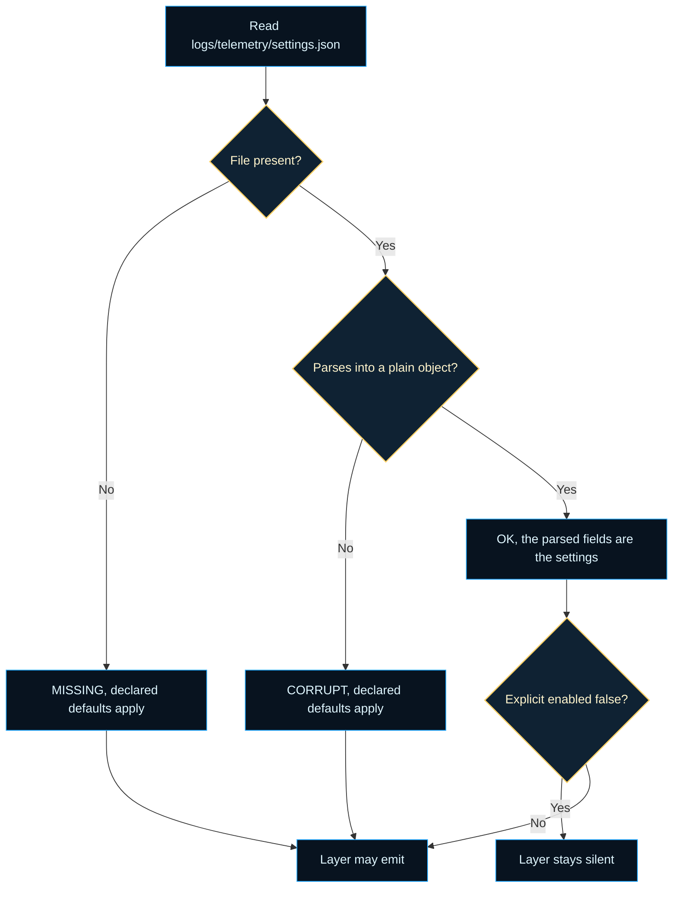
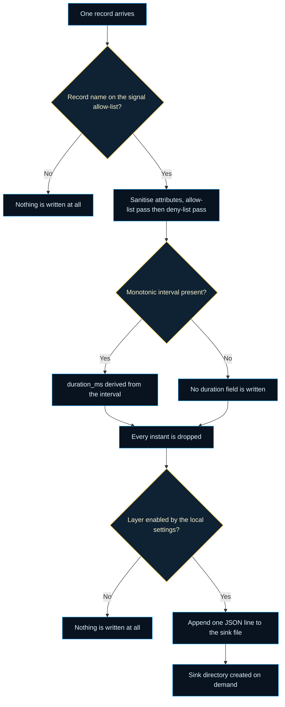

# observability/telemetry

The DECLARATION of the local OpenTelemetry signal policy of the
observability boundary: the sink root, the telemetry engine floor, the
per-signal allow-list and the two forbidden sets.

WHAT this module is: the ONE place where the privacy rules of the local
signal layer are DECLARED. The exporter boundary is an ALLOW-LIST first - a
field is written only when it is explicitly permitted for that signal - and
a DENY-LIST second, so a bug in the allow-list still cannot leak a
forbidden field.

WHY the forbidden sets live here AND in `scripts/telemetry/telemetry-contract.mjs`:
the rules are pinned in two languages (this TypeScript policy and the
repo-owned JavaScript contract), and the drift guard compares them. A second
implementation would be a drift bug, so the two lists are kept IDENTICAL and
the guard fails on any difference.

WHY the engine floor is declared HERE and not in the manifest: the root
manifest floor stays at `>= 22.0.0` because the OpenTelemetry 3.x line is
optional for a consumer. The telemetry path needs a HIGHER floor of its own,
and a manifest cannot express two floors for one package, so the telemetry
path declares and enforces its own floor in source.

LAYER INDEPENDENCE: this module imports NOTHING from the repo-owned
measurement tooling in `scripts/telemetry` and NOTHING from the
NEAT-algorithm telemetry tree in `src/neat/telemetry`. The signal layer
produces SIGNALS; the repo-owned per-slice ledger produces the
MEASUREMENTS, and neither depends on the other.

Example:

import { TELEMETRY_ALLOW_LIST } from './telemetry.policy';

TELEMETRY_ALLOW_LIST.trace.recordNames;
// => ['neat.telemetry.trace']

## observability/telemetry/telemetry.policy.ts

### FORBIDDEN_KEYS

The forbidden KEY set: every key that would carry an instant, a clock time,
a date, a modification marker or a PII-ish identifier. A persisted field
that would carry an instant is REMOVED, never exempted.

The list is shared with `scripts/telemetry/telemetry-contract.mjs`; a drift
guard compares the two lists and fails on any difference.

### FORBIDDEN_VALUE_PATTERNS

The forbidden VALUE patterns: the shapes a persisted value must never take
- ISO-8601 datetimes, calendar dates, epoch-millisecond literals, absolute
Windows paths, absolute POSIX user paths, any other absolute path shape and
e-mail addresses.

The patterns are deliberately NOT global, so `RegExp.prototype.test` and
`RegExp.prototype.exec` are stateless and a caller can reuse them safely.

### getAllowListEntry

```ts
getAllowListEntry(
  signal: TelemetrySignal,
): TelemetryAllowListEntry
```

Returns the allow-list entry of a signal. An unknown signal resolves to the
EMPTY entry, so a typo can never widen the allow-list.

Returns: The allow-list entry of the signal.

Example:

getAllowListEntry('metric').recordNames; // => ['neat.telemetry.metric']

### isForbiddenKey

```ts
isForbiddenKey(
  key: unknown,
): boolean
```

Tells whether a key is one of the forbidden key names. The comparison is
exact on the normalised form, so `startTime`, `start_time` and `START-TIME`
are one and the same forbidden key, while `duration_ms` stays legal.

Returns: True when the key is forbidden.

Example:

isForbiddenKey('startTime'); // => true
isForbiddenKey('duration_ms'); // => false

### isForbiddenValue

```ts
isForbiddenValue(
  value: unknown,
): boolean
```

Tells whether a value carries a forbidden shape. A string is matched
against every forbidden value pattern; a number is matched as its decimal
text, so an epoch-millisecond literal cannot hide behind a number type.

Returns: True when the value carries a forbidden shape.

Example:

isForbiddenValue('2024-01-01'); // => true
isForbiddenValue('probe'); // => false

### isTelemetrySignal

```ts
isTelemetrySignal(
  value: unknown,
): boolean
```

Tells whether a value names one of the three known signals.

Returns: True when the value is a known signal.

Example:

isTelemetrySignal('trace'); // => true
isTelemetrySignal('span'); // => false

### REASON_NODE_BELOW_TELEMETRY_FLOOR

The machine-stable reason token the telemetry path reports when the runtime
is below its own floor. A TOKEN, not a sentence: it has to be greppable and
stable across releases.

### TELEMETRY_ALLOW_LIST

The ALLOW-LIST of the export boundary, one entry per signal.

WHY THE LISTS ARE SHORT: an allow-list only protects what it names, and
every name here is a repo-owned namespace. The metric list deliberately
carries NO `neat.acceleration` instrument: the acceleration variants emit an
unconditional inference duration of zero, so a metric instrument built on it
would report a MEASUREMENT OF ZERO for work that was never measured - and a
zero is a measurement, so it may only be written when a source really
reported zero.

### TELEMETRY_NODE_FLOOR

The engine floor of the TELEMETRY path, which is strictly higher than the
root manifest floor (`>= 22.0.0`): the ruled OpenTelemetry 3.1.1 packages
require `>= 22.15.0` themselves. A runtime below this floor degrades the
layer warn-only instead of failing the caller's work.

### TELEMETRY_SIGNALS

The signals the layer knows, in the canonical order. The order is the
canonical one - trace, then metric, then log - so a rendered listing of
the supported signals stays stable across releases and comparable between
runs.

### TELEMETRY_SINK_ROOT

The repo-relative root of the local JSONL sink. The sink is the ONLY thing
the signal layer writes to disk, and `.gitignore` already covers it.

### TelemetryAllowListEntry

The per-signal allow-list entry: the record names that may be written for
that signal and the attribute names that may be written with them.

### TelemetrySignal

The three signals the local OpenTelemetry layer emits. A signal names the
KIND of observation - a span, a metric data point or a log record - and
every record written to the local sink belongs to exactly one of them.

## observability/telemetry/telemetry.sanitize.ts

The export boundary of the local OpenTelemetry signal layer: the ALLOW-LIST
pass and the DENY-LIST pass that every attribute has to survive before it
may reach the local JSONL sink.

THE TWO PASSES, IN THIS ORDER:

  1. THE ALLOW-LIST PASS. An attribute survives only when its NAME is
     explicitly permitted for the signal that writes it. A name that is not
     permitted is dropped without a trace, because an allow-list is a rule
     and not an anomaly.
  2. THE DENY-LIST PASS. A name the allow-list permits can still be
     REJECTED by its VALUE: a non-scalar bag (a tool argument list, a file
     content, a nested object) and a value that carries a forbidden shape
     (an absolute path, a calendar date, an epoch literal, an e-mail
     address) never reach the sink, even when the name is allowed.

WHY THE DENY PASS IS NOT REDUNDANT: the allow-list names the KEYS, and a
key that is allowed can still carry a value nobody meant to publish. The
allow-list is the rule; the deny pass is the safety net under it.

WHY A THROWING ACCESSOR IS A WARNING AND NOT AN EXCEPTION: an attribute bag
is caller-supplied data, and a getter that throws is a defect in the
CALLER, not in the telemetry path. The path warns with a short
machine-stable token, drops that one attribute and keeps going, because a
broken attribute must never fail the work the telemetry path observes.

WHY THE WARNINGS ARE TOKENS: a warning is persisted in a log like any other
artefact, so a warning carries no absolute path, no calendar date and no
free text that could carry one. The tokens are greppable and stable across
releases.

LAYER INDEPENDENCE: this module imports NOTHING from the repo-owned
measurement tooling in `scripts/telemetry` and NOTHING from the
NEAT-algorithm telemetry tree in `src/neat/telemetry`. The sanitizer of the
signal layer knows nothing about the repo-owned per-slice ledger.

Example:

import { sanitizeAttributes } from './telemetry.sanitize';

sanitizeAttributes(
  { 'neat.telemetry.signal': 'trace', 'not.allowed': 'x' },
  { allowedAttributeNames: ['neat.telemetry.signal'] },
);
// => { attributes: { 'neat.telemetry.signal': 'trace' }, dropped: ['not.allowed'] }

### carriesForbiddenShape

```ts
carriesForbiddenShape(
  value: unknown,
): boolean
```

Tells whether a value carries a forbidden shape. A number is matched as its
decimal text, so an epoch-millisecond literal cannot hide behind a number
type.

Returns: True when the value carries a forbidden shape.

### isForbiddenKey

```ts
isForbiddenKey(
  key: unknown,
): boolean
```

Tells whether a key is forbidden.

Returns: True when the key is forbidden.

### isWritableScalar

```ts
isWritableScalar(
  value: unknown,
): boolean
```

Tells whether a value is a SCALAR the sink may write. An object, an array, a
function, a symbol and a bigint-free exotic value are all non-scalars: a
non-scalar bag is where tool arguments and file contents live.

Returns: True when the value is a writable scalar.

### normalizeKey

```ts
normalizeKey(
  key: unknown,
): string
```

Normalises a key the way the forbidden set is normalised, so `startTime`,
`start_time` and `START-TIME` are one and the same forbidden key.

Returns: The normalised key.

### REASON_ATTRIBUTE_ACCESSOR_FAILED

The warning token for an attribute whose accessor threw. The attribute is
dropped and the path continues.

### REASON_ATTRIBUTE_NOT_ALLOWED

The warning token for an attribute whose NAME is not in the allow-list. The
attribute is dropped silently by default; the token exists for a caller
that asks for the strict mode.

### REASON_ATTRIBUTE_VALUE_REJECTED

The warning token for an allow-listed attribute whose VALUE was rejected by
the deny pass.

### RESERVED_RECORD_KEYS

The keys the exporter reserves for itself. An attribute that carries one of
them is dropped, so a caller can never overwrite the record name or the
single duration field.

### sanitizeAttributes

```ts
sanitizeAttributes(
  attributes: Record<string, unknown> | null | undefined,
  options: SanitizeAttributesOptions,
): SanitizeAttributesResult
```

Runs both passes over a caller-supplied attribute bag. An attribute has to
survive the ALLOW-LIST pass AND the DENY-LIST pass to reach the returned
bag; everything else is dropped and named in `dropped`.

Returns: The surviving attributes and the dropped names.

Example:

sanitizeAttributes({ 'neat.telemetry.signal': 'trace' }, {
  allowedAttributeNames: ['neat.telemetry.signal'],
}).attributes;
// => { 'neat.telemetry.signal': 'trace' }

### SanitizeAttributesOptions

The options of one sanitisation pass. The permitted attribute names may be
given EXPLICITLY, or the pass reads them from the allow-list of the signal
that writes the record.

### SanitizeAttributesResult

The result of one sanitisation pass: the attributes that survived BOTH
passes, and the names that were dropped, in the order they were seen.

## observability/telemetry/telemetry.local-settings.ts

The READER of the LOCAL telemetry settings: the file
`logs/telemetry/settings.json` under the repository root, which the local
enablement command owns and which the exporters OBEY.

WHAT THIS MODULE IS: the one place where the local signal layer learns
what the operator decided on THIS machine - whether the layer is enabled
and where its sinks live.

WHY THE SETTINGS GOVERN THE SINKS: the layer used to hard-code its sink
root and ignore the settings entirely, so the local settings were a note
nobody read and `enabled: true` changed nothing. The settings are now the
ONLY source of the sink root and of the enabled flag, and the enablement
command writes them, so the file the operator edits is the file the
exporters obey.

WHY AN ABSOLUTE SINK PATH IS REFUSED: an absolute machine path in a
persisted artefact is a privacy violation, so a settings file that carries
one is treated as carrying no usable sink root and the declared default
root is used instead. The same reasoning that makes [path traversal]
(https://en.wikipedia.org/wiki/Path_traversal) a security bug in a
filesystem API applies here: a configuration file that may name an
arbitrary absolute location is a capability nobody needs to hand out.

WHY THE READ IS FAIL-OPEN: the signal layer is optional and fail-open by
contract, in the [fail-safe](https://en.wikipedia.org/wiki/Fail-safe)
sense of the term - the optional subsystem is the one that gives way, not
the work it observes. A settings file that cannot be read, cannot be
parsed, or names no usable sink MUST NOT silence the layer that is
supposed to be optional. Only an EXPLICIT `enabled: false` in a PARSEABLE
settings file stops the emission.

THE THREE STATES, AND WHAT EACH ONE MEANS:

- `OK`: the file is there and it parsed into a plain JSON object. The
  parsed fields are the settings, and the missing ones fall back to the
  declared defaults.
- `MISSING`: there is no settings file on this machine. The declared
  defaults apply, and the layer stays enabled.
- `CORRUPT`: the file is there but it cannot be trusted - it cannot be
  read, it is not JSON, or it parses into something that is not a plain
  object (an array or a scalar). The declared defaults apply, and the
  layer stays enabled.



LAYER INDEPENDENCE: this module imports NOTHING from the repo-owned
measurement tooling in `scripts/telemetry` and NOTHING from the
NEAT-algorithm telemetry tree in `src/neat/telemetry`. The local settings
are a LOCAL artefact of the signal layer, not a measurement of a slice.

Example:

import { resolveTelemetryEnabled, resolveTelemetrySinkRoot } from './telemetry.local-settings';

resolveTelemetryEnabled('/repo');
// => true
resolveTelemetrySinkRoot('/repo');
// => '/repo/logs/telemetry'

### isPlainObject

```ts
isPlainObject(
  value: unknown,
): boolean
```

Tells whether a parsed value is a plain JSON object, so an ARRAY or a
scalar can never be mistaken for a settings object.

Returns: True when the value is a plain object.

Example:

isPlainObject({});
// => true

### LocalTelemetrySettings

The shape of the local settings the reader understands. Every field is
OPTIONAL: a settings file that carries less than this is still readable,
and the reader falls back to the declared defaults for what it lacks.

`exporter.path` is RELATIVE to the directory of the settings file. An
absolute value is refused by the reader rather than honoured.

### LocalTelemetrySettingsRead

The result of reading the local settings: the state of the file, the
parsed settings when they are usable, and the absolute path the read was
made against.

### LocalTelemetrySettingsStatus

The three states of the local settings, mirroring the states of the
repo-owned classifier: a settings file that is there and parsable, one
that is not there and one that cannot be trusted.

### readLocalTelemetrySettings

```ts
readLocalTelemetrySettings(
  repositoryRoot: string,
): LocalTelemetrySettingsRead
```

Reads the local settings and tells the three states apart.

The read NEVER throws and NEVER rejects: an unreadable file, a file that
is not JSON, and a file that parses into something other than a plain
object all resolve to `CORRUPT`, and an absent file resolves to
`MISSING`. Callers get a state to reason about, not an exception to
handle.

Returns: The read result.

Example:

readLocalTelemetrySettings('/repo');
// => { status: 'OK', settings: { ... }, path: '/repo/logs/telemetry/settings.json' }
readLocalTelemetrySettings('/repo-without-settings');
// => { status: 'MISSING', settings: null, path: '/repo-without-settings/logs/telemetry/settings.json' }

### resolveSettingsPath

```ts
resolveSettingsPath(
  repositoryRoot: string,
): string
```

Resolves the absolute path of the local settings file for a repository
root, without touching the filesystem.

Returns: The absolute settings path.

Example:

resolveSettingsPath('/repo');
// => '/repo/logs/telemetry/settings.json'

### resolveTelemetryEnabled

```ts
resolveTelemetryEnabled(
  repositoryRoot: string,
): boolean
```

Resolves whether the local signal layer is enabled.

ONLY an explicit `enabled: false` in a PARSEABLE settings file disables
the layer: a missing or corrupt settings file keeps the declared default,
which is ENABLED, because the layer is optional and fail-open.

Returns: True when the layer may emit.

Example:

resolveTelemetryEnabled('/repo');
// => true

### resolveTelemetrySinkRoot

```ts
resolveTelemetrySinkRoot(
  repositoryRoot: string,
): string
```

Resolves the sink root of the local signal layer.

The sink root is the `exporter.path` of the local settings, resolved
against the directory of the settings file. A settings file that carries
no usable relative path - because it is missing, corrupt, carries no
exporter or carries an ABSOLUTE path - resolves to the DECLARED default
root instead.

Returns: The absolute sink directory.

Example:

resolveTelemetrySinkRoot('/repo');
// => '/repo/logs/telemetry'

### TELEMETRY_SETTINGS_RELPATH

The repo-relative path of the LOCAL settings file.

The path is RELATIVE to the repository root on purpose: an absolute
machine path is exactly what a persisted artefact must never carry, so
even the location of the settings file is expressed relative to the tree
it configures.

Example:

TELEMETRY_SETTINGS_RELPATH;
// => 'logs/telemetry/settings.json'

## observability/telemetry/telemetry.jsonl-exporters.ts

The THREE local JSONL exporters of the observability boundary: the trace
exporter, the metric exporter and the log exporter, all of them writing one
sanitized JSON record per line under `logs/telemetry/`.

WHAT AN EXPORTER DOES, IN THIS ORDER:

  1. It checks the RECORD NAME against the allow-list of its signal. A
     record the allow-list does not cover is not written at all - not
     written with fewer fields, NOT written: the sink stays empty, so an
     instrument nobody declared cannot show up in the artefact.
  2. It sanitises the attributes (allow-list pass, then deny pass).
  3. It converts the MONOTONIC INTERVAL into the single duration field
     `duration_ms` and drops every instant (`startTime`, `endTime`,
     `timeUnixNano`, `observedTimestamp`): a persisted artefact carries a
     DURATION, never a moment.

WHY A CALLER-SUPPLIED DURATION IS IGNORED: the duration is a MEASUREMENT,
and the only honest measurement of a span is the monotonic interval the
exporter itself was handed. A caller that also passes `durationMs` gets the
interval-derived value, so a second duration field can never appear and a
caller cannot smuggle a duration of its own into the artefact. When there
is no interval at all, NO duration field is written - a record without a
measurement carries no measurement.

WHY THE EXPORTER NEVER THROWS: the telemetry path is fail-open by
contract. A sink that cannot be created, a sink that cannot be written and
an attribute accessor that throws all produce a short machine-stable
warning and never an exception into the caller, because the work the
telemetry path observes must never fail because of the telemetry path.

WHY THE SINK DIRECTORY IS CREATED ON DEMAND: an exporter that is
constructed but never used must leave no trace on disk, and the sink
directory of a repo whose telemetry was never enabled must not appear in
the working tree.

WHY THE LOCAL SETTINGS GOVERN THE SINKS: the sink root is the
`exporter.path` of `logs/telemetry/settings.json`, resolved against the
directory of that file, and an EXPLICIT `enabled: false` in that file
stops the emission. The local enablement command owns the file, so the
settings an operator writes are the settings the exporters obey - they
are not a note nobody reads.

THE PIPELINE OF ONE RECORD, IN ORDER:



WHY THE FILE FORMAT IS JSON LINES: each record is written as ONE JSON
object on ONE line, which is the [JSON Lines](https://en.wikipedia.org/wiki/JSON_Lines)
convention. A line-oriented format keeps an append-only sink cheap, keeps
a truncated write readable, and lets a reader parse one record without
parsing the whole file.

WHY THE ALLOW-LIST IS A GATE AND NOT A FILTER: the list of accepted
record names is an [allow list](https://en.wikipedia.org/wiki/Allow_list),
so an instrument nobody declared has no path into the artefact. A record
the list does not cover is not written with fewer fields - it is not
written at all.

LAYER INDEPENDENCE: this module imports NOTHING from the repo-owned
measurement tooling in `scripts/telemetry` and NOTHING from the
NEAT-algorithm telemetry tree in `src/neat/telemetry`. It measures nothing
of a slice window and it owns no slice instant.

Example:

const exporter = createJsonlExporter({ signal: 'trace' });
await exporter.exportRecord({
  name: 'neat.telemetry.trace',
  attributes: { 'neat.telemetry.signal': 'trace' },
  interval: { startMonotonicMs: 1000, endMonotonicMs: 1250 },
});
await exporter.forceFlush();

### createJsonlExporter

```ts
createJsonlExporter(
  options: JsonlExporterOptions,
): JsonlExporter
```

Creates one local JSONL exporter for one signal. The sink directory is
created on demand by the first write, so an exporter that is constructed
and never used leaves no trace on disk. An exporter whose LOCAL SETTINGS
say `enabled: false` validates every record as usual but writes NOTHING
into the sink and never creates the sink directory.

Returns: The exporter.

Example:

const exporter = createJsonlExporter({ signal: 'metric' });
exporter.sinkDirectory; // => 'C:\\...\\logs\\telemetry'

const quiet = createJsonlExporter({ signal: 'log', enabled: false });
quiet.exportRecord({ name: 'neat.telemetry.log' });
// => nothing is written and the sink directory is never created

### findRepositoryRoot

```ts
findRepositoryRoot(): string
```

Walks up from the working directory to the repository root, so the default
sink directory does not depend on the directory a runner happened to choose.

Returns: The absolute repository root.

### JsonlExporter

The exporter handle. Every method of the handle is fail-open: a record the
allow-list does not cover is not written at all, and a sink that cannot be
created or written produces a warning instead of an exception.

### JsonlExporterOptions

The options of one exporter: the sink directory it writes into, the signal
whose allow-list governs the records it accepts, and the warning sink that
receives its fail-open warnings.

TWO OF THE OPTIONS COME FROM THE LOCAL SETTINGS: `repositoryRoot` says
WHICH tree the settings are read from, and `enabled` says whether the
exporter may emit at all. When `enabled` is left out, the `enabled` flag
of `logs/telemetry/settings.json` decides, and when `repositoryRoot` is
left out, the repository root of the working directory is used. An
explicit `enabled` therefore OVERRIDES the settings file, which is what
makes a caller able to switch the layer off without touching the file.

### REASON_RECORD_NOT_ALLOWED

The warning token for a record whose name the allow-list does not cover.

### REASON_SINK_UNWRITABLE

The warning token for a sink that cannot be created or written.

### resolveDefaultSinkDirectory

```ts
resolveDefaultSinkDirectory(
  repositoryRoot: string | undefined,
): string
```

Resolves the DEFAULT sink directory: the sink root the LOCAL SETTINGS name.

THE LOCAL SETTINGS GOVERN THE SINKS: the sink root is the `exporter.path`
of `logs/telemetry/settings.json`, resolved against the directory of that
file, so the file the local enablement command writes is the file the
exporters obey. When the settings are missing, corrupt or carry an
ABSOLUTE path, the DECLARED default root is used instead. The directory
itself is NOT created here - it is created on demand, by the first write.

Returns: The absolute sink directory.

Example:

resolveDefaultSinkDirectory();
// => 'C:\\...\\logs\\telemetry'
resolveDefaultSinkDirectory('/repo');
// => '/repo/logs/telemetry'

### TelemetryRecordInput

A record the exporter may write. The exporter decides the final shape: it
drops every instant, derives the single duration field from the monotonic
interval, and writes only the attributes that the allow-list and the
deny-list both accept.

## observability/telemetry/telemetry.bootstrap.ts

The provider bootstrap of the local OpenTelemetry signal layer: the
optional-peer loader, the telemetry engine floor guard and the construction
of the three local providers.

WHY EVERY PEER IS LOADED THROUGH A DYNAMIC IMPORT: the six OpenTelemetry
packages are OPTIONAL peers. A consumer that never enables the telemetry
path does not install them, and a static import would turn their absence
into a load-time crash of the whole library. A dynamic import turns their
absence into a DEGRADED no-op mode: one warning per missing peer, and every
API call of the layer still succeeds.

WHY THE WARNING NEVER CARRIES THE ERROR MESSAGE: a failed module
resolution carries the absolute path of the module the loader looked for,
and a warning is persisted like any other artefact. The warning is
therefore a short machine-stable token plus the SPECIFIER of the peer (a
package name, never a path).

WHY THE ENGINE FLOOR IS ENFORCED HERE: the root manifest floor stays at
`>= 22.0.0` because the OpenTelemetry packages are optional, and a
manifest cannot express two floors for one package. The telemetry path
declares and enforces its OWN, higher floor, and a runtime below it
degrades the layer warn-only with the machine-stable reason token
`node_below_telemetry_floor` instead of failing the caller's work.

WHY THE PROVIDER COLUMN NAME IS `TracerProvider`: the ruled 3.1.1 line
exposes `TracerProvider` and the 2.x `BasicTracerProvider` is GONE. The
bootstrap resolves the constructor by name and never mentions the retired
one, so a dependency that still ships the retired name cannot be picked up
by accident.

LAYER INDEPENDENCE: this module imports NOTHING from the repo-owned
measurement tooling in `scripts/telemetry` and NOTHING from the
NEAT-algorithm telemetry tree in `src/neat/telemetry`. It measures nothing
of a slice window and it owns no slice instant.

Example:

const peer = await loadOptionalPeer('@opentelemetry/api');
checkNodeFloor('22.15.0');
// => { supported: true, reason: null }

### checkNodeFloor

```ts
checkNodeFloor(
  nodeVersion: string | undefined,
): NodeFloorVerdict
```

Tells whether a runtime is at or above the telemetry engine floor.

Returns: The verdict and its reason token.

Example:

checkNodeFloor('22.15.0'); // => { supported: true, reason: null }
checkNodeFloor('22.14.0'); // => { supported: false, reason: 'node_below_telemetry_floor' }

### createLogExporter

```ts
createLogExporter(
  exporter: JsonlExporter,
): unknown
```

The adapter that hands the log records of the logs SDK to the local JSONL
exporter.

Parameters:
- `exporter` - The local exporter.

Returns: The SDK-facing exporter.

### createMetricExporter

```ts
createMetricExporter(
  exporter: JsonlExporter,
): unknown
```

The adapter that hands the metric data points of the metrics SDK to the
local JSONL exporter. A metric data point carries no measured duration, so
the record carries no duration field at all.

Parameters:
- `exporter` - The local exporter.

Returns: The SDK-facing exporter.

### createSpanExporter

```ts
createSpanExporter(
  exporter: JsonlExporter,
): unknown
```

The adapter that hands the spans of the trace SDK to the local JSONL
exporter. The SDK hands a MEASURED duration, and the exporter derives its
single duration field from an interval, so the adapter carries the measured
duration as a zero-based interval. No instant is ever carried over.

Parameters:
- `exporter` - The local exporter.

Returns: The SDK-facing exporter.

### createTelemetryProviders

```ts
createTelemetryProviders(
  options: TelemetryProviderOptions,
): Promise<TelemetryProviders>
```

Constructs the three local providers out of the optional peers.

A peer that is not installed leaves its provider null and the layer
DEGRADED: EACH missing peer emits ONE warning that names it, and every
API call of the layer still succeeds through the local exporters.

Returns: The providers and the degradation verdict.

Example:

const providers = await createTelemetryProviders();
providers.degraded; // => false when the peers are installed

### describeMissingPeer

```ts
describeMissingPeer(
  specifier: string,
): string
```

Builds the warning text of a peer that could not be loaded. The text is a
machine-stable token plus the specifier of the peer, and it carries no
absolute path, because a warning is persisted like any other artefact.

Returns: The warning text.

### loadOptionalPeer

```ts
loadOptionalPeer(
  specifier: string,
  warn: ((message: string) => void) | undefined,
): Promise<unknown>
```

Loads an OPTIONAL peer through a dynamic import. A peer that is not
installed yields NULL and one warning, instead of a load-time crash of the
whole library.

Returns: The loaded module, or null when it is not installed.

Example:

await loadOptionalPeer('@opentelemetry/api');
// => the module namespace

### NodeFloorVerdict

The verdict of the engine floor guard. A supported runtime carries NO
reason token, and an unsupported one carries the machine-stable token that
names the floor it fell below.

### parseVersion

```ts
parseVersion(
  value: string,
): number[] | null
```

Parses a `major.minor.patch` version out of a version string.

Returns: The three components, or null when the string carries none.

### PEER_API

The specifier of the API package the layer always needs.

### PEER_LOGS_SDK

The specifier of the ruled logs SDK. The logs SDK is an OPTIONAL peer: a
consumer that never enables the telemetry path does not install it.

### PEER_METRICS_SDK

The specifier of the ruled metrics SDK. The metrics SDK is an OPTIONAL
peer: a consumer that never enables the telemetry path does not install
it.

### PEER_TRACE_SDK

The specifier of the ruled trace SDK. The trace SDK is an OPTIONAL peer: a
consumer that never enables the telemetry path does not install it.

### pickConstructor

```ts
pickConstructor(
  peer: unknown,
  name: string,
): unknown
```

Picks a constructor out of a loaded peer.

Returns: The constructor, or null when the peer does not expose it.

### REASON_PEER_UNAVAILABLE

The warning token for a peer that could not be loaded.

### TelemetryProviderOptions

The options of the provider construction: the sink directory the local
exporters write into, and the warning sink that receives the warnings the
construction emits.

### TelemetryProviders

The three providers of the local layer, each of them null when its peer is
not installed.

## observability/telemetry/telemetry.session.ts

The session lifecycle of the local OpenTelemetry signal layer: it starts the
session, emits the three signals for the sanitized snapshot it is HANDED,
flushes deterministically and shuts the layer down.

WHAT THIS MODULE OWNS, AND WHAT IT MUST NOT OWN:

  IT OWNS: the exporters, the provider lifecycle, the emission of the
  snapshot it is handed, the deterministic flush and the shutdown.

  IT DOES NOT OWN: the slice begin/end instants, the slice-window
  duration, the usage deltas, the transient dispatch record of the
  repo-owned measurement tooling and the ledger block. Those belong to the
  repo-owned per-slice ledger, which PRODUCES the measurements; the signal
  layer may only CONSUME a finished snapshot.
  This module therefore imports NO `scripts/telemetry` module, references
  NO dispatch-record path and computes NO slice-window duration, so the
  ownership inversion cannot reappear inside the fail-open layer.

WHY THE SNAPSHOT IS HANDED IN: the caller owns the facts. The session
emits what it is given and never goes looking for a measurement of its
own, because a layer that measures its own window would report a duration
it cannot evidence.

WHY EVERY CALL IS FAIL-OPEN: an emission that fails warns with a short
machine-stable token and returns. The work the telemetry path observes must
never fail because of the telemetry path.

Example:

const session = await startTelemetrySession({
  snapshot: {
    trace: [{ name: 'neat.telemetry.trace', attributes: { 'neat.telemetry.signal': 'trace' } }],
  },
});
await session.flush();
await session.shutdown();

### REASON_EMISSION_FAILED

The warning token for an emission that failed. It is a TOKEN, not a
sentence, so a persisted warning stays greppable and stable across
releases.

### shutdownTelemetry

```ts
shutdownTelemetry(): Promise<void>
```

Shuts the ACTIVE session of the signal layer down. A session that was never
started is not an error: the shutdown is idempotent and fail-open.

Returns: The completion of the shutdown.

Example:

await shutdownTelemetry();

### startTelemetrySession

```ts
startTelemetrySession(
  options: StartTelemetrySessionOptions,
): Promise<TelemetrySession>
```

Starts a session of the signal layer. The returned handle is always
usable: when a peer SDK or the runtime floor is missing, the session still
starts and reports the degradation through its verdict.

Returns: The session handle.

Example:

const session = await startTelemetrySession();
await session.shutdown();

### StartTelemetrySessionOptions

The options of a session start: the sanitized snapshot the session emits,
the sink directory of the local exporters, and the warning sink that
receives the fail-open warnings.

### TelemetrySession

The session handle. It exposes the degradation verdict of the layer, the
three emit calls and the two lifecycle calls. Every one of them is
fail-open, so the work the telemetry path observes never fails because of
the telemetry path.

### TelemetrySnapshot

The sanitized snapshot the session emits: one list of records per signal.
